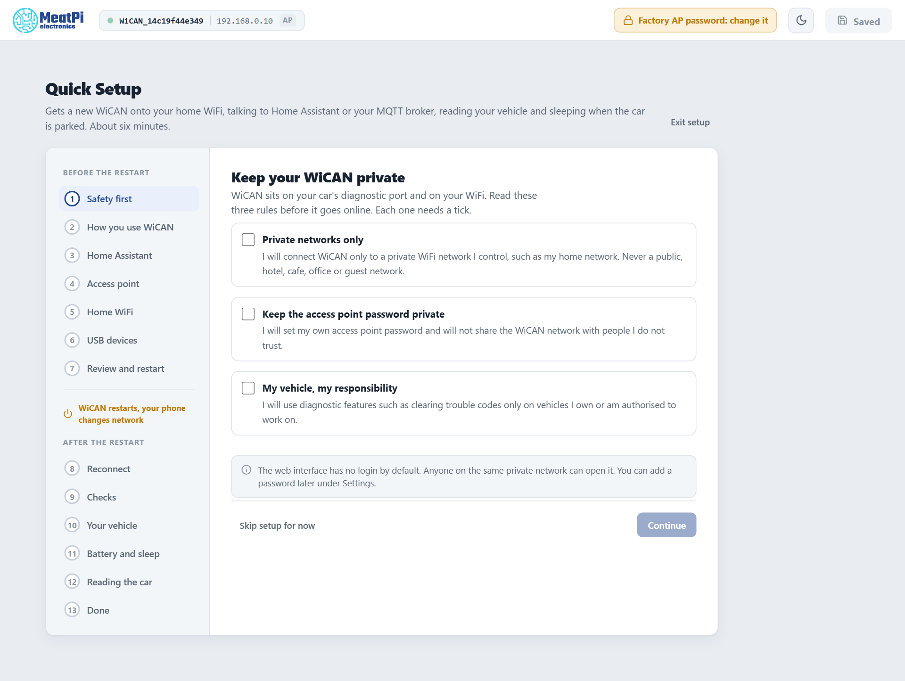
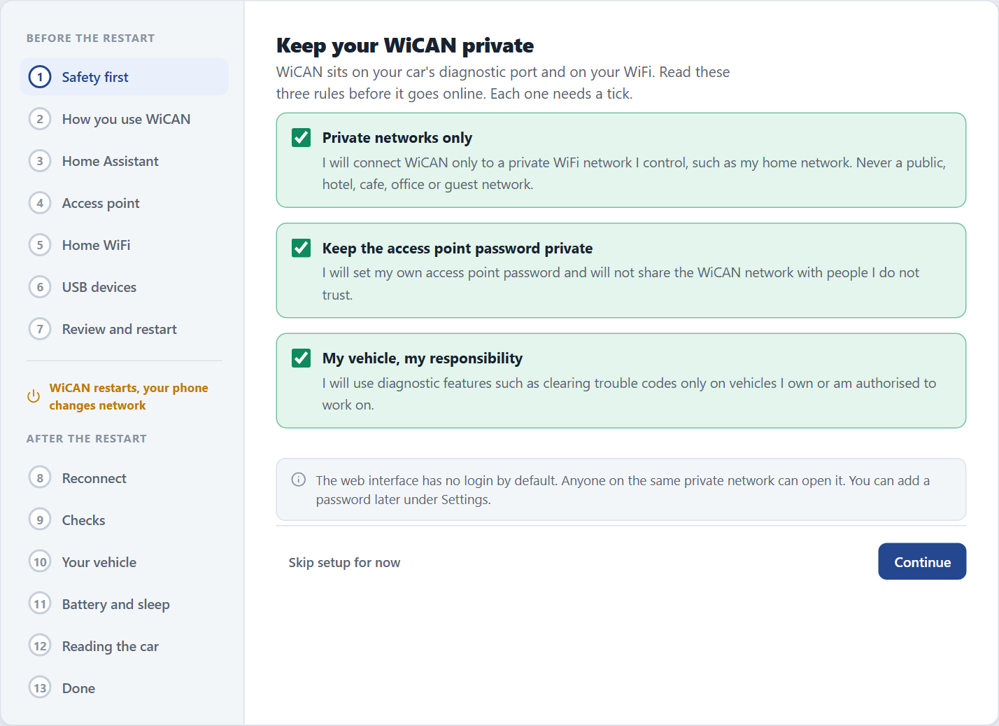

# Writing guide

<p class="lead">Every building block these manuals use, shown live next to the markup that produces it. Copy from here rather than inventing a new one.</p>

## Voice and rules

- Talk to the reader as "you", in the present tense. One action per step, and say what they will see after it.
- Name screens, buttons and fields exactly as the device shows them, in the [label style](#labels-from-the-device-screen) below.
- Keep a page to one job. A reader on a phone, sitting in the car, should always see the next action.
- No long dashes (em or en dash) anywhere: use a colon, a comma, parentheses or two sentences.
- A number that changes what the reader does goes in a table or on its own line, not in the middle of a sentence.
- Every picture has alt text that says what is on it and a caption that says what to notice.

## Labels from the device screen

Wrap any button, page, field or menu name the reader will see on the device in double equals signs. Put a `›` between the levels of a path.

Tap ==Save and restart==, then open ==Settings== › ==WiFi== and choose ==Station==.

```markdown
Tap ==Save and restart==, then open ==Settings== › ==WiFi== and choose ==Station==.
```

Keyboard keys are for a computer only, never for the device: `++ctrl+shift+r++` renders as ++ctrl+shift+r++.

## Step-by-step guides

A guide is an ordered list inside a `steps` block. The first line of a step is its title in bold. Everything else that belongs to the step (text, notes, pictures) is indented by four spaces.

<div class="steps" markdown>

1.  **Plug WiCAN Pro into the OBD-II port**

    On most cars the port is under the dashboard on the driver side. The LED lights within a few seconds.

2.  **Join the WiCAN access point from your phone**

    Open the WiFi settings on your phone and pick the network whose name starts with `WiCAN_`. The password is on the quick start card.

    !!! tip
        Your phone may warn that this network has no internet. Stay connected anyway.

3.  **Open the setup page**

    In a browser, go to `http://192.168.0.10`. On a new device Quick Setup opens by itself.

    <figure class="shot" markdown>
    { width="720" }
    <figcaption>Quick Setup opens with the three safety rules. Continue stays grey until all three are ticked.</figcaption>
    </figure>

</div>

````markdown
<div class="steps" markdown>

1.  **Plug WiCAN Pro into the OBD-II port**

    On most cars the port is under the dashboard on the driver side. The LED lights within a few seconds.

2.  **Join the WiCAN access point from your phone**

    Open the WiFi settings on your phone and pick the network whose name starts with `WiCAN_`.

    !!! tip
        Your phone may warn that this network has no internet. Stay connected anyway.

3.  **Open the setup page**

    In a browser, go to `http://192.168.0.10`.

    <figure class="shot" markdown>
    { width="720" }
    <figcaption>Quick Setup opens with the three safety rules.</figcaption>
    </figure>

</div>
````

Keep a guide under ten steps. If it needs more, it is two guides.

## Screenshots

Pictures of the device web interface are taken by a script, never by hand, so every page shows the same window size, the same theme and no personal data:

```text
node tools/capture.mjs quick-setup
```

The script opens the real web interface over its mock data (no device needed), walks to each screen and writes `docs/<product>/img/<set>/NN-<screen>.png`. When the interface changes, run it again: the file names stay the same, so the pages do not change.

A screenshot is a `figure` with the `shot` class and a caption. Set a width so the text in the picture stays readable; readers can click any picture to enlarge it.

<figure class="shot" markdown>
{ width="640" }
<figcaption>With the three rules ticked, Continue turns blue.</figcaption>
</figure>

```markdown
<figure class="shot" markdown>
{ width="640" }
<figcaption>With the three rules ticked, Continue turns blue.</figcaption>
</figure>
```

A picture taken on a phone gets the `shot-phone` class instead, which draws a rounded phone frame around it. A picture with no caption can carry the class directly: `{ .shot width="480" }`.

## Numbered callouts on a picture

When a step talks about several parts of one screen, number them on the picture instead of describing where they are. The markers are placed in percent of the picture width and height, so they stay put at any size, and the list below uses the same numbers.

<div class="annotated" markdown>
{ .shot width="720" }
<i class="m" style="left:9%;top:22%">1</i>
<i class="m" style="left:52%;top:50%">2</i>
</div>

<ol class="callouts">
<li>The step list: the current step is highlighted, finished steps get a tick.</li>
<li>The rules to accept before setup starts.</li>
</ol>

```markdown
<div class="annotated" markdown>
{ .shot width="720" }
<i class="m" style="left:9%;top:22%">1</i>
<i class="m" style="left:52%;top:50%">2</i>
</div>

<ol class="callouts">
<li>The step list: the current step is highlighted, finished steps get a tick.</li>
<li>The rules to accept before setup starts.</li>
</ol>
```

## Notes, tips and warnings

Use them sparingly, at most one or two per screen of text, and always with a title that says what the box is about.

!!! note "Where the OBD-II port is"
    Most cars have it under the dashboard on the driver side, sometimes behind a small cover.

!!! tip "Keep the quick start card"
    It has the access point name and the setup address printed on it.

!!! warning "Driving"
    Set WiCAN up while parked. Never use a phone to configure it while driving.

!!! danger "Battery"
    WiCAN draws power while the engine is off. Leave sleep mode on if the car will sit for days.

??? info "Why is the access point password changed during setup?"
    The factory password is printed on every card, so anyone near the car could join. Quick Setup asks for a new one before anything else is saved.

```markdown
!!! note "Where the OBD-II port is"
    Most cars have it under the dashboard on the driver side.

!!! tip "Keep the quick start card"
    It has the access point name and the setup address printed on it.

!!! warning "Driving"
    Set WiCAN up while parked.

!!! danger "Battery"
    WiCAN draws power while the engine is off.

??? info "Why is the access point password changed during setup?"
    A collapsed box for the curious; the guide works without it.
```

## Different phones and computers

When a step differs by platform, use tabs. The reader picks one and the choice follows them down the page.

=== "Android"

    Open ==Settings== › ==Network & internet== › ==Internet== and tap the `WiCAN_` network.

=== "iPhone"

    Open ==Settings== › ==Wi-Fi== and tap the `WiCAN_` network.

=== "Windows"

    Click the network icon in the taskbar, then the `WiCAN_` network, then ==Connect==.

=== "macOS"

    Click the Wi-Fi icon in the menu bar and pick the `WiCAN_` network.

```markdown
=== "Android"

    Open ==Settings== › ==Network & internet== › ==Internet== and tap the `WiCAN_` network.

=== "iPhone"

    Open ==Settings== › ==Wi-Fi== and tap the `WiCAN_` network.
```

## LED colours

Show an LED state as a coloured dot, with `blink` for a blinking pattern. The names are `blue`, `green`, `red`, `amber`, `cyan`, `purple`, `white` and `off`.

| LED | Meaning |
| --- | --- |
| <span class="led blue"></span> Blue | Example: the access point is up, nobody is connected |
| <span class="led green"></span> Green | Example: connected to your WiFi |
| <span class="led amber blink"></span> Amber, blinking | Example: a firmware update is being written |
| <span class="led red"></span> Red | Example: something needs attention |
| <span class="led off"></span> Off | Example: asleep |

```markdown
| <span class="led amber blink"></span> Amber, blinking | A firmware update is being written |
```

## Pills and key facts

A pill marks a condition in passing: <span class="pill">firmware 6.0+</span> <span class="pill ok">tested</span> <span class="pill warn">beta</span> <span class="pill danger">removed</span>. A guide that applies to several products starts with one pill per product.

```markdown
<span class="pill">firmware 6.0+</span> <span class="pill ok">tested</span> <span class="pill warn">beta</span>
```

A key facts block sums up a product or a feature at the top of its landing page.

<dl class="facts" markdown>
<dt>Access point</dt><dd>`WiCAN_` followed by the device address, password on the card</dd>
<dt>Setup address</dt><dd>`http://192.168.0.10`</dd>
<dt>Needs</dt><dd>A phone or laptop with WiFi and a browser</dd>
</dl>

```markdown
<dl class="facts" markdown>
<dt>Access point</dt><dd>`WiCAN_` followed by the device address, password on the card</dd>
<dt>Setup address</dt><dd>`http://192.168.0.10`</dd>
</dl>
```

## Tables, code and addresses

Tables carry settings and their meaning, one row per setting, the default marked. An address, a file name or a value the reader types goes in `inline code`. Something the reader runs on a computer goes in a code block with a copy button:

```text
ping wican.local
```

| Setting | Default | What it does |
| --- | --- | --- |
| Sleep mode | Off | Puts WiCAN to sleep when the car is off |
| Sleep voltage | 13.1 V | The battery voltage below which sleep starts |
| Wake on motion | Off | Wakes WiCAN when the car moves |

## Files and names

- Pages: lowercase with hyphens, grouped by product and section, for example `wican-pro/getting-started/quick-setup.md`.
- Sections inside a product manual, in this order: `getting-started`, `connectivity`, `vehicle-data`, `integrations`, `tools`, `power`, `firmware`, `troubleshooting`.
- Pictures: `docs/<product>/img/<page>/NN-<screen>.png`, numbered in the order they appear.
- A guide that applies to every product lives under `integrations/` and names its products with pills at the top.
