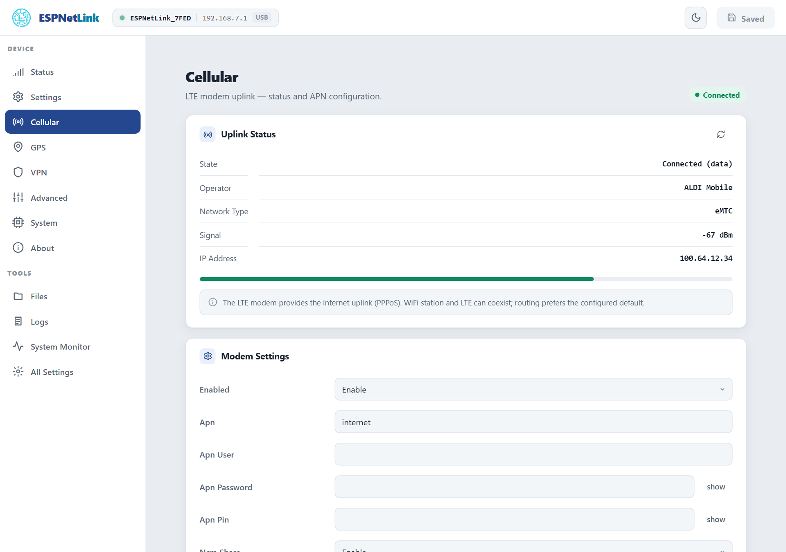

# Cellular

<p class="lead">The mobile network is the dongle's reason to exist: a Quectel BG95-M5 modem for LTE Cat M1 and NB-IoT, one nano SIM, and a connection that comes up by itself and heals itself. This page is about the SIM, the carrier settings and what the status means.</p>

## The SIM

<dl class="facts" markdown>
<dt>Size</dt><dd>Nano SIM (4FF). The slot is a push-in holder in the window on the underside: contacts down, cut corner first, push until it clicks. Insert and remove it with the dongle unplugged.</dd>
<dt>Plan</dt><dd>One that covers <strong>LTE Cat M1</strong> or <strong>NB-IoT</strong> where the car goes. These are the narrowband LTE services for devices; a plain phone plan may not include them. Ask the carrier, and check the coverage map for Cat M1 (sometimes called LTE-M) rather than for ordinary LTE.</dd>
<dt>APN</dt><dd>The dongle uses the name `internet` unless you set another. Most carriers accept it or ignore it; some need their own (the carrier's web page lists it).</dd>
<dt>PIN</dt><dd>A SIM with a PIN works once the PIN is stored on the dongle. A SIM with the PIN removed (done on a phone) is simpler.</dd>
</dl>

## What the status means

==Cellular== shows the uplink and a signal meter; the Status page's LTE tile shows the same in short.

| State | Meaning |
| --- | --- |
| ==Searching for network== | The modem is on and registering. Normal for the first 20 to 40 seconds after power-on; the first start of a brand new dongle takes longer while the modem is configured. |
| ==Attached (no data)== | Registered on the network, the data connection not up yet. |
| ==Connected (data)== | Internet is up. The LTE address is the one the carrier gave the dongle (often a private address in the `100.64.x.x` range: carriers put devices behind their own NAT, so nothing on the internet can reach the dongle unless you set up a [VPN](vpn.md)). |
| ==Modem status unavailable== | The LTE uplink is disabled under ==Modem Settings==, or the modem has not answered yet. |

The LED says the same from across the car: amber while connecting, green once connected, a slow red blink when the link dropped and the dongle is reconnecting by itself, steady red when the SIM needs you (no SIM, a PIN needed, or a PIN refused). See [LED patterns](../troubleshooting/led-patterns.md).

| Row | Meaning |
| --- | --- |
| Operator | The network's name as the SIM registered it. |
| Network Type | `eMTC` is LTE Cat M1; `NB-IoT` the other narrowband service. The modem picks whichever the SIM and the area allow. |
| Signal | The received signal in dBm. Above about -75 is excellent, down to -95 is fine, below -105 the link gets slow and may drop. The meter under the rows is the same number as a bar. |
| IP Address | The dongle's address on the carrier's network. |

<figure class="shot" markdown>
{ width="720" }
<figcaption>Cellular, with the uplink up. The Modem Settings card below carries the APN and the SIM PIN.</figcaption>
</figure>

## Carrier settings

Under ==Cellular== › ==Modem Settings==, applied with ==Submit Changes== (one restart):

<dl class="facts" markdown>
<dt>Enabled</dt><dd>Start the LTE uplink at boot. On by default. Off makes the dongle a GPS receiver with a WiFi access point and nothing else.</dd>
<dt>Apn</dt><dd>The access point name of your plan. Default `internet`.</dd>
<dt>Apn User, Apn Password</dt><dd>Only when the carrier gave you a login for the APN. Usually empty.</dd>
<dt>Apn Pin</dt><dd>The SIM's PIN. The dongle enters it once per start. A PIN the SIM refuses is reported as ==PIN rejected== (on the dongle's console and on the WiCAN PRO's SIM row) and is <strong>not tried again</strong> until you save a different one: three wrong tries lock a SIM, and the PUK can only be entered on a phone.</dd>
<dt>Ncm Share</dt><dd>Share the LTE link over the USB cable: the computer or WiCAN PRO on the cable gets the dongle as its router and DNS server. Off by default so that a laptop keeps its own internet; a WiCAN PRO in USB Ethernet mode turns it on by itself. See [USB](usb.md).</dd>
<dt>Cli</dt><dd>Advanced: whether the `lte` console command exists.</dd>
</dl>

!!! note "Through a WiCAN PRO"
    A WiCAN PRO relays the APN, its username and password, and the SIM PIN you type on its own dongle screen (==USB== › ==Status== › ==Set up==) to the dongle over the cable, and the dongle restarts once to apply them. Leave the dongle's own fields alone in that case: the next relay would overwrite them.

## Time from the network

Once registered, the dongle sets its clock from the network's time. The clock is what makes the VPN's handshake possible, stamps the restart history and feeds assisted GPS, and the Status page's ==Time Synced== row says whether it happened.

## Data usage

Nothing the dongle does by itself costs mobile data: the position and health that a WiCAN PRO polls travel over the cable or the dongle's own WiFi. What does cost data: the traffic of whatever is behind the dongle (a WiCAN PRO's Home Assistant pushes, MQTT, the firmware files it downloads when you allow that over cellular), the dongle's own Home Assistant link when it is on, a VPN's keepalives, and the console's `speedtest`.

## From the console

```text
lte -s          signal, network, data connection, operator
lte -q          the radio in detail: RSRP, SINR, RSRQ, the serving cell, power saving modes
lte -j          everything as one JSON document (the modem's model and firmware, the IMEI, the SIM state and more)
ping            4 pings to 8.8.8.8 over the LTE link
speedtest -d    a download test against Cloudflare (costs data: 100 KB by default)
```

A real answer from a dongle on the bench:

```text
esp> lte -s
--- LTE Status ---
  Signal   : RSSI=31 (-51 dBm)  BER=99
  Network  : attached
  Net type : eMTC
  PPP      : connected
  Operator : ALDI Mobile  (act=8)
OK
```

## Troubleshooting

| Symptom | Likely cause | What to do |
| --- | --- | --- |
| Steady red LED, ==Searching for network== forever, the WiCAN's SIM row says `missing` | no SIM seen | push the card in until it clicks; check it is a nano SIM, the right way round |
| The SIM row says ==PIN locked== or `pin` | the SIM has a PIN and the dongle has none stored | type it under ==Apn Pin== (or on the WiCAN PRO's dongle screen) and submit |
| The SIM row says ==PIN rejected== or `pin_wrong` | the stored PIN is wrong | check it on a phone, save the right one; the dongle never retries a refused PIN by itself |
| Registered, never ==Connected (data)== | the APN is wrong, or the plan has no data | set the carrier's APN; ask the carrier whether the plan covers Cat M1 or NB-IoT data |
| ==Searching for network== in a place with phone coverage | no Cat M1 or NB-IoT coverage here, or none for this carrier | check the Cat M1 coverage map; try another spot |
| The link drops and comes back every few minutes | weak signal | move the dongle: higher, away from metal, a window |
| Slow red blink | the link dropped, the dongle is reconnecting | wait; it retries by itself, and power-cycles the modem when the modem stops answering |
| The modem answers nothing (`lte -j` says `modem_responsive: false`) | the modem's command channel hung | the dongle power-cycles the modem after five unanswered commands; a `reboot` does it at once |
