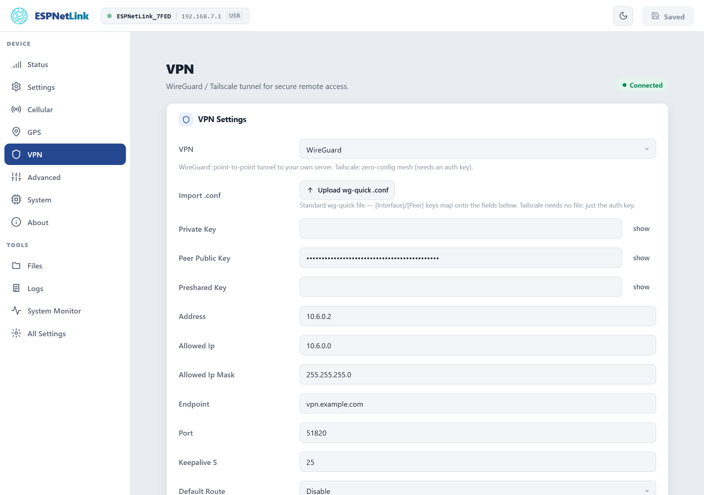

# VPN

On the mobile network the dongle sits behind the carrier's address translation: nothing can reach it from outside. A VPN turns that around. The dongle is a WireGuard client to your own server, or a node on a Tailscale network, and its web page, API and Home Assistant link become reachable from home while the car is anywhere.

<dl class="facts" markdown>
<dt>Types</dt><dd>WireGuard (one peer, your server) or Tailscale (an auth key, your tailnet; Headscale works too)</dd>
<dt>Needs</dt><dd>The mobile network up and the clock set from it: the dongle connects a tunnel only once both are there</dd>
<dt>Routes</dt><dd>Only the tunnel's own range by default; ==Default Route== sends everything through it</dd>
<dt>Shows</dt><dd>A blue LED while the tunnel is verified; ==VPN== on the Status page; `vpn` on the console</dd>
</dl>

!!! note "The WiCAN PRO has its own VPN"
    A WiCAN PRO behind the dongle runs its own VPN for its own traffic (its manual's Connectivity chapters). The dongle's VPN is for reaching the dongle: its page, its API, its firmware update, and its own Home Assistant link.

## WireGuard

1.  **Create a peer on your WireGuard server** with an address for the dongle (`10.6.0.2/32`, say) and leave its private key for the next step, or let the dongle generate its own pair.

2.  **Open ==VPN== and pick ==WireGuard==** in the ==VPN== dropdown. The WireGuard fields appear.

3.  **Fill the fields**, or upload a standard `wg-quick` configuration file with ==Upload wg-quick .conf==: its `[Interface]` and `[Peer]` keys land in the fields below.

    | Field | Meaning |
    | --- | --- |
    | ==Private Key== | The dongle's private key (44 characters). Or press ==Generate Keys==: the dongle makes a key pair, keeps the private key and shows the public key once, to paste into the server's peer. The private key never leaves the dongle. |
    | ==Peer Public Key== | The server's public key. |
    | ==Preshared Key== | Optional, when the server uses one. |
    | ==Address== | The dongle's tunnel address (`10.6.0.2`). |
    | ==Allowed Ip==, ==Allowed Ip Mask== | The range reached through the tunnel. `0.0.0.0` means the dongle's own address only. |
    | ==Endpoint==, ==Port== | The server's name or address and UDP port (51820). |
    | ==Keepalive S== | 25 seconds by default; keeps the carrier's address translation open. 0 turns it off. |
    | ==Default Route== | Off: only the allowed range goes through the tunnel. On: all of the dongle's traffic does. |
    | ==Dns== | A DNS server to use while the tunnel is up. |

4.  **Submit Changes.** After the restart the dongle connects as soon as it has the mobile network and the time; the page's badge turns ==Connected== and the LED blue (breathing with a GPS fix).

<figure class="shot" markdown>
{ width="720" }
<figcaption>VPN with a WireGuard tunnel up. The secret fields show their value with ==show==; a saved secret is never sent back to the page.</figcaption>
</figure>

A tunnel that loses the network, or hears nothing from the peer for 30 seconds, is reconnected with a backoff from 5 to 60 seconds.

## Tailscale

Pick ==Tailscale== in the ==VPN== dropdown and fill:

| Field | Meaning |
| --- | --- |
| ==Ts Auth Key== | An auth key from the Tailscale admin console (a reusable, pre-authorised key spares you approving the node by hand). |
| ==Ts Device Name== | The name the dongle takes on the tailnet. Empty uses the default. |
| ==Ts Control Url== | Empty for Tailscale itself; your Headscale server's URL otherwise. |

After ==Submit Changes== the dongle registers, gets a tailnet address (shown as ==Tailscale IP== under ==VPN Debug== and on the Status page), and reaches peers directly when the carrier's network allows it or through Tailscale's relays otherwise. The ==Tailscale Peers== card lists the nodes it sees, their address, whether they are online and whether the path is `direct` or `relay`.

## Status

==VPN Debug== shows ==Type==, ==State== (`disabled`, `waiting` for the network or the clock, `connecting`, `connected`), ==Endpoint==, ==Tailscale IP==, ==Peers==, ==Connects==, ==Failures== and ==Uptime==. The same is `GET /api/vpn` and `vpn` on the console. While the tunnel is up the dongle's Home Assistant push carries `vpn_ip`, which the integration uses as the way to reach the dongle when it is away from home.

## Troubleshooting

| Symptom | Likely cause | What to do |
| --- | --- | --- |
| State stays `waiting` | no mobile network yet, or the clock is not set | wait for ==Connected (data)== on ==Cellular==; ==Time Synced== on Status should say Yes |
| State stays `connecting` (WireGuard) | a key is wrong, the endpoint or port is unreachable, the server has no peer for this public key | compare the keys on both ends; the server's UDP port must be open |
| State stays `connecting` (Tailscale) | the auth key is used up or expired, or the node needs approval | a new reusable key; approve the node in the admin console |
| Connected, but nothing reaches the dongle | the allowed range on the server side does not include the dongle, or the dongle's range here does not include your side | set ==Allowed Ip== and its mask to cover the addresses you use |
| Everything is slow with the VPN on | ==Default Route== is on: all traffic goes through the tunnel | turn it off unless you need it |
