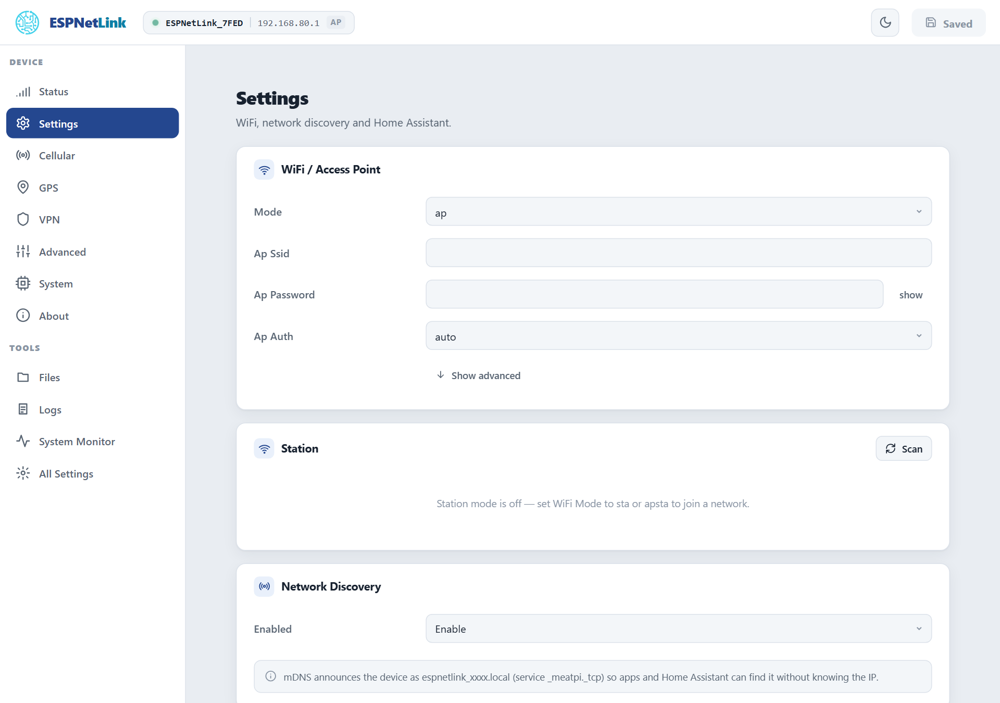
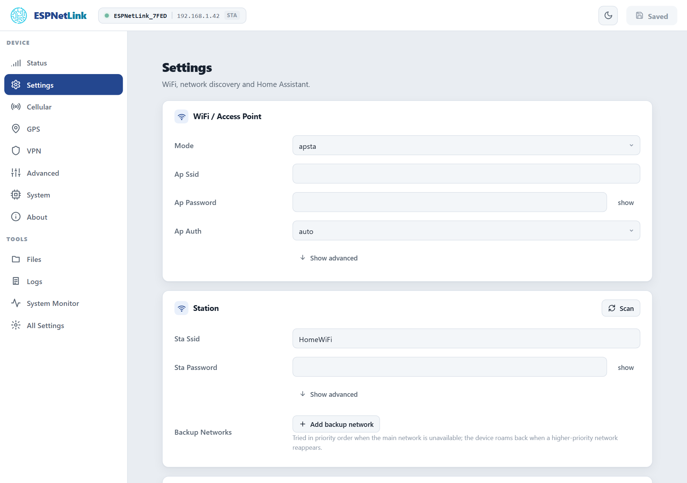
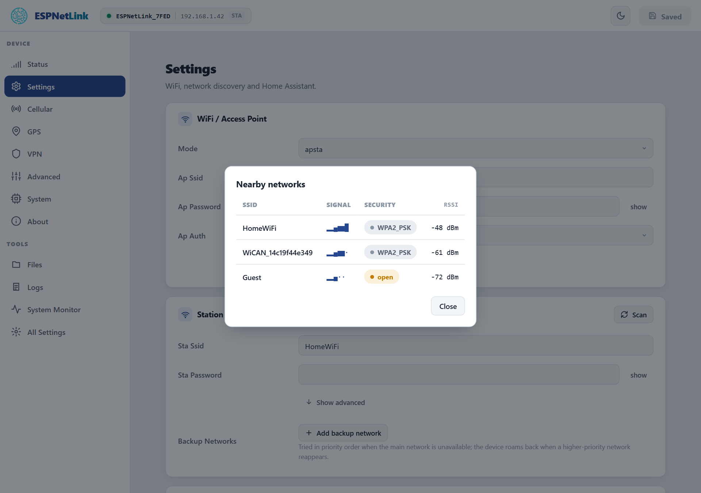

# WiFi

<p class="lead">The dongle has a WiFi radio with an access point of its own and a station that can join your network. It ships with the radio off: the USB cable is the way in, and the access point is for the WiCAN PRO's WiFi modem mode or for a dongle that serves a few devices from a charger.</p>

<dl class="facts" markdown>
<dt>Ships</dt><dd>Radio off (==Mode== `off`)</dd>
<dt>Access point</dt><dd>`ESPNetLink_` and the last six characters of the device id, at `192.168.80.1`, WPA2, channel 6, up to 4 clients</dd>
<dt>Password</dt><dd>Generated for each dongle at its first start, 12 characters. `wifi_modem -k` on the console prints it; a WiCAN PRO reads it over the cable</dd>
<dt>Station</dt><dd>One main network and up to five backup networks, in priority order</dd>
</dl>

## Turning the radio on

==Settings== › ==WiFi / Access Point== › ==Mode==, then ==Submit Changes==:

| Mode | What runs |
| --- | --- |
| `off` | Nothing. The default. |
| `ap` | The access point only. |
| `sta` | The station only: the dongle joins your network. |
| `apsta` | Both. |

From the console: `config set WIFI_MODE ap` (or `sta`, `apsta`) and `reboot`. A WiCAN PRO in WiFi modem mode turns the access point on by itself; in USB Ethernet mode it leaves the radio alone.

## The access point

<figure class="shot" markdown>
{ width="720" }
<figcaption>Settings with the access point on. The name is derived from the device id when ==Ap Ssid== is empty.</figcaption>
</figure>

**The password.** Every dongle gets its own random 12-character password at its first start (letters and digits that cannot be confused: no `0`, `O`, `1`, `l` or `I`), in place of a factory password that would be the same on every unit. It never appears on the web page or in a log. Read it on the console with `wifi_modem -k`, which works with the radio off too:

```text
esp> wifi_modem -k
ap_ssid=ESPNetLink_457FED ap_password=xxxxxxxxxxxx ap_enabled=0
OK
```

A WiCAN PRO reads the same thing over the USB cable when it pairs. Set your own under ==Ap Password== (8 to 64 characters); a factory reset generates a new random one.

**Sharing the LTE link.** With ==Ap Share== on (the default, under ==All Settings== › ==Wifi Modem==), every client of the access point gets internet through the dongle: the dongle is the gateway and the DNS server of its own network and translates addresses onto the LTE link. That is what a WiCAN PRO uses in WiFi modem mode, and what makes the dongle a small hotspot for a phone or a laptop. Keep expectations at Cat M1 speed: tens of kilobytes per second shared by everyone on it.

The other fields of the card, under ==Show advanced==: ==Ap Ip== (the dongle's address and the DHCP range, `192.168.80.1` by default), ==Ap Channel== (1 to 13), ==Ap Bandwidth== (20 or 40 MHz), ==Ap Hidden==, ==Ap Max Connections== (1 to 10), ==Ap Auto Disable== (turn the access point off while the station is connected, back on when it loses the network), ==Ap Auth== (`auto` is WPA2 with a password and open without; `wpa3` and `wpa2wpa3` are available), ==Power Save== and the WiFi memory profile.

## The station

<figure class="shot" markdown>
{ width="720" }
<figcaption>Settings in `apsta` mode on a home network. ==Scan== lists the networks in reach; ==Add backup network== adds one of the five fallback slots.</figcaption>
</figure>

| Field | Meaning |
| --- | --- |
| ==Sta Ssid==, ==Sta Password== | The main network. ==Scan== shows what is in reach with signal and security. |
| ==Sta Trusted== | On by default. Off marks the network as untrusted: the web page and the API refuse requests that arrive through it (HTTP 403), so a dongle on a shared or office network cannot be reconfigured from there. The USB link and the access point are always trusted. |
| ==Backup Networks== | Up to five more networks, tried in order when the main one is not in reach; each with its own password, trust and addressing. While on a backup network the dongle looks for a higher-priority one every ==Sta Roam Interval S== seconds (300 by default) and moves back when it sees it. |
| ==Hostname== | The name on your router. The mDNS name is always `espnetlink_<device id>.local`. |
| ==Sta Ip Mode== and the static fields | DHCP by default; a static address, netmask and gateway per network under ==Show advanced==. |
| ==Sta Dns== | A DNS server to use instead of the one the network offers, for both addressing modes. |
| ==Sta Auto Reconnect==, ==Sta Max Retry== | Reconnect by itself (on), and how many tries before a one-minute pause (-1 is forever). |

A network that refuses the password three times is set aside for ten minutes and the next candidate tried; when it is the only one it is still tried once a minute, so the dongle comes back when the home router does.

<figure class="shot" markdown>
{ width="640" }
<figcaption>==Scan== takes about two seconds. In access point mode the radio switches briefly to scan and back.</figcaption>
</figure>

## WiFi modem mode with a WiCAN PRO

Seen from the dongle, the WiFi modem mode is: radio in `ap` mode, ==Ap Share== on, the USB data lines cut by the WiCAN after it has read the password. The WiCAN keeps its home network first and the dongle's network as a backup, so it is on the dongle only when away from home. The dongle's page is then at `http://192.168.80.1` for anyone on its access point, and its health document (`GET /api/wifi_modem`) is what the WiCAN polls. The WiCAN PRO manual's [USB accessories](../../wican-pro/connectivity/usb-accessories.md) chapter has the WiCAN side.

## Troubleshooting

| Symptom | Likely cause | What to do |
| --- | --- | --- |
| No `ESPNetLink_` network in the air | the radio is off (the default) | ==Mode== `ap`, submit; or `config set WIFI_MODE ap` and `reboot` |
| Forgot the access point password | it was generated, never shown | `wifi_modem -k` on the console (over USB, or through the WiCAN's ==Dongle console==); or a factory reset for a new one |
| Joined the access point, no internet | ==Ap Share== off, or the LTE link down | check ==Cellular== first; ==Ap Share== under ==All Settings== › ==Wifi Modem== |
| The page refuses with 403 on my network | the network is marked untrusted | reach the dongle over USB or its access point and tick ==Sta Trusted== |
| The dongle does not join my network | wrong password, or the network is 5 GHz only | the radio is 2.4 GHz only; check the password with ==Scan== showing the network |
| A WiCAN PRO says `pairing on hold` | the WiCAN's own factory access point password is still in place | change it on the WiCAN; nothing to do on the dongle |
