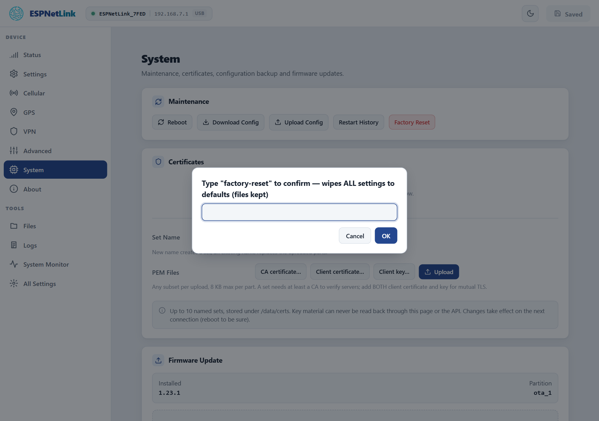

# Factory reset

<p class="lead">A factory reset wipes every setting and restarts the dongle as it left the factory: WiFi off, a USB network adapter and a console on the cable, the APN `internet`, assisted GPS and the VPN off, and a new random WiFi password. Files and the firmware stay.</p>

| Wiped | Kept |
| --- | --- |
| Every setting: the carrier settings and the SIM PIN, WiFi (mode, networks, the access point password), USB mode and class, GPS, VPN keys, the Home Assistant link, the LED, logging | The firmware (both slots), the files under `/data` (certificate sets, the factory record), the WiFi calibration and the assisted GPS cache |

## From the web page

<div class="steps" markdown>

1.  **==System== › ==Maintenance== › ==Factory Reset==.**

2.  **Type `factory-reset` into the dialog** and press ==OK==. Anything else cancels.

3.  **Wait for the restart.** The page shows the offline banner, then reconnects to a fresh dongle. On the first start the dongle generates its new access point password.

</div>

<figure class="shot" markdown>
{ width="640" }
<figcaption>The dialog refuses anything but the word `factory-reset`.</figcaption>
</figure>

## From the console

```text
esp> factoryreset
=== FACTORY RESET WARNING ===
This will permanently delete ALL settings (WiFi, LTE APN, GPS, VPN, ...)
and reboot to factory defaults (WiFi off, USB Ethernet + console).
The AP password is generated anew on that boot (wifi_modem -k shows it).
Files on /data (certificates, factory record) and NVS are NOT deleted.

This action CANNOT be undone!

Type 'yes' to proceed. You have 60 seconds.
(scripts: factoryreset --confirm)
============================
OK
esp> yes
```

`yes` within 60 seconds wipes the settings and restarts; `yes` at any other time answers "Nothing to confirm". A script uses `factoryreset --confirm` in one go. `config reset` is not a factory reset: it only puts the quick settings of `config list` back and needs a `reboot` like any setting.

The HTTP route is `POST /api/settings/factory_reset` with the body `{"confirm":"factory-reset"}`.

## After the reset

- **With a WiCAN PRO**: nothing to do. At the dongle's next start the WiCAN reads its new WiFi key over the cable and, in USB Ethernet mode, turns the sharing of the LTE link on again (one more dongle restart). A WiCAN in WiFi modem mode restarts itself once to store the new key.
- **With a computer**: the dongle is back at `http://192.168.7.1` with the RNDIS class, WiFi off. A SIM PIN, an APN or a WiFi network you had set must be typed again, or restored from a [backup](backup-and-restore.md).
- **The new WiFi password** is printed by `wifi_modem -k` on the console.

## No reset button

The button under the window on the underside is not a reset: held while power is applied it parks the firmware for a flash (a magenta LED, nothing else), and released it does nothing. A dongle whose page and console are out of reach is reset over USB with the flash set: [Recovery over USB](usb-flash.md) rewrites the firmware and, with it, the settings.
