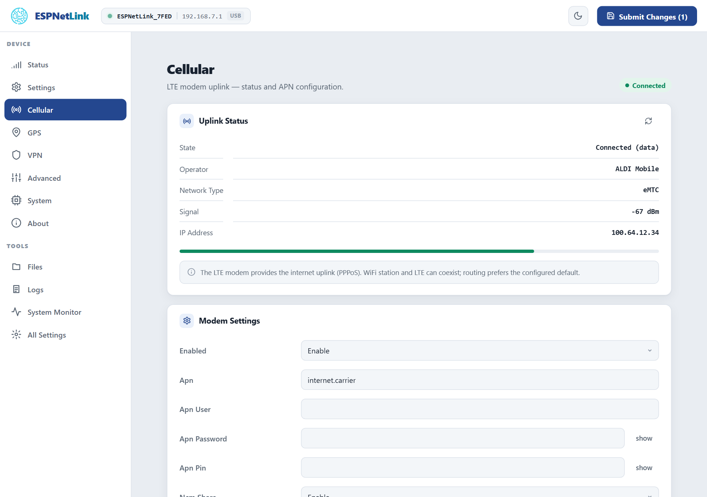
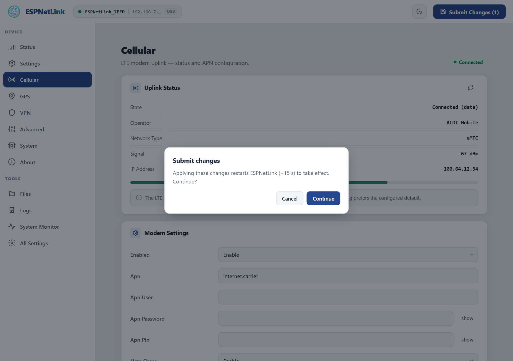
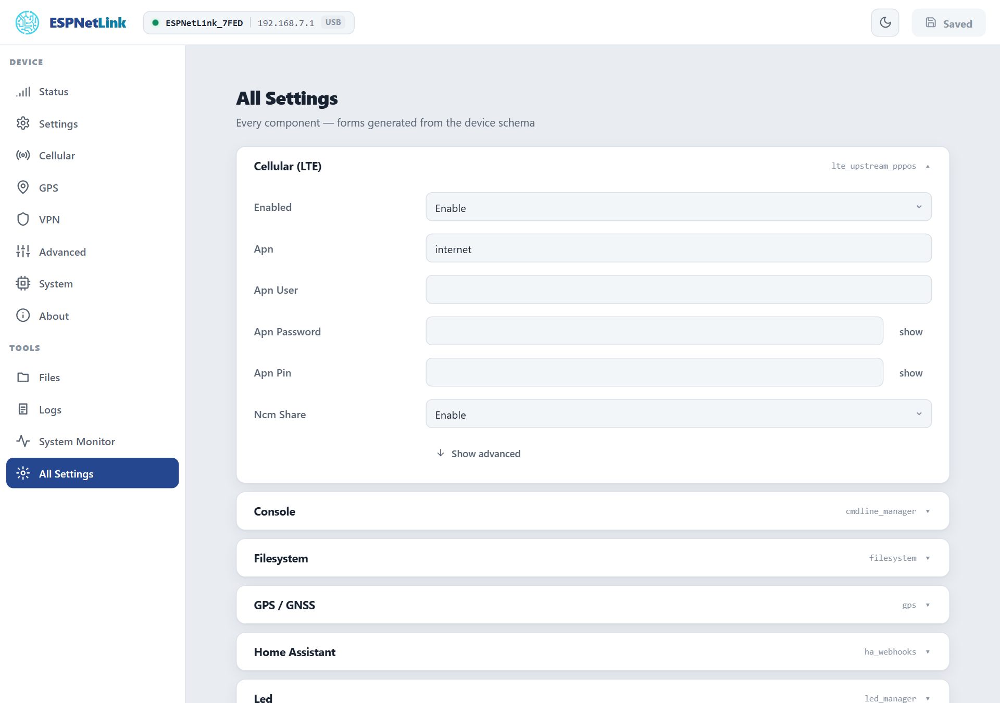

# The web interface

One page served by the dongle itself, in the same design as the WiCAN PRO's: a header with the connection pill and the Submit button, a sidebar of pages, and forms that are generated from the firmware's own settings schema. Nothing to install, and no page ever needs a manual reload.

## Reaching it

| Where the dongle is | Address |
| --- | --- |
| On a computer's USB port | `http://192.168.7.1` |
| On its own WiFi access point | `http://192.168.80.1` |
| On your WiFi network (station mode) | the address your router gave it, or `http://espnetlink_<device id>.local` by mDNS |
| On a WiCAN PRO | In WiFi modem mode, `http://192.168.80.1` for anyone on the dongle's access point. In USB Ethernet mode the cable is the WiCAN's, so the page is out of reach; the WiCAN's ==USB== › ==Dongle console== is your way to the dongle's commands |

A network you marked as untrusted under ==Settings== › ==Station== refuses the pages and the API (HTTP 403) from that network; the USB link and the access point always work. There is no password on the page: whoever reaches the dongle's address can change its settings.

## The header

{ .shot width="720" }
<i class="m" style="left:11%;top:4%">1</i>
<i class="m" style="left:34%;top:4%">2</i>
<i class="m" style="left:88%;top:4%">3</i>
<i class="m" style="left:94%;top:4%">4</i>

<ol class="callouts">
<li>The logo brings you back to Status.</li>
<li>The connection pill: the dongle's name (<code>ESPNetLink_</code> and the last four characters of its id), the address you are on, and how you are connected: <code>USB</code>, <code>AP</code> (its access point) or <code>STA</code> (your network). It turns grey when the page loses the dongle.</li>
<li>Light or dark theme. The choice is remembered by the browser.</li>
<li><strong>Submit Changes</strong>: every setting you change is staged here until you submit, and the count tells you how many pages have pending changes.</li>
</ol>

## Settings apply at a restart

Every setting on the dongle takes effect at the next start. Changing a field on any page stages it; nothing is written until you press ==Submit Changes==. The dialog says what happens next:

<figure class="shot" markdown>
{ width="640" }
<figcaption>Submit writes the pending settings and restarts the dongle. A submit that changes nothing does not restart.</figcaption>
</figure>

While the dongle restarts the page shows an offline banner and polls until it is back, then reloads the page you were on by itself. Leaving a page with unsaved changes asks whether to stay, discard or submit. A setting a page cannot show (an unknown key from a newer firmware, say) is still on ==All Settings==, where every component's form is generated from the schema.

!!! note "Through a WiCAN PRO"
    A dongle plugged into a WiCAN PRO restarts the same way after a submit, and the WiCAN's internet through it pauses for about 45 seconds while the modem registers again.

## The pages

**DEVICE**

| Page | What is on it |
| --- | --- |
| ==Status== | Four tiles (Connection, LTE, GPS, Uptime) and two cards: Network (WiFi mode, station, addresses, mDNS name, LTE address, VPN) and System (firmware, partition, device id, motion, time synced, free memory, die temperature, unexpected resets). Refreshes every 4 seconds. |
| ==Settings== | WiFi / Access Point, Station (with ==Scan== and up to five backup networks), Network Discovery (mDNS), Home Assistant. |
| ==Cellular== | The uplink status with a signal meter, the modem settings (APN, username, password, SIM PIN, sharing over USB), the USB Ethernet class. |
| ==GPS== | The live fix and the receiver settings (assisted GPS, constellations, static navigation, interference cancellation). |
| ==VPN== | One dropdown for Disabled, WireGuard or Tailscale, the fields of the chosen one, a `.conf` import, on-device key generation, the tunnel's state and peers. |
| ==Advanced== | Motion detection (the IMU) and the two consoles. |
| ==System== | Reboot, Download Config and Upload Config, Restart History, Factory Reset; the TLS certificate sets; the firmware update. |
| ==About== | Model, firmware, hardware, device id, MAC, API level, partition, uptime, boot count, the IMU's reading. |

**TOOLS**

| Page | What is on it |
| --- | --- |
| ==Files== | The `/data` filesystem: browse, upload, download, delete, new folder. |
| ==Logs== | The log ring that survives restarts, the log level per component, the sinks, Download and Clear. |
| ==System Monitor== | CPU load, every task with its stack headroom and CPU share, both heaps, the die temperature. |
| ==All Settings== | Every settings component as a collapsible form, with ==check settings== and ==restart pending== markers. |

The sidebar's bottom card warns when a component fell back to its defaults (==Settings problem==) or when a saved change waits for a restart (==Restart pending==, with a ==reboot to apply== link).

<figure class="shot" markdown>
{ width="720" }
<figcaption>All Settings with the Cellular component opened. The grey name on the right is the component's name in the HTTP API.</figcaption>
</figure>

## Show advanced

Cards keep the rarely needed fields behind ==Show advanced==: the access point's channel and bandwidth, the station's static address, the GPS passthrough switches, every component's ==Cli== switch (whether its console commands exist). A card whose component is disabled shows only its ==Enabled== switch until you enable it.
