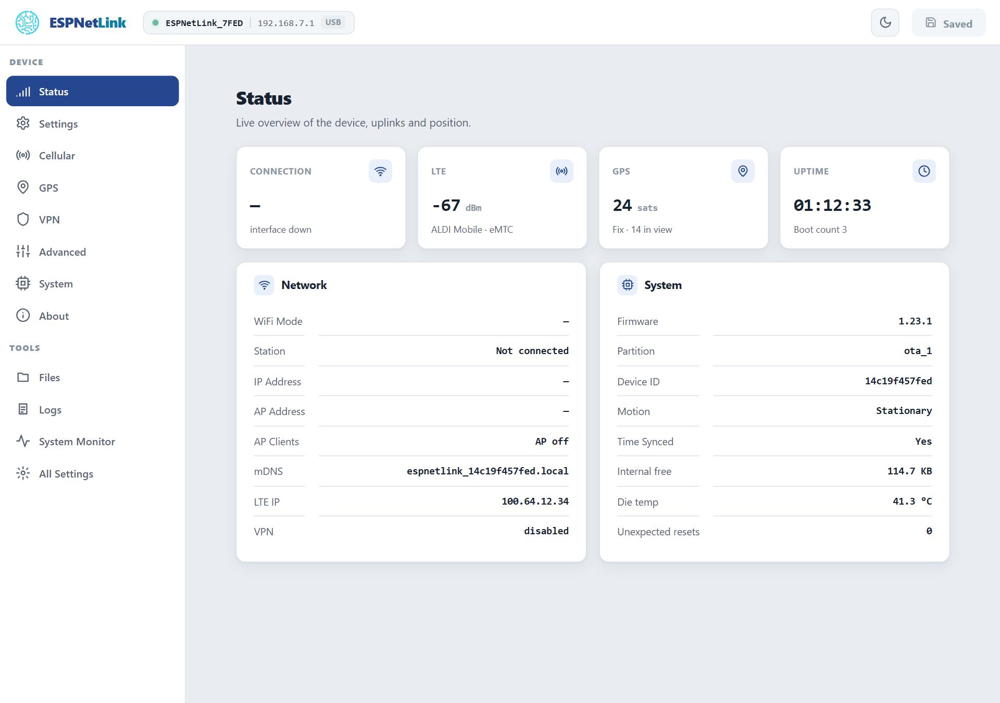

# With a computer

<p class="lead">On a computer the dongle is a USB network adapter with its web interface at `http://192.168.7.1`, and a serial port with a command line. Internet over the mobile network is one switch away.</p>

<dl class="facts" markdown>
<dt>USB device</dt><dd>A network adapter (RNDIS out of the box, or CDC-NCM) and a serial port, on one cable</dd>
<dt>Address</dt><dd>The dongle is `192.168.7.1`; your computer gets `192.168.7.2` from it</dd>
<dt>Web interface</dt><dd>`http://192.168.7.1`, no password, no app to install</dd>
<dt>Internet for the computer</dt><dd>Off until you turn on ==Ncm Share== on the ==Cellular== page</dd>
</dl>

## Plug it in

<div class="steps" markdown>

1.  **Insert the SIM**, with the dongle unplugged. The nano SIM slot is in the window on the underside: contacts down, cut corner first, push until it clicks.

2.  **Plug the USB-A plug into the computer.** Any USB port that gives 5 V. The LED is cyan while the dongle starts, amber while the modem registers, green when it is on the mobile network.

3.  **Wait for the network adapter.** About 5 seconds after power-on the computer finds a new USB network adapter and a serial port.

    === "Windows 10"

        The adapter is listed as `Remote NDIS based Internet Sharing Device` and the serial port as `USB Serial Device (COMx)`. Nothing to install.

    === "Windows 11"

        Windows 11 version 24H2 and later have no driver for the RNDIS class the dongle presents out of the box: the adapter shows with a warning, or not at all. Switch the dongle to the NCM class once, from its serial port: see [the NCM class](#windows-11-and-the-ncm-class) below. The adapter is then `MeatPi Electronics ESPNetLink`.

    === "macOS and Linux"

        Both carry drivers for RNDIS and for CDC-NCM. The dongle appears as a USB Ethernet interface (`rndis_host` or `cdc_ncm` on Linux) and a serial port (`/dev/ttyACM0` on Linux, `/dev/cu.usbmodem...` on macOS).

4.  **Open the web interface** at `http://192.168.7.1`. The Status page shows the mobile network, the GPS and the system at a glance; the header pill reads `ESPNetLink_XXXX · 192.168.7.1 · USB`.

    <figure class="shot" markdown>
    { width="720" }
    <figcaption>The Status page over USB. "Interface down" under Connection is the dongle's WiFi, which ships off.</figcaption>
    </figure>

</div>

## Internet for the computer

Out of the box the USB link is a way to reach the dongle, not a way to the internet: the dongle hands your computer an address but no default route, so a laptop keeps using its own WiFi. To route the computer through the mobile network:

1. Open ==Cellular== and set ==Ncm Share== to ==Enable== under ==Modem Settings==.
2. Press ==Submit Changes== in the header, then ==Continue==. The dongle restarts (about 15 seconds).

From then on the dongle offers itself as the computer's router and DNS server over the USB link, and the computer's traffic rides the LTE link. LTE Cat M1 is a narrowband service: expect tens of kilobytes per second, enough for messaging, telemetry and a terminal, not for video. A WiCAN PRO in USB Ethernet mode turns this switch on by itself.

!!! note "A laptop with WiFi and the dongle"
    With ==Ncm Share== on, Windows and macOS usually prefer the wired adapter over WiFi, so the laptop's internet moves onto the slow link. Turn the switch off again (or unplug the dongle) when you do not want that.

## Windows 11 and the NCM class

The dongle presents the RNDIS class by default because a WiCAN PRO pairs with it that way. A computer without an RNDIS driver still sees the serial port, and the class can be changed from there:

<div class="steps" markdown>

1.  **Open the serial port** with a terminal program (PuTTY, Tera Term, the Windows Terminal's serial support): the `USB Serial Device (COMx)` the dongle added, any baud rate. Press ++enter++ and the prompt `esp>` appears.

2.  **Type the two commands**

    ```text
    config set USB_CLASS ncm
    reboot
    ```

    The dongle restarts and comes back as `MeatPi Electronics ESPNetLink`, a CDC-NCM adapter Windows 11 drives out of the box. The serial port stays.

</div>

The same choice is ==Class== under ==USB Ethernet== on the ==Cellular== page once the page is reachable. A WiCAN PRO sets the class to match its own mode when it pairs, so a dongle that moves between a computer and a WiCAN PRO may change class on its own: see [USB](../connectivity/usb.md).

## What to check first

| Page | What it tells you |
| --- | --- |
| ==Status== | The four tiles: Connection (the dongle's WiFi), LTE (signal, operator, network type), GPS (satellites, fix), Uptime. The Network card: mDNS name, LTE address, VPN. The System card: firmware, device id, motion, time, memory, temperature, unexpected resets. |
| ==Cellular== | ==Connected (data)== with the operator, the network type (`eMTC` is Cat M1, `NB-IoT` the other), the signal in dBm and the LTE address; or ==Searching for network== while the modem registers. The APN and SIM PIN are on the same page. |
| ==GPS== | Fix or no fix, satellites tracked and in view, the position, altitude, speed, course, the fix's age. |

The command line gives the same, and more, from the serial port: `lte -s`, `gps -p`, `version`. See [Console](../tools/console.md).

!!! tip "The WiFi password is on the console"
    The dongle's WiFi access point ships off, but its per-device password already exists. `wifi_modem -k` on the console prints the network name and the password; ==Settings== › ==WiFi / Access Point== › ==Mode== turns the access point on. See [WiFi](../connectivity/wifi.md).
