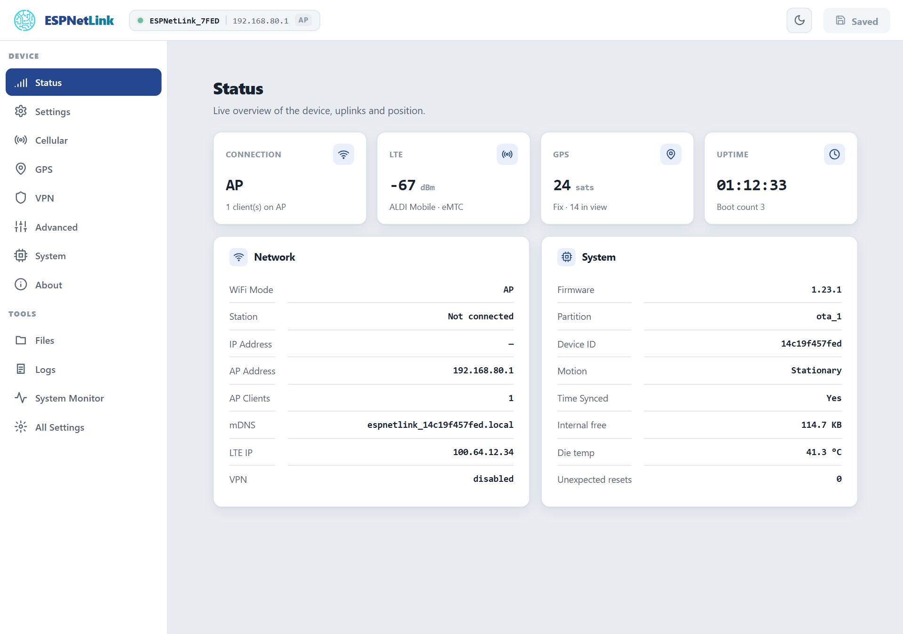

# With WiCAN PRO

Put a SIM in, plug the dongle into the WiCAN PRO's USB port, and the WiCAN pairs with it by itself. Nothing to type on the dongle: the WiCAN PRO reads what it needs over the cable, turns on what it needs, and shows the dongle on its own pages.

<dl class="facts" markdown>
<dt>WiCAN PRO firmware</dt><dd>6.0 or newer. The WiCAN needs a dongle with API level 7 or newer; every dongle release since 1.23.0 has level 10</dd>
<dt>SIM</dt><dd>A nano SIM with a plan that covers LTE Cat M1 or NB-IoT, from a carrier with coverage where the car goes</dd>
<dt>Cable</dt><dd>The dongle's own USB-A cable, into the USB-A to USB-C adapter in the box, into the WiCAN PRO</dd>
<dt>Power</dt><dd>From the WiCAN PRO. The dongle restarts whenever the WiCAN wakes from sleep</dd>
</dl>

## Plug it in

1.  **Insert the SIM**

    Turn the dongle over. The nano SIM slot is in the window on the underside, next to a small switch block and a button. Push the card into the slot, contacts down and the cut corner first, until it clicks. Do this with the dongle unplugged.

    <figure class="shot" markdown>
    { width="560" }
    <figcaption>The window on the underside: the SIM slot on the left, the switch block and the button above it. Leave the switches as they are.</figcaption>
    </figure>

2.  **Connect it to the WiCAN PRO**

    Plug the dongle's USB-A plug into the adapter and the adapter into the WiCAN PRO's USB-C port. Put the dongle where it can see the sky (the top of the dashboard, under the rear window): the GPS antenna is inside the case.

3.  **Watch the LED**

    The light on the top of the case is cyan while the dongle starts, then amber while the modem registers on the mobile network, then green once it has internet. A slow breathing instead of a steady light means the GPS has a fix. The first fix takes a minute or two with a view of the sky. The other colours are in [LED patterns](../troubleshooting/led-patterns.md).

4.  **Look at it on the WiCAN PRO**

    On a WiCAN PRO that is already set up, a bar under the header says ==ESPNetLink connected== with the SIM, the carrier and the GPS state; ==Finish setup== opens the dongle's screen. The header's connection pill reads `USB: ESPNetLink · LTE · fix` from then on, and ==USB== › ==Status== shows the dongle's card: its id, firmware, SIM, operator, signal, internet and GPS. On a new WiCAN PRO, Quick Setup's ==USB devices== step finds the dongle and asks the one question it has.

!!! tip "No home WiFi where the car lives?"
    Quick Setup's ==Home WiFi== step offers ==Use the ESPNetLink, no home WiFi== as soon as a dongle with a SIM is on the cable. The WiCAN keeps its access point as your way in and gets its internet over LTE.

## What the WiCAN PRO does for you

- **Identifies the dongle** every time it starts, over the USB cable, and shows its firmware and API level.
- **Turns on what it needs.** The dongle ships with WiFi off and assisted GPS off. In USB Ethernet mode the WiCAN switches on the sharing of the LTE link over USB (one dongle restart at the first contact, about a minute) and assisted GPS. In WiFi modem mode it also reads the dongle's access point key and turns the access point on.
- **Relays the carrier settings.** The APN, its username and password, and a SIM PIN typed on the WiCAN's dongle screen are sent to the dongle over the cable; the dongle restarts once to apply them. See [Cellular](../connectivity/cellular.md).
- **Reads the position** every 2 seconds and the dongle's health (SIM, signal, operator, internet) every 10 seconds, and turns the position into the `gps_*` parameters that flow to Home Assistant, the logger, rules and ABRP.
- **Updates the dongle's firmware** from the WiCAN's own ==System== › ==Firmware update== page. See [Update](../firmware/update.md).

## Two ways to use it

The WiCAN PRO decides how the cable is used; the setting is on its dongle screen (==USB== › ==Status== › ==Set up==, or Quick Setup).

| Mode | How it works | When to pick it |
| --- | --- | --- |
| **USB Ethernet** (the default) | The dongle is a USB network adapter on the cable. Internet over LTE the moment the cable is in, GPS read over the cable too. | Always, unless the GPS never gets a fix this way. |
| **WiFi modem** | The WiCAN reads the dongle's WiFi key over the cable, then asks the dongle to switch its USB data lines off: the cable carries power only. The WiCAN joins the dongle's own access point whenever the home WiFi is out of range and the dongle routes it onto LTE. GPS is read over WiFi. | When the GPS matters: the USB link disturbs the dongle's GPS reception, and a cold fix takes about half as long with the lines off. |

In USB Ethernet mode the WiCAN tells you when to switch: after ten minutes away from home with internet up and no fix, its dongle screen offers ==Switch to WiFi modem==. One press and a restart of the WiCAN do the rest. The dongle side of both modes is in [USB](../connectivity/usb.md) and [WiFi](../connectivity/wifi.md).

<figure class="shot" markdown>
{ width="720" }
<figcaption>The dongle's own Status page in WiFi modem mode: the WiCAN PRO is the one client on its access point. In USB Ethernet mode the Connection tile reads "interface down" because the dongle's WiFi is off.</figcaption>
</figure>

## Things to know

- **Internet pauses when the dongle restarts.** A dongle restart (settings applied from the WiCAN, a firmware update) costs about 45 seconds of mobile network: the modem registers again.
- **Sleep.** The WiCAN PRO cuts the USB power while it sleeps. The dongle starts afresh when the WiCAN wakes and needs a minute or so to be back on LTE and to get a fix.
- **A second WiCAN, or a factory reset.** The dongle keeps no record of which WiCAN it is paired with. A new WiCAN reads the dongle's key over the cable the next time the dongle starts; a dongle that was factory reset gets a new WiFi key, and the WiCAN picks it up the same way.
- **The dongle's own pages.** In USB Ethernet mode the WiCAN PRO reaches the dongle at `192.168.7.1`, and so can you from a computer on the cable; in WiFi modem mode the dongle's page is at `192.168.80.1` on the dongle's own access point (the WiCAN PRO itself stays at `192.168.0.10` on its own access point). The WiCAN's ==USB== › ==Dongle console== sends the dongle's console commands over the cable without any of that: see [Console](../tools/console.md).
