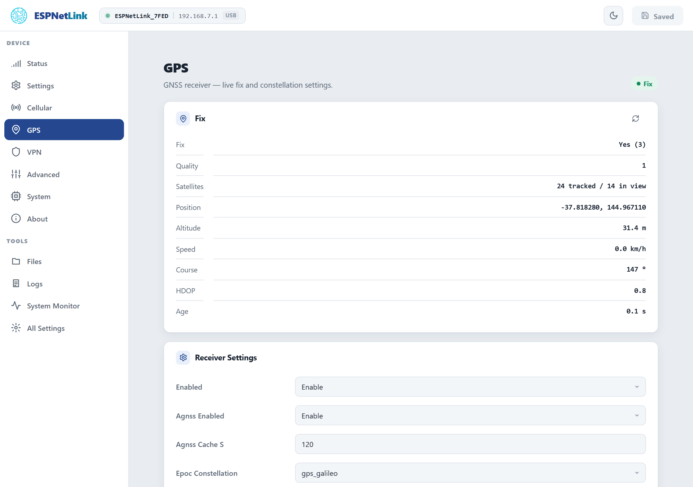

# Position and assisted GPS

<p class="lead">A Quectel LC76G receiver with an antenna inside the case tracks GPS, GLONASS, Galileo, BeiDou and QZSS at once. The position goes to the WiCAN PRO as its `gps_*` parameters, to the dongle's own Home Assistant link, and to the GPS page.</p>

<dl class="facts" markdown>
<dt>Receiver</dt><dd>Multi-constellation, one frequency band, a ceramic patch antenna on the board under the top of the case</dd>
<dt>First fix</dt><dd>Typically one to two minutes from cold with a view of the sky; faster with assisted GPS and a recent position</dd>
<dt>Assisted GPS</dt><dd>Off out of the box. A WiCAN PRO turns it on; on a computer, ==Agnss Enabled== on the GPS page</dd>
<dt>Shows</dt><dd>The GPS page, the Status page's GPS tile, a breathing LED while it has a fix</dd>
</dl>

## Where to put the dongle

The antenna is a ceramic patch inside the case. It needs sky: the top of the dashboard, the rear parcel shelf, a spot under the windscreen, the dongle lying flat. Metal above it (a roof, a footwell under the dash) blocks the signal; glass does not, unless it is a metallised, heat-reflecting windscreen, which many cars have, and then the rear window is the better spot. A USB extension cable between the WiCAN PRO and the dongle is fine. If the fix is slow where you put it, try the dongle turned over: the patch radiates through one face of the case.

## Reading the fix

<figure class="shot" markdown>
{ width="720" }
<figcaption>GPS, with a fix. The page refreshes every 2 seconds.</figcaption>
</figure>

| Row | Meaning |
| --- | --- |
| Fix | Whether the receiver has a position, and the kind (3D with four or more satellites). |
| Quality | The NMEA fix quality: 0 none, 1 standard, 2 with SBAS corrections. |
| Satellites | Tracked (used in the fix) and in view (heard). A fix needs four tracked; more make it steadier. |
| Position, Altitude, Speed, Course | The last fix. Speed in km/h, course in degrees from north. |
| HDOP | The horizontal dilution of precision: a geometry figure, lower is better, under 2 is good. |
| Age | How long ago the receiver last reported. A growing age means the receiver stopped talking. |

A WiCAN PRO shows the same on its ==USB== › ==Status== page and publishes `gps_latitude`, `gps_longitude`, `gps_altitude`, `gps_speed`, `gps_heading` and `gps_satellites` wherever vehicle parameters go. It only publishes a live fix; a remembered position is never reported as current.

## Time to first fix

A cold start (no idea of the time, the orbits or the position) takes the receiver one to two minutes with a good view of the sky, sometimes longer in a car park. Three things shorten it:

- **Assisted GPS** (below): the dongle hands the receiver the time from the mobile network and the last known position, and the receiver predicts the satellite orbits itself for a few days ahead.
- **A quiet USB cable.** The host's USB transmitter sits close to the antenna, and a cable carrying data makes the receiver deaf to the weakest satellites. On the bench a cold fix took 86 to 110 seconds on a live USB link and 50 to 66 seconds with the data lines off. That is why the WiCAN PRO's WiFi modem mode cuts the lines, and why the WiCAN suggests that mode after ten minutes without a fix. See [USB](../connectivity/usb.md).
- **The modem.** Transmissions from the LTE modem disturb the receiver a little; ==Aic Enabled== (active interference cancellation, on by default) is the receiver's own counter-measure.

Once it has a fix the receiver keeps it through a drive; it does not drop the fix when the modem transmits or when USB traffic starts.

## Assisted GPS

With ==Agnss Enabled== on, at every start the dongle:

1. waits for the time from the mobile network and injects it into the receiver;
2. injects the position it cached at the previous run (saved every ==Agnss Cache S== seconds, 120 by default, while it had a fix);
3. lets the receiver's own orbit prediction (EASY) use that to find satellites at once. ==Epoc Constellation== chooses which constellations the prediction covers: `gps`, `gps_galileo` (the default) or `gps_bds`.

A WiCAN PRO turns assisted GPS on when it pairs. `agnss -s` on the console shows the state (enabled, time injected, position injected, the cached position); `agnss -e` and `agnss -d` switch it for the next start.

## Settings

==GPS== › ==Receiver Settings==, applied with ==Submit Changes==:

<dl class="facts" markdown>
<dt>Enabled</dt><dd>Reserved. The receiver runs whenever the dongle does.</dd>
<dt>Agnss Enabled</dt><dd>Assisted GPS, off by default (a WiCAN PRO turns it on).</dd>
<dt>Agnss Cache S</dt><dd>10 to 86400 s, 120 by default: how often the position is cached for the next start.</dd>
<dt>Epoc Constellation</dt><dd>`gps`, `gps_galileo` or `gps_bds`: the constellations the orbit prediction covers.</dd>
<dt>Static Nav Threshold</dt><dd>0 to 20, in tenths of a metre per second, 5 by default: below this speed the receiver holds the position still and reports zero speed, so a parked car does not wander. 0 turns it off.</dd>
<dt>Aic Enabled</dt><dd>The receiver's active interference cancellation, on by default: the LTE modem transmits centimetres from the antenna.</dd>
<dt>Passthru</dt><dd>Advanced: at start, turn the USB console into a raw NMEA stream (for a GPS application on a computer). `gps -t 1` does the same at runtime; typing seven `+` characters in a row brings the console back.</dd>
<dt>Uart0 Out</dt><dd>Advanced: copy the NMEA stream onto the dongle's UART.</dd>
<dt>Cli</dt><dd>Advanced: whether the `gps` and `agnss` console commands exist.</dd>
</dl>

## From the console

```text
gps -p          the fix in one line (lat, lon, satellites, quality, altitude, HDOP, speed, course, age)
gps -p -j       the same as JSON, plus the assisted GPS state
gps -s          stream the raw NMEA sentences; any key stops
gps -c          check that the receiver is talking
gps -V          the receiver's firmware version
agnss -s        assisted GPS status
```

## Troubleshooting

| Symptom | Likely cause | What to do |
| --- | --- | --- |
| No fix after two minutes | no view of the sky, or a live USB cable from a WiCAN PRO | move the dongle up and out; on a WiCAN PRO pick WiFi modem mode |
| No fix, ever, indoors | normal: the receiver needs the sky, a window at least | test it in the car |
| Fix, but the position jumps around while parked | ==Static Nav Threshold== is 0 | set it back to 5 |
| ==Age== keeps growing, the LED stops breathing | the receiver stopped reporting | `gps -c` on the console; a `reboot` restarts it |
| Satellites in view, none tracked | acquisition still in progress, or strong interference nearby | wait; try another spot |
| The WiCAN PRO shows no position although the dongle has a fix | the WiCAN reads only a live fix, over the cable or the access point | check the dongle's card on the WiCAN's ==USB== › ==Status== for the uplink state |
