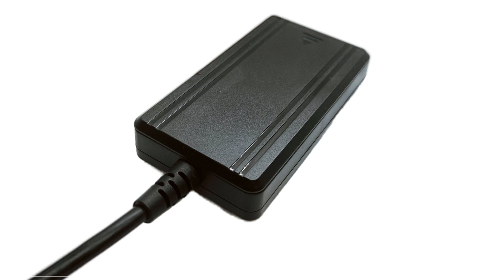
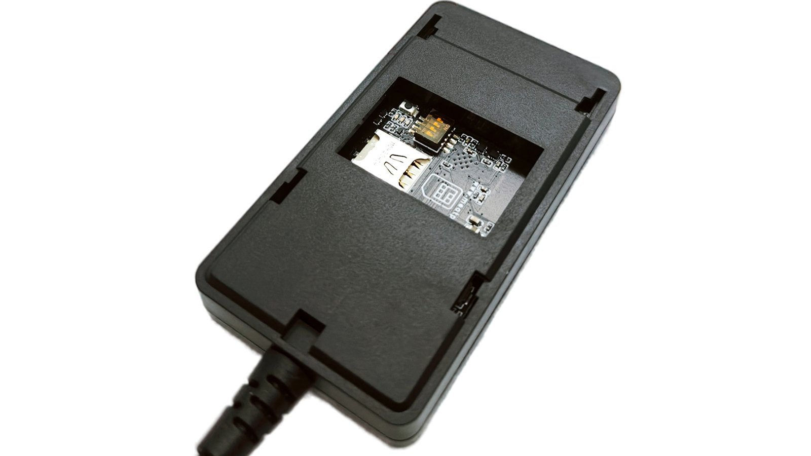
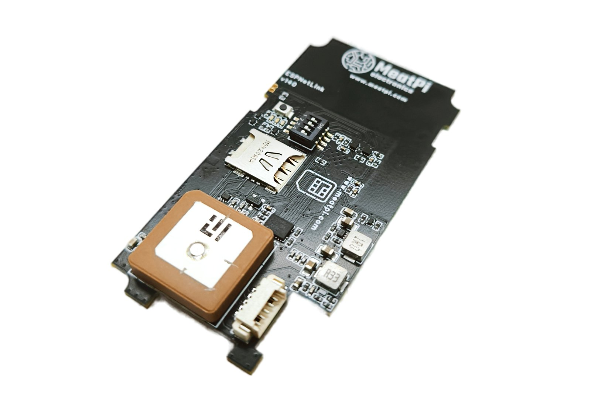
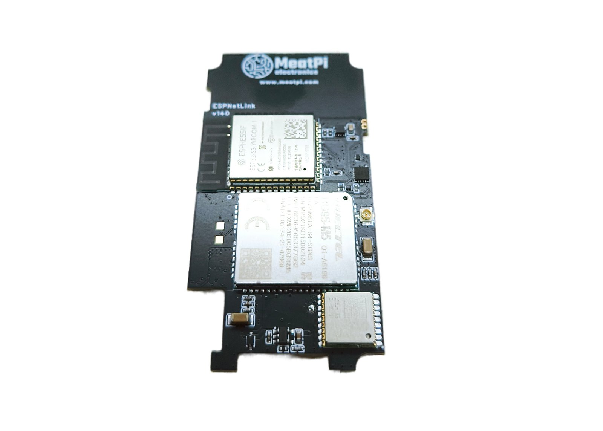

# Hardware

A sealed box on a captive USB cable: a cellular modem, a GPS receiver, a motion sensor and a WiFi radio around an ESP32-S3, powered from the USB port it is plugged into. The only things to touch are under a window on the underside: the SIM slot, and a switch block and a button that are for service.

## In the box

- The ESPNetLink, with its USB-A cable attached.
- A USB-A to USB-C adapter (an OTG adapter): the cable's plug goes into it, and it goes into the WiCAN PRO's USB-C port.

<figure class="shot" markdown>
{ width="560" }
<figcaption>The top of the case. The status LED shines through the mark near the end away from the cable.</figcaption>
</figure>

<figure class="shot" markdown>
{ width="560" }
<figcaption>The underside. The window gives access to the nano SIM slot (left), the switch block and the button. Leave the switches as shipped.</figcaption>
</figure>

## What is inside

<figure class="shot" markdown>
{ width="560" }
<figcaption>The board's top: the ceramic GPS patch antenna, the nano SIM holder, the switch block and the button.</figcaption>
</figure>

<figure class="shot" markdown>
{ width="560" }
<figcaption>The board's other side: the ESP32-S3 module with the WiFi antenna, the BG95-M5 modem with its antenna connector, the LC76G receiver.</figcaption>
</figure>

| Part | What it is |
| --- | --- |
| Processor | Espressif ESP32-S3-WROOM-1: dual core, 16 MB flash, 8 MB PSRAM, WiFi 2.4 GHz. Bluetooth is not used. |
| Modem | Quectel BG95-M5: LTE Cat M1 and NB-IoT (with EGPRS fallback where the carrier still has it), worldwide bands. The LTE antenna is inside the case on the module's antenna connector. |
| GPS | Quectel LC76G: GPS, GLONASS, Galileo, BeiDou and QZSS on one band, with orbit prediction for fast starts. A ceramic patch antenna on the board, inside the case. |
| Motion sensor | TDK ICM-42670-P accelerometer: motion detection and wake on motion. |
| LED | One RGB LED (an AW2023 driver) visible through the case, plus a red one inside. |
| USB | A full-speed USB 2.0 device: a network adapter (RNDIS or CDC-NCM) and a serial console. A switch block can route the connector to an on-board USB-UART bridge or straight to the modem for service. |
| SIM | One nano SIM (4FF) in a push-in holder. |
| Power | 5 V from the USB port. No battery. |

## Specifications

| | |
| --- | --- |
| Supply | 5 V over USB. Power the dongle from a 5 V USB port only. |
| Mobile network | LTE Cat M1 (eMTC) and NB-IoT. A plan that covers one of them is required; check coverage with the carrier before relying on it. |
| Position | Multi-constellation GNSS, cold start typically one to two minutes with a view of the sky, assisted GPS available. |
| WiFi | 2.4 GHz, access point (up to 10 clients) and station. |
| Interfaces | USB (network adapter and serial console), WiFi, the HTTP API on port 80. |
| Operating position | Lying flat with a view of the sky; keep the GNSS antenna unobstructed, no metal above the dongle. |

## Instructions for safe use

From the card in the box:

- This device is intended for testing and development purposes. MeatPi Electronics is not responsible for damage or harm caused by misuse or by applications outside its intended scope.
- Do not surpass the rated input voltage: power the device from a 5 V USB interface only, and do not expose any pin to a higher voltage.
- A compatible SIM card (Cat M1 or NB-IoT) is required for cellular connectivity. Verify network coverage with your mobile operator before deployment.
- Do not obstruct the GNSS antenna; ensure a clear view of the sky for the best GPS performance.

MeatPi Electronics, PO Box 5005 Clayton, VIC 3168, Australia, `www.meatpi.com`.

## Identification

Every dongle has a device id (12 hexadecimal characters, from its WiFi MAC address) that names its access point (`ESPNetLink_` and the last six characters), its mDNS name (`espnetlink_<id>.local`) and the production record on its flash. ==About== shows it, with the MAC, the firmware, the API level and the hardware. The modem's IMEI is in `lte -j` on the console.
