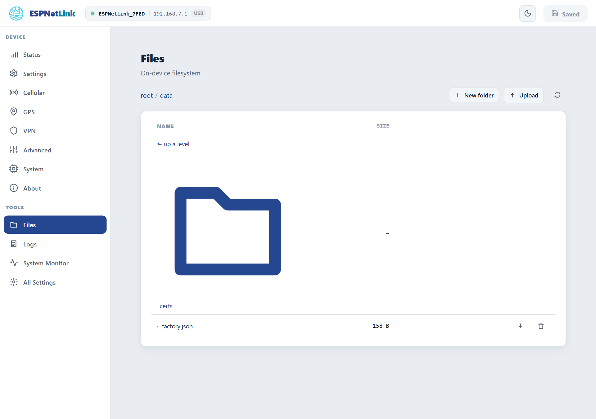
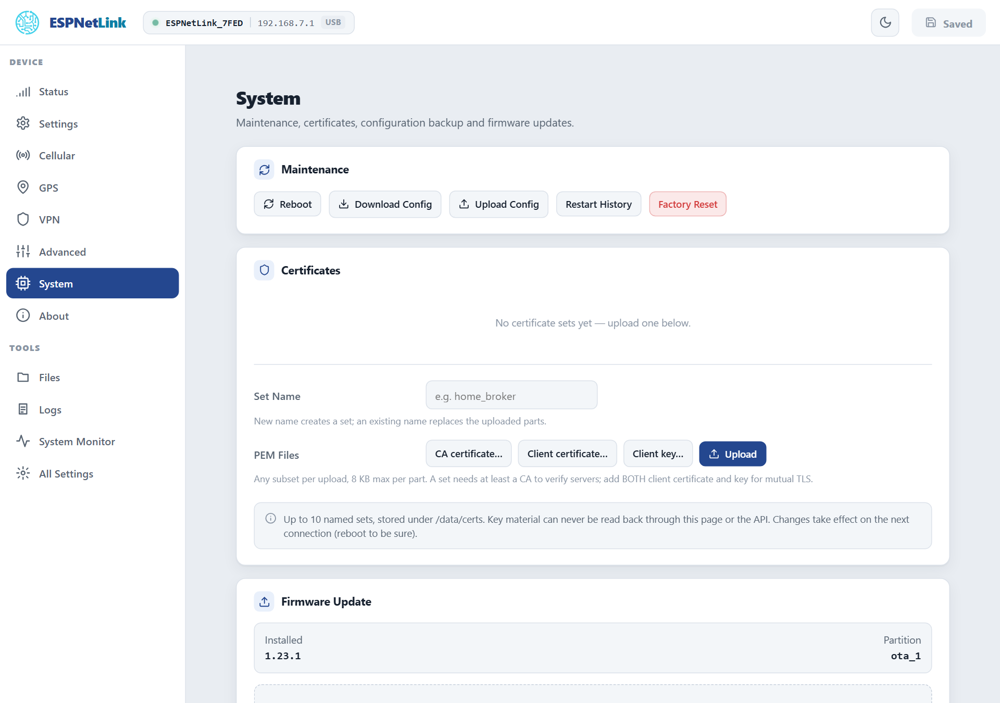

# Files

The dongle keeps a small filesystem on its own flash, 4 MB under `/data`, for certificates and its records. The Files page browses it; the System page manages the certificate sets that live there. There is no memory card slot.

## The Files page

<figure class="shot" markdown>
{ width="720" }
<figcaption>Files. Folders open on a click; a file has a download and a delete button.</figcaption>
</figure>

What you will find under `/data`:

| Entry | What it is |
| --- | --- |
| `certs/` | The TLS certificate sets, one folder per set. |
| `factory.json` | The production record written when the dongle was tested: the device id, MAC, firmware and date. Leave it. |
| `config.json.imported` | On a dongle updated from firmware 1.2x: its old configuration, renamed after the import. Can be deleted. |

==Upload== takes a file of any kind up to 2 MB into the current folder; ==New folder== creates one; the arrow downloads a file; the bin deletes a file or an empty folder. Writes are atomic: a power cut during an upload leaves the old file or the new one, never a torn one. The settings themselves are not here: they live on a separate partition, reached through [Backup and restore](../firmware/backup-and-restore.md).

`fs` on the console prints the space used; `GET /api/fs/info?path=/data` the same for a script.

## Certificates

==System== › ==Certificates== holds named sets of PEM files for connections the dongle makes with TLS: today the Home Assistant push to a server with a private certificate authority (==Cert Set== on the Home Assistant card).

| Part | File | For |
| --- | --- | --- |
| CA certificate | `ca.pem` | Verifying the server. A set needs at least this. |
| Client certificate, Client key | `client.crt`, `client.key` | Mutual TLS, when the server asks the dongle to prove itself. Add both. |

Type a ==Set Name== (letters, digits, `-` and `_`, up to 24 characters), pick any of the three files (8 KB each at most) and ==Upload==. An existing name replaces the parts you uploaded and keeps the others. Up to ten sets. Key material can never be read back, through this page or the API; the generic file browser can still see the `certs` folder, so keep the dongle's network trusted. Deleting a set sends the connections that used it back to the built-in bundle at their next attempt.

<figure class="shot" markdown>
{ width="720" }
<figcaption>System. The Certificates card lists the sets with which parts each one has.</figcaption>
</figure>
