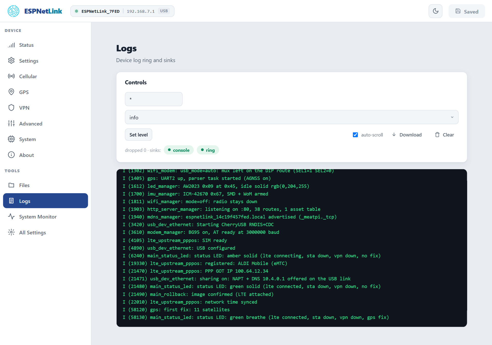
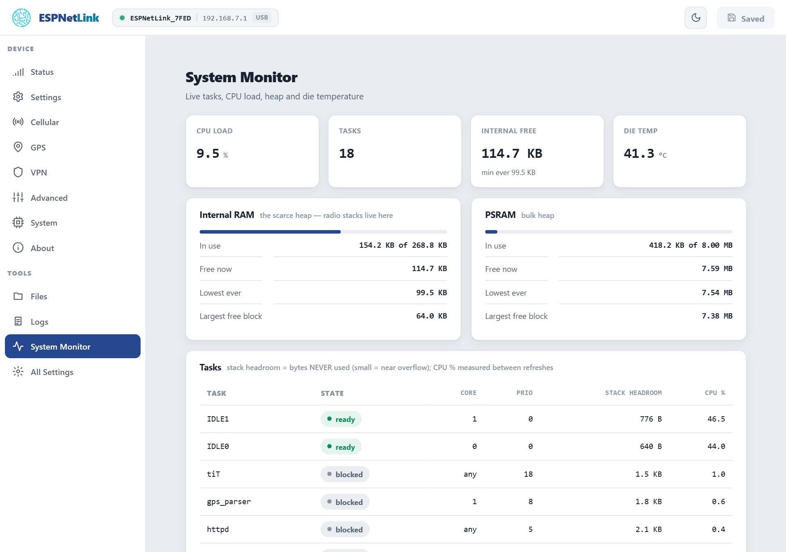

# Logs and system monitor

The Logs page shows the firmware's own log, kept in a ring that survives a restart, so the lines from before a crash are still there afterwards. The System Monitor shows what the processor and the memory are doing. Both are the first stop when something behaves oddly, and what support will ask for.

## Logs

<figure class="shot" markdown>
{ width="720" }
<figcaption>Logs. Errors are highlighted in red, warnings in amber, the `---- boot ----` separators in grey.</figcaption>
</figure>

The ring holds the last 16 KB of log lines in memory that a warm restart (a reboot, a crash, a watchdog) does not clear; only a power cut does. Each start writes a `---- boot ----` line, so the ring reads as a short history of the last few starts. The page refreshes every 2.5 seconds.

| Control | What it does |
| --- | --- |
| The tag field and level | Set the level of one component (`wifi_manager`, `lte_upstream_pppos`, `gps`, or `*` for all) to `error`, `warn`, `info`, `debug` or `verbose` until the next restart. The level stored for every start is ==All Settings== › ==Logging== › ==Level==. |
| ==auto-scroll== | Keep the newest line in view. |
| ==Download== | Save the ring as a text file: what to attach to a support request, together with the About page. |
| ==Clear== | Empty the ring. |
| The sink chips | `console` (the serial console) and `ring`: click one to turn it off or on until the next restart. The `dropped` count says how many lines were lost under a burst. |

On the console `debug 1` turns the live log output on and `debug 0` off.

## System Monitor

<figure class="shot" markdown>
{ width="720" }
<figcaption>System Monitor. The CPU column is measured between two refreshes, so it reads after the second one.</figcaption>
</figure>

| Part | What it shows |
| --- | --- |
| The tiles | CPU load over the last 2 seconds, the number of tasks, free internal memory (with the lowest ever), the die temperature. |
| Internal RAM and PSRAM | The two memory pools: the small internal one holds the radios and the drivers, the large PSRAM everything else. ==Largest free block== below ==Free now== shows fragmentation. |
| Tasks | Every task with its state, core, priority, **stack headroom** (bytes never used: a small figure means the task is close to its limit) and CPU share. |

Nothing here needs attention on a healthy dongle: a CPU load of a few percent, internal free memory above 100 KB, a die temperature in the 40s to 60s in a car. A rising ==Unexpected resets== count on the Status page, not these figures, is the sign of a problem: see [Crash report](../troubleshooting/crash-report.md).
