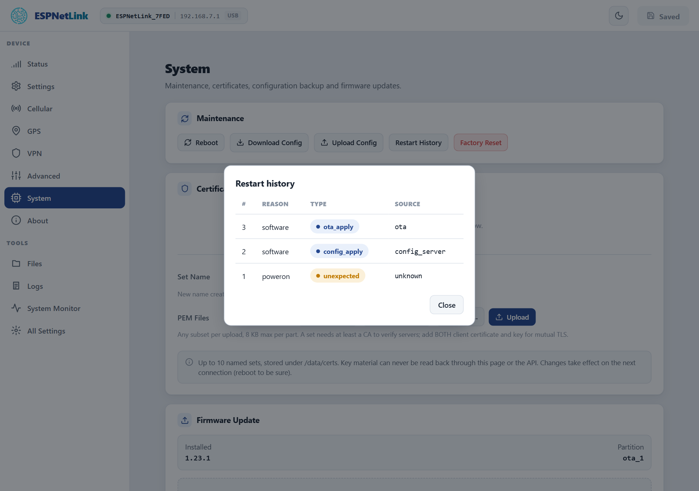

# Crash report

<p class="lead">The dongle remembers why it restarted, keeps its log across restarts and stores a summary of a crash. When something is wrong, these three tell you whether the dongle restarted by itself, how often, and what it was doing.</p>

## Unexpected resets

The Status page's ==Unexpected resets== row and the About page's ==Boot Count== are the first look: a dongle that only ever restarts because you asked (a submit, an update, a reboot) shows 0. The count survives warm restarts and clears at a power cut, so a WiCAN PRO's sleep (which cuts the dongle's power) clears it too.

## The restart history

==System== › ==Restart History== lists the last eight starts, newest first: the reason the chip reports (`software`, `poweron`, `panic`, `task_wdt`, `brownout`, `deepsleep`...), whether the restart was planned and why (`config_apply` after a submit, `ota_apply` after an update, `user_request` for the Reboot button, `factory_reset`, `power_wake` after `wake`), and who asked (`web_ui`, `console`, `ota`, `wican` for a WiCAN PRO's update relay).

<figure class="shot" markdown>
{ width="640" }
<figcaption>Restart history. A `panic` or a watchdog reason with the type `unexpected` is a crash; `software` with a planned type is one the firmware chose.</figcaption>
</figure>

On the console `restart_tracker -a` prints the same with the time of each request and start:

```text
esp> restart_tracker -a
Boots: 3, unexpected resets: 0
[3] reset=software planned=ota_apply source=ota flags=0x0 request=2026-10-23T14:23:24Z uptime_ms=72948 boot=2026-10-23T14:23:25Z
[2] reset=software planned=ota_apply source=ota flags=0x0 request=2026-10-23T14:22:09Z uptime_ms=1442862 boot=2026-10-23T14:22:11Z
[1] reset=poweron planned=none source=unknown flags=0x0 request=unsynced uptime_ms=0 boot=unsynced
OK
```

`GET /api/restart/history` is the same for a script.

## The log from before the restart

The log ring on the ==Logs== page is kept in memory that a warm restart does not clear. After an unexpected reset, open ==Logs== before anything else: the lines above the newest `---- boot ----` separator are the last thing the dongle logged before it went down. ==Download== saves the ring; send that file with a support request, with the About page's details.

## The stored crash summary

A crash writes a core dump into a dedicated flash partition. `factory coredump` on the console prints its summary as one JSON line: the task that crashed, the cause, the program counter and the backtrace addresses, which the firmware developers can resolve against the build. `factory coredump erase` clears it.

## After a firmware update

A new firmware runs as pending until it has been on the mobile network or has run for two minutes. On a dongle with the rollback-capable bootloader (`system -i` says `bootloader 2`), a crash before that boots the previous firmware again: the version on ==About== is then the old one and the history shows the crash. See [Update](../firmware/update.md).

## When the dongle keeps restarting

1. Power: a USB port that cannot supply enough current makes the modem's transmissions reset the dongle (`brownout` in the history). Try another port or cable.
2. Settings: a component whose settings fell back to defaults shows ==Settings problem== in the sidebar. ==All Settings== names it.
3. A [factory reset](../firmware/factory-reset.md), then a [recovery over USB](../firmware/usb-flash.md) if the resets continue with factory settings. Keep the downloaded log for the report.
