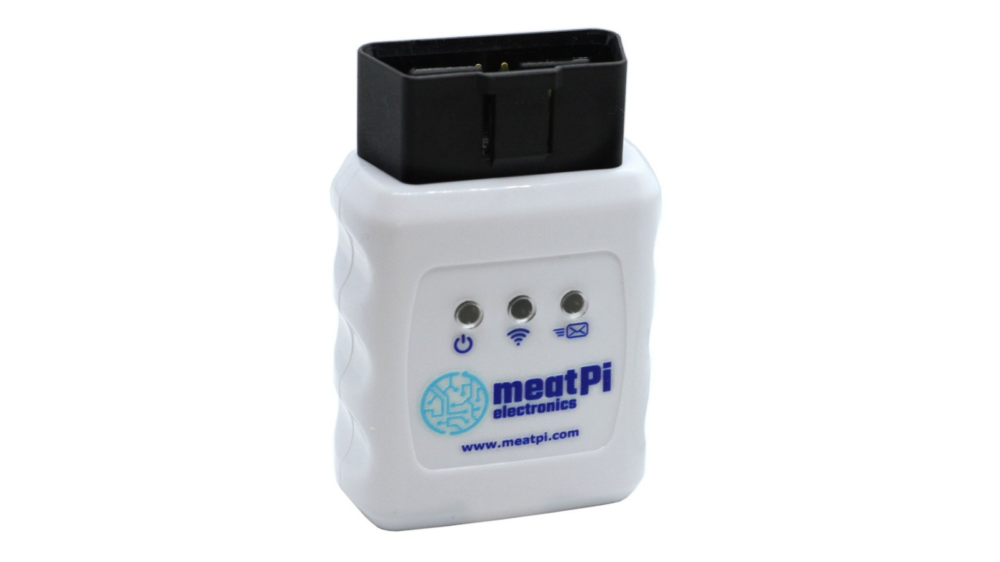
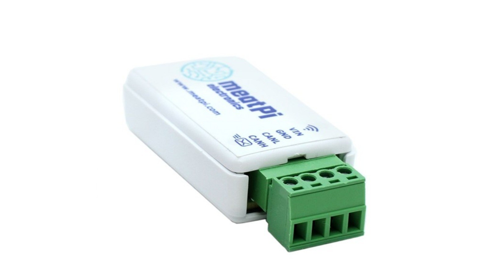

# MeatPi product manuals

Setup guides and reference for every MeatPi device, step by step, with pictures of what you will see. Pick your product.

-   [{ .product-photo .no-lightbox }](wican-pro/index.md)

    **WiCAN PRO**

    ---

    The OBD-II adapter with WiFi, Bluetooth LE and a USB port for accessories. Vehicle data for Home Assistant, MQTT and the apps you already use.

    [:octicons-arrow-right-24: Open the manual](wican-pro/index.md)

-   [{ .product-photo .no-lightbox }](wican-obd/index.md)

    **WiCAN OBD**

    ---

    The original WiCAN for the OBD-II port, with WiFi and Bluetooth: an ELM327 adapter for Car Scanner and RealDash, a CAN interface for SavvyCAN and SocketCAN, vehicle data for Home Assistant and MQTT.

    [:octicons-arrow-right-24: Open the manual](wican-obd/index.md)

-   [{ .product-photo .no-lightbox }](wican-usb/index.md)

    **WiCAN USB**

    ---

    The original WiCAN with screw terminals for any CAN bus, 7.5 V to 36 V, and a USB serial port: SocketCAN, SavvyCAN, BUSMASTER and RealDash over WiFi, Bluetooth or the cable.

    [:octicons-arrow-right-24: Open the manual](wican-usb/index.md)

-   [{ .product-photo .no-lightbox }](espnetlink/index.md)

    **ESPNetLink**

    ---

    The LTE and GPS dongle for WiCAN PRO: internet over Cat M1 or NB-IoT wherever the car is, and a GPS position, with nothing to set up. On a computer, a USB modem with a web interface, a WiFi access point and a console.

    [:octicons-arrow-right-24: Open the manual](espnetlink/index.md)

## Guides that span products

-   :material-car-info:{ .lg .middle } **Supported vehicles**

    ---

    The cars with a vehicle profile, by make, with what each profile reads. Generated from the profile sources every time one is merged.

    [:octicons-arrow-right-24: Supported vehicles](wican-pro/supported-vehicles.md)

-   :material-home-automation:{ .lg .middle } **Integrations**

    ---

    Home Assistant, MQTT brokers and the diagnostic apps: Car Scanner, RealDash, SavvyCAN, BUSMASTER and SocketCAN.

    [:octicons-arrow-right-24: Integrations](integrations/index.md)

-   :material-pencil-ruler:{ .lg .middle } **Contributing**

    ---

    How these manuals are written and built, and how to send a correction.

    [:octicons-arrow-right-24: Writing guide](contributing/writing-guide.md)

## Videos

Three walkthroughs of WiCAN PRO with Home Assistant, by people who use it, two in English and one in German. The manual's own steps are in [Quick Setup](wican-pro/getting-started/quick-setup.md) and [Home Assistant](wican-pro/send-data/home-assistant.md).

<figure class="video">

<iframe src="https://www.youtube.com/embed/nB30hqOT9yk?si=RJ_9A0bnlZWB30uW" title="Teach Your Vehicle to Talk to Home Assistant with WiCAN Pro!" loading="lazy" allow="accelerometer; autoplay; clipboard-write; encrypted-media; gyroscope; picture-in-picture; web-share" referrerpolicy="strict-origin-when-cross-origin" allowfullscreen></iframe>

<figcaption>Smarty Van: Teach Your Vehicle to Talk to Home Assistant with WiCAN Pro!</figcaption>
</figure>

<figure class="video">

<iframe src="https://www.youtube.com/embed/3JW3J4_Ukrs?si=FZ_jsP0GmlNBxHeJ" title="Connect Any Car to Home Assistant! Probably..." loading="lazy" allow="accelerometer; autoplay; clipboard-write; encrypted-media; gyroscope; picture-in-picture; web-share" referrerpolicy="strict-origin-when-cross-origin" allowfullscreen></iframe>

<figcaption>The Stock Pot: Connect Any Car to Home Assistant! Probably...</figcaption>
</figure>

<figure class="video">

<iframe src="https://www.youtube.com/embed/97avTCEZMZM" title="Nie wieder Cloud-Ärger! So holst du JEDES Auto lokal ins Smart Home" loading="lazy" allow="accelerometer; autoplay; clipboard-write; encrypted-media; gyroscope; picture-in-picture; web-share" referrerpolicy="strict-origin-when-cross-origin" allowfullscreen></iframe>

<figcaption>SmartHome yourself: Nie wieder Cloud-Ärger! So holst du JEDES Auto lokal ins Smart Home (in German)</figcaption>
</figure>

