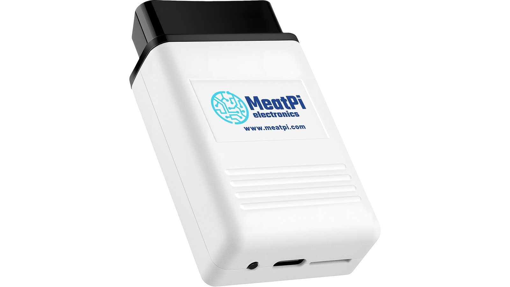
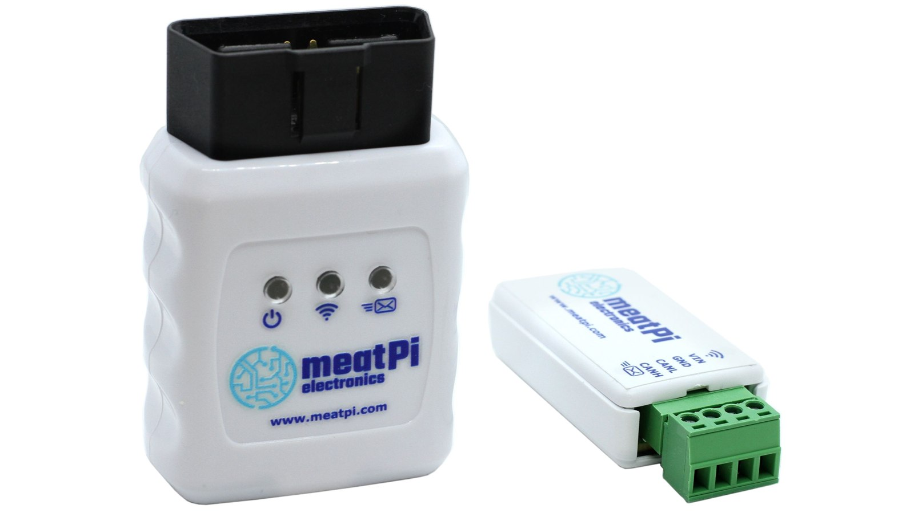
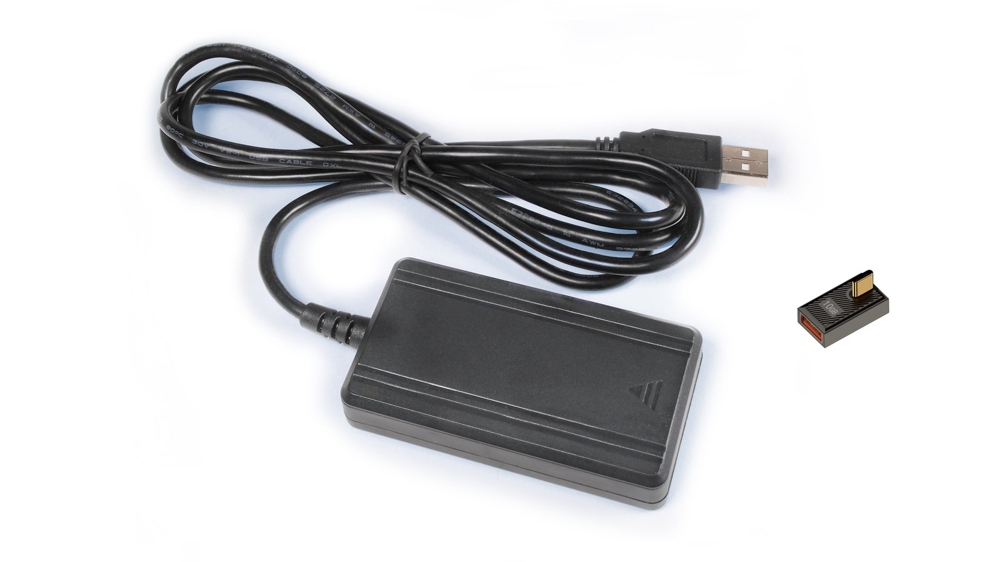

# MeatPi product manuals

Setup guides and reference for every MeatPi device, step by step, with pictures of what you will see. Pick your product.

-   { .product-photo .no-lightbox }

    **WiCAN PRO**

    ---

    The OBD-II adapter with WiFi, Bluetooth LE and a USB port for accessories. Vehicle data for Home Assistant, MQTT and the apps you already use.

    [:octicons-arrow-right-24: Open the manual](wican-pro/index.md)

-   { .product-photo .no-lightbox }

    **WiCAN OBD and WiCAN USB**

    ---

    The original WiCAN with WiFi and Bluetooth, in two versions: WiCAN OBD plugs into the OBD-II port, WiCAN USB has screw terminals for any CAN bus and a USB port.

    [:octicons-arrow-right-24: WiCAN OBD manual](wican-obd/index.md) 
    [:octicons-arrow-right-24: WiCAN USB manual](wican-usb/index.md)

-   { .product-photo .no-lightbox }

    **ESPNetLink**

    ---

    The cellular modem and GPS accessory that plugs into the WiCAN PRO USB port.

    [:octicons-arrow-right-24: Open the manual](espnetlink/index.md)

## Guides that span products

-   :material-home-automation:{ .lg .middle } **Integrations**

    ---

    Home Assistant, MQTT brokers and the diagnostic apps: Car Scanner, RealDash, SavvyCAN, BUSMASTER and SocketCAN.

    [:octicons-arrow-right-24: Integrations](integrations/index.md)

-   :material-pencil-ruler:{ .lg .middle } **Contributing**

    ---

    How these manuals are written and built, and how to send a correction.

    [:octicons-arrow-right-24: Writing guide](contributing/writing-guide.md)

