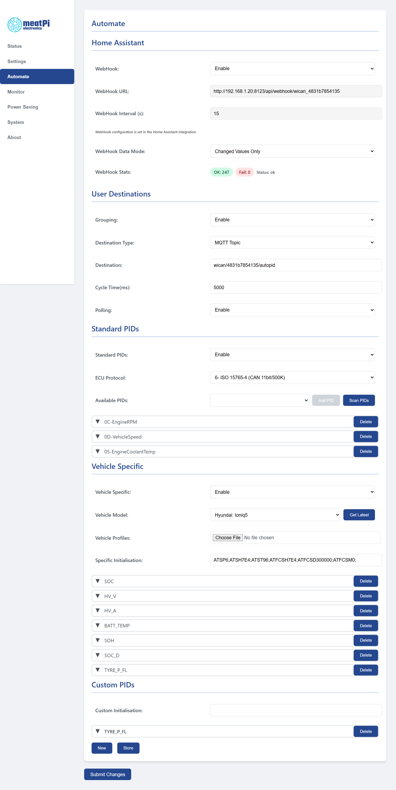
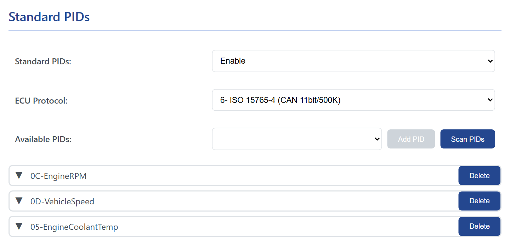
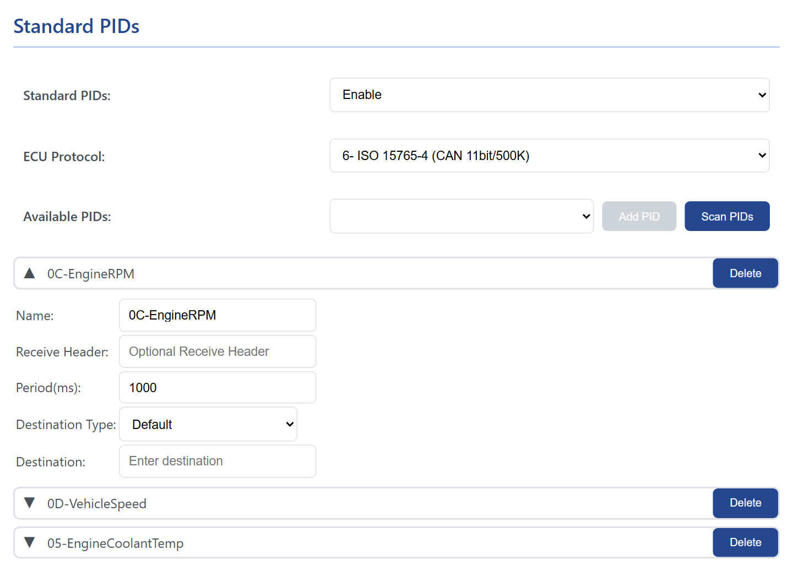
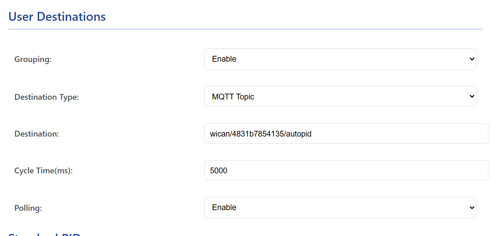

# AutoPID

AutoPID is the mode in which WiCAN reads the vehicle by itself: it asks the car for values on a schedule, decodes the answers into named parameters such as engine speed or battery state of charge, and hands them to Home Assistant, to MQTT and to anyone who asks over HTTP. The web interface calls the whole area <mark>Automate</mark>.

## Switching it on

1. Under ==Settings== › ==CAN==, set ==Protocol== to ==AutoPID== and press ==Submit Changes==. In this mode WiCAN talks to the car through its built-in ELM327 interpreter, so no app can use the bus at the same time.
2. Open ==Automate== and choose what to read: the standard OBD-II values, a vehicle profile for the make and model, or requests of your own. Press ==Store==.
3. Restart WiCAN (==System== › ==Reboot==, or ==Submit Changes== on the Settings tab). The tables take effect at the next start.

AutoPID needs the ignition on, or the engine running, to get answers. Polling, Home Assistant and MQTT need WiCAN on your network (==AP+Station==), the HTTP endpoint works on the access point as well.

<figure class="shot" markdown>
{ width="760" }
<figcaption>The Automate tab on a device set up for a car: standard PIDs, a vehicle profile and a custom PID.</figcaption>
</figure>

## The three tables

| Section | Rows | Where they come from |
| --- | --- | --- |
| ==Standard PIDs== | the OBD-II values every car must answer, as far as yours supports them: engine speed, vehicle speed, coolant temperature, fuel level, intake temperature and some 180 more | ==Scan PIDs== asks the car which ones it supports; you add the ones you want |
| ==Vehicle Specific== | the values only your make and model carry, such as battery state of charge, cell voltages or tyre pressures on an EV | a vehicle profile from the published list, see [Vehicle profiles](vehicle-profiles.md) |
| ==Custom PIDs== | requests you write yourself, with your own decoding | you, see [Custom PIDs and expressions](custom-pids.md) |

Every row has a period in milliseconds: how often that value is asked for. WiCAN works through the rows one after the other, so many rows with short periods slow each other down; a second per value is comfortable, five seconds is plenty for a home dashboard.

### Standard PIDs

<figure class="shot" markdown>
{ width="640" }
<figcaption>Three standard PIDs chosen after a scan.</figcaption>
</figure>

1. Set ==Standard PIDs== to ==Enable==.
2. Pick the ==ECU Protocol== of your car: `6` (CAN 11-bit ids, 500 kbit/s) fits almost every car; `7` is the 29-bit variant, `8` and `9` the 250 kbit/s variants. There is no automatic detection: if a scan finds nothing, try the next one.
3. With the ignition on, press ==Scan PIDs==. WiCAN asks the car which values it supports and fills ==Available PIDs== with them (the scan takes some seconds; on a car that answers everything, the list is long).
4. Pick a value from the list and press ==Add PID==. Each row opens on a click: ==Receive Header== (leave empty unless the answer comes from a module other than the engine), ==Period(ms)== (1000 or more), ==Destination Type== and ==Destination==, explained under [Where the values go](#where-the-values-go).
5. ==Store==, then restart.

<figure class="shot" markdown>
{ width="640" }
<figcaption>A standard PID row. The name is fixed; the period and the destination are yours.</figcaption>
</figure>

The names are the PID number and a short description, `0C-EngineRPM` or `05-EngineCoolantTemp`, and that is how the values are called everywhere else: in Home Assistant, on MQTT and in the HTTP answer.

## The settings at the top

<figure class="shot" markdown>
{ width="640" }
<figcaption>User Destinations: the grouped snapshot goes to one MQTT topic every 5 seconds.</figcaption>
</figure>

| Setting | What it does |
| --- | --- |
| ==WebHook== and the Home Assistant card | The push to Home Assistant, set up from the Home Assistant side, see [Home Assistant](../send-data/home-assistant.md). |
| ==Grouping== | ==Enable== publishes all values together as one JSON object, every ==Cycle Time(ms)==. ==Disable== leaves only the per-row destinations and the HTTP endpoint. |
| ==Destination Type== | With grouping: ==MQTT Topic== publishes the snapshot to the ==Destination== topic; ==Default== publishes nothing on a cycle, the snapshot is only served over HTTP and to Home Assistant. |
| ==Destination== | The MQTT topic for the grouped snapshot. Empty means the MQTT RX topic of the device. |
| ==Cycle Time(ms)== | How often the snapshot is published, 1000 or more. |
| ==Polling== | ==Enable== reads the car continuously. ==Disable== reads it only when someone asks: an HTTP request to `/autopid_data`, or the MQTT command `get_autopid_data`, triggers one round of requests. |

## Where the values go

| Destination | What arrives | When |
| --- | --- | --- |
| `http://<wican>/autopid_data` | all values as one flat JSON object: `{"0C-EngineRPM":716,"0D-VehicleSpeed":173,"05-EngineCoolantTemp":21}` | whenever asked; with Polling disabled the request itself triggers a round |
| The MQTT ==Destination== topic | the same object, with ==Grouping== enabled and ==Destination Type== ==MQTT Topic== | every ==Cycle Time== |
| A row's own topic | a row with ==Destination Type== ==MQTT_Topic== publishes `{"name": value}` to its ==Destination== every time it is read; ==MQTT_WallBox== publishes the bare number with two decimals, the format wallbox chargers expect; ==Default== publishes nothing by itself | every period of that row |
| Home Assistant | the values, their units and classes, and the device status | every webhook interval |
| `http://<wican>/load_car_config` | the names with their class and unit, for a program that wants to label the values | whenever asked |

The values are rounded to two decimals. A value outside the row's ==Min Value== and ==Max Value== is dropped.

## Good to know

- **The ECU status.** WiCAN counts the car as online while at least one row gets answers, and as offline once every row fails; the status is published to Home Assistant and shown in the `ecu_status` field of the status endpoint.
- **Ignition off.** Rows time out and the values stop changing. WiCAN keeps asking; on some cars, polling a parked car can keep a module awake or set off the alarm. Sleep mode stops polling with everything else, see [Sleep and battery alert](../power/sleep-and-wake.md).
- **One protocol at a time.** With AutoPID chosen, port 3333 is not served: Car Scanner and the other apps need the protocol switched back.
- **Where it is stored.** The Automate tab is kept in its own file on the device and is part of the configuration download, see [Backup and restore](../firmware/backup-and-restore.md).

## Troubleshooting

| Symptom | Likely cause | What to do |
| --- | --- | --- |
| `Set protocol to AutoPid and reboot to be able to scan` | the protocol is not AutoPID yet | ==Settings== › ==CAN== › ==Protocol== ==AutoPID==, Submit Changes |
| The scan finds nothing | ignition off, or the wrong ECU protocol | ignition on; try protocol 7, then 8 and 9 |
| `/autopid_data` says `No data available` | no rows yet, or no answers yet | add rows, Store, restart; ignition on |
| Values never change | the car stopped answering (ignition off), or the period is long | check the ignition; the period of the row |
| Nothing on MQTT | MQTT is not enabled or not connected, or grouping is off and the rows have the Default type | [MQTT](../send-data/mqtt.md); enable Grouping with MQTT Topic, or set a row's type |
| Nothing in Home Assistant | the webhook is off, WiCAN is not on the network, or the protocol is not AutoPID | [Home Assistant](../send-data/home-assistant.md) |
