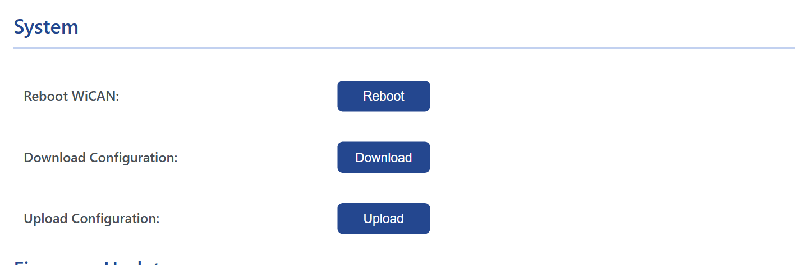

# Backup and restore

Every setting of the device in one JSON file: download it before a firmware update or an experiment, keep it as a record, move it to a replacement device. The file carries the WiFi, access point and MQTT passwords in clear, so keep it private.

<figure class="shot" markdown>
{ width="640" }
<figcaption>System: reboot, download and upload.</figcaption>
</figure>

## Back up

==System== › ==Download Configuration== saves `config_<date>.json` with up to four parts:

| Part | What it holds |
| --- | --- |
| `config` | The Settings and Power Saving tabs: WiFi, access point, CAN, protocol, Bluetooth, MQTT, sleep, battery alert |
| `auto_pid` | The Automate tab: grouping, destinations, the standard PIDs and custom PIDs |
| `auto_pid_car_data` | The vehicle profile loaded under Vehicle Specific |
| `canflt` | The MQTT CAN Filter table |

A part the device does not have (no profile loaded, no filter rules) is left out. The Home Assistant webhook registration is not in the file; the integration registers again on its own.

## Restore

==System== › ==Upload Configuration==, pick the file. The page sends each part to the device and the device restarts: `Configuration uploaded successfully, Rebooting...`. Afterwards WiCAN is on the WiFi of the backup with the access point password of the backup: look for it there.

!!! note "A refused configuration is replaced by the factory settings"
    When WiCAN starts, it checks the configuration file: a WiFi or access point password shorter than 8 characters, an empty SSID, an empty MQTT topic, and a few more, make it throw the whole file away and start with the factory settings. A backup edited by hand should stay within the limits the web interface enforces.

**To another WiCAN.** The same file restores onto another device of the same kind. The MQTT topics in it contain the device id of the old one (`wican/<device id>/can/tx` and so on): edit them to the new id, or to names of your own, before uploading, or the two devices will talk on the same topics. The access point name is not in the file; it always follows the device id.

## By hand

The four parts are what four endpoints answer: `/load_config`, `/load_auto_pid`, `/load_auto_pid_car_data` and `/load_canflt`, and their `store` counterparts take them back. [HTTP endpoints](../reference/http-endpoints.md) has them, with the shape of each document.
