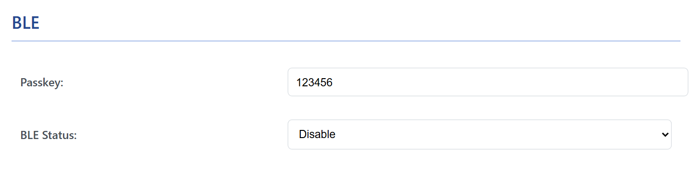
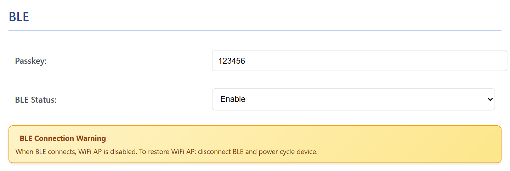

# Bluetooth LE

Bluetooth Low Energy is the way a phone talks to WiCAN without any WiFi: Car Scanner or another ELM327 app, RealDash, or a CAN app of your own. It is off until you turn it on, and it has one rule to remember: while a phone is connected over Bluetooth, the WiFi access point is off.

## Turning it on

<figure class="shot" markdown>
{ width="640" }
<figcaption>Settings, BLE. Off on a new device.</figcaption>
</figure>

1. Set ==Mode== under ==AP Config== to ==AP==. Bluetooth is not available in AP+Station mode: the page greys the switch out.
2. Under ==BLE==, set ==BLE Status== to ==Enable== and, if you like, change the ==Passkey==: six digits, the first one not zero. The factory passkey is `123456`.
3. Press ==Submit Changes==. WiCAN restarts and advertises as `WiC_<device id>`, the same twelve characters as in the access point name.

<figure class="shot" markdown>
{ width="640" }
<figcaption>Choosing Enable shows the warning: when a phone connects over Bluetooth, the WiFi access point is switched off.</figcaption>
</figure>

Enabling Bluetooth switches MQTT and the battery alert off: the page hides their cards, and the firmware treats MQTT as disabled while Bluetooth is enabled.

## Pairing a phone

- Pick `WiC_<device id>` in the app (Car Scanner, RealDash) as a Bluetooth LE adapter. The phone asks for the passkey the first time; type the six digits.
- The pairing is remembered (bonded): the phone reconnects without the passkey afterwards.
- One phone at a time.

!!! warning "The access point goes away while the phone is connected"
    As soon as a phone is connected over Bluetooth, WiCAN switches its WiFi off, access point included, so the web interface is out of reach. When the phone disconnects the access point does not come back by itself: disconnect the phone and power cycle WiCAN (unplug it) to get the web interface back. The other way round, a phone that joins the access point pauses Bluetooth until it leaves.

## What an app can do over Bluetooth

The ==Protocol== under ==Settings== › ==CAN== applies to Bluetooth as it does to WiFi:

| Protocol | Over Bluetooth |
| --- | --- |
| ==elm327== | Car Scanner, Torque and other ELM327 apps, and RealDash's OBD2 adapter mode. The ECU protocol must be picked by hand in the app, see [Apps over WiFi and BLE](../send-data/apps.md). |
| ==realdash66== | RealDash as a CAN device (Android and iOS; RealDash on Windows uses WiFi only). |
| ==slcan== | slcan text frames, for an app of your own. |
| ==savvyCAN== | GVRET frames, for an app of your own. |
| ==AutoPID== | Not served over Bluetooth: AutoPID needs WiFi for Home Assistant and MQTT anyway. |

For your own app: one service, `FEE0`, with a characteristic `FEE1` that notifies the data WiCAN sends and a characteristic `FEE3` to write to. Both require the encrypted, authenticated link the passkey sets up. Notifications carry up to 20 bytes unless the app negotiates a larger MTU, which Car Scanner on Android, for example, does not.

## Troubleshooting

| Symptom | Likely cause | What to do |
| --- | --- | --- |
| The phone does not see `WiC_...` | Bluetooth is off, Mode is AP+Station, another phone is already connected, or a phone is on the WiCAN access point | check ==BLE Status== and ==Mode==; disconnect the other phone; leave the access point |
| Pairing fails | a wrong passkey, or the phone remembers an old pairing from before a firmware update or a reflash | type the passkey from the BLE card; remove WiCAN from the phone's Bluetooth list and pair again |
| The web interface is gone since the phone connected | expected: the access point is off while a phone is connected | disconnect the phone and power cycle WiCAN |
| The app connects but gets no data | the protocol does not match the app, or the ignition is off | ==elm327== for OBD apps, ==realdash66== for RealDash CAN; ignition on |
| Slow or stuttering data | Bluetooth LE carries less than WiFi, and the default 20-byte packets cost round trips | use WiFi for CAN traffic; keep Bluetooth for OBD apps |
