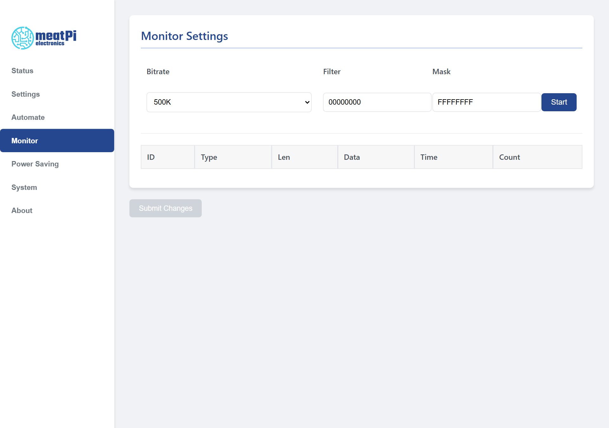

# CAN Monitor

The <mark>Monitor</mark> tab shows the frames on the bus as they arrive, one line per CAN id with the latest data, the time since the previous frame with that id and a count. It is the quickest way to see whether a bus is alive and at which speed, without any tool on the computer.

<figure class="shot" markdown>
{ width="760" }
<figcaption>The Monitor tab before Start. The table fills with one row per CAN id.</figcaption>
</figure>

## Using it

1. Choose the ==Bitrate== of the bus. 500K for a car's OBD port, 250K for most trucks; pick another if nothing shows and the data LED stays dark.
2. Press ==Start==. The page warns that WiCAN should be restarted after the monitor; confirm. The browser opens a WebSocket to the device and the table starts filling.
3. Read the table: ==ID== in hexadecimal, ==Type== `Std` for 11-bit ids, `Ext` for 29-bit ids, `RTR-Std` and `RTR-Ext` for remote frames, ==Len== the number of data bytes, ==Data== the bytes, ==Time== the milliseconds since the previous frame with this id, ==Count== how many frames with this id arrived. New ids are added at the top.
4. Press ==Stop== when done, then restart WiCAN from ==System== › ==Reboot==.

!!! warning "Restart after using the monitor"
    The monitor opens the CAN controller at the bit rate you chose, over the head of the protocol configured on the Settings tab. Until the restart the protocol may not work as expected; the page says so when you press Start.

## What it does not do

- The ==Filter== and ==Mask== fields are not applied by this firmware: every frame on the bus is shown. To watch a single id, read its row; the table keeps one row per id.
- The monitor shows what the bus carries by itself. It sends no requests, so an OBD-II car at rest shows little or nothing: the engine's answers only appear while an app or AutoPID is asking.
- It listens on WiCAN's own CAN controller. With the bus in ==Silent== mode (Settings, CAN) WiCAN never acknowledges frames; on a bus with only one other node that node will keep retransmitting, which the count column makes obvious.

For a proper capture, with filtering, logging and decoding, connect SavvyCAN or SocketCAN instead, see [Apps over WiFi and BLE](../send-data/apps.md).
