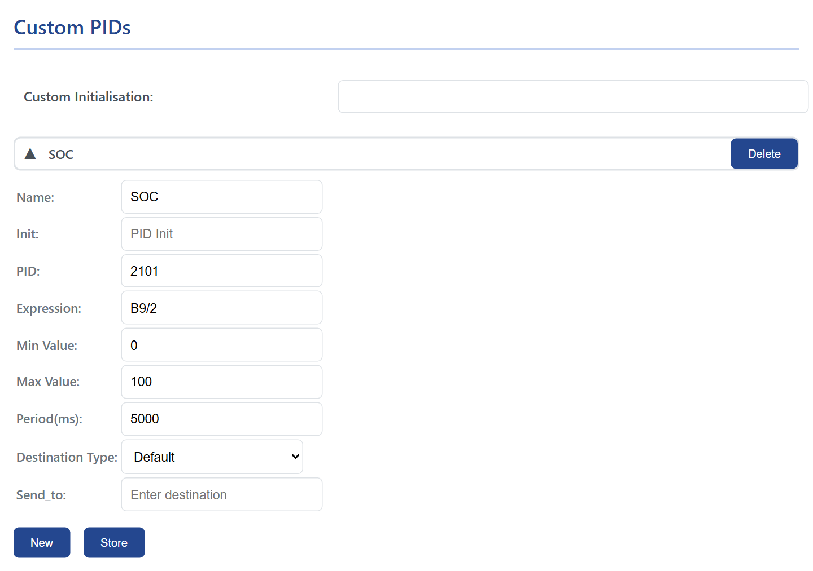

# Custom PIDs and expressions

A custom PID is a request you write yourself: which bytes to send, how to turn the answer into a number, and where the number goes. It is how you read a value no profile covers, test a request before it goes into a profile, or send one value to its own MQTT topic.

## Add a custom PID

<figure class="shot" markdown>
{ width="640" }
<figcaption>A custom PID row. New adds a row, Store writes the table to the device.</figcaption>
</figure>

On ==Automate==, under ==Custom PIDs==, press ==New== and click the new row to open it:

| Field | What it is |
| --- | --- |
| ==Name== | The name of the value, up to 31 characters. It becomes the key in the JSON, the MQTT payload and the Home Assistant entity. |
| ==Init== | AT commands sent before this request, separated by `;`, for example `ATSH7E4;` to address the battery module. ==Custom Initialisation== above the rows is sent once before the whole table. |
| ==PID== | The request, in hexadecimal, up to 9 characters: `010C` for engine speed, `221E3B` for a manufacturer value. An odd trailing digit tells WiCAN how many answer frames to wait for, as on an ELM327. |
| ==Expression== | How the answer becomes a number, below. |
| ==Min Value==, ==Max Value== | Answers outside these limits are dropped. |
| ==Period(ms)== | How often the request is sent, 100 ms or more. |
| ==Destination Type==, ==Send_to== | ==Default==: the value is only part of the snapshot (HTTP, the grouped MQTT topic, Home Assistant). ==MQTT_Topic==: every reading is also published as `{"Name": value}` to the ==Send_to== topic. ==MQTT_WallBox==: every reading is published to ==Send_to== as a bare number with two decimals, `173.00`. |

Press ==Store== and restart WiCAN. ==Delete== removes a row.

## Expressions

An expression is arithmetic over the bytes of the answer. The bytes are counted from the first byte after the CAN id, including the length byte the module puts first, so for the answer `7E8 04 41 0C 1A F8` to the request `010C`:

| Byte | `B0` | `B1` | `B2` | `B3` | `B4` |
| --- | --- | --- | --- | --- | --- |
| Value | `04` (length) | `41` (service) | `0C` (the PID) | `1A` | `F8` |

Engine speed is the two data bytes divided by four: `[B3:B4]/4`, which gives 1726 rpm here. For an answer that spans several frames, the frames are joined in order, with the sequence byte that starts each frame counted like any other, which is why profiles for EV batteries index bytes well into the thirties.

| Write | For |
| --- | --- |
| `B0`, `B1`, ... | a byte, unsigned (0 to 255) |
| `S0`, `S1`, ... | a byte, signed (-128 to 127) |
| `[B3:B4]` | several consecutive bytes as one big-endian number, up to 8 bytes; `[S3:S4]` the signed version |
| `B5:3` | bit 3 of byte 5 (0 or 1) |
| `+ - * /` | arithmetic, with decimals |
| `& | ^ << >>` | bitwise and, or, exclusive or, shifts |
| `( )` | grouping |

Common patterns, with the request they belong to:

| Value | Request | Expression |
| --- | --- | --- |
| Engine speed, rpm | `010C` | `[B3:B4]/4` |
| Vehicle speed, km/h | `010D` | `B3` |
| Coolant temperature, degrees C | `0105` | `B3-40` |
| Fuel level, percent | `012F` | `B3*100/255` |
| A 16-bit value in tenths | | `[B9:B10]/10` |
| A signed temperature | | `S16` |
| A flag | | `B14:7` |

!!! tip "Test a request before trusting it"
    The quickest check is to ask the car the same request from an ELM327 app and compare: Car Scanner's log shows every request and answer, byte by byte. The values WiCAN decodes appear at `/autopid_data` after the restart.

## The standard PIDs are decoded for you

The ==Standard PIDs== section knows the formulas of the OBD-II standard, so for engine speed, speed, temperatures, fuel and the other standard values you need no expression: [AutoPID](autopid.md). Custom PIDs are for everything else, and for a standard value that your car answers only from another module.
