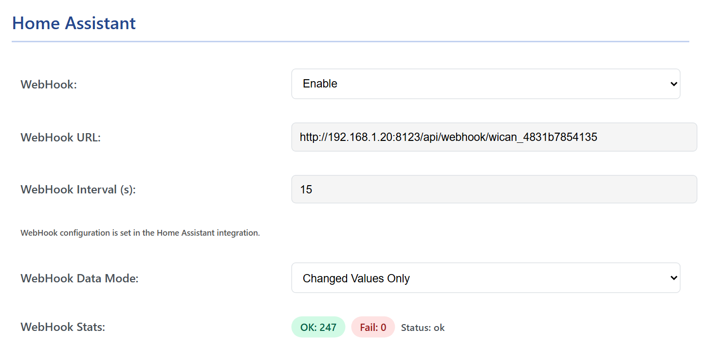

# Home Assistant

WiCAN pushes its vehicle data straight into Home Assistant: one entity per parameter, plus the device status. No MQTT broker is needed. The WiCAN integration finds the device on your network and registers its webhook on it; from then on WiCAN sends.

## How it works

1. The WiCAN integration in Home Assistant discovers the device on the local network (WiCAN announces itself as `_wican._tcp` over mDNS), or you give it the address.
2. The integration registers its webhook address and the push interval on the device. The device remembers them across restarts.
3. On every interval WiCAN posts the parameter values, their units and classes, and its own status to that address. Home Assistant creates and updates the entities from that.

Because WiCAN sends, Home Assistant never has to poll a device that may be asleep in a parked car.

## Before you start

- WiCAN on the same network as Home Assistant in ==AP+Station== mode, see [First setup](../getting-started/first-setup.md).
- ==Protocol== set to ==AutoPID== and at least one row stored on the Automate tab, see [AutoPID](../vehicle-data/autopid.md). The webhook only sends in AutoPID mode.
- ==WebHook== on the Automate tab left at ==Enable== (the factory setting).
- HACS installed in Home Assistant.

## Install the integration

1.  **Add the WiCAN integration in HACS**

    Open HACS, search for ==WiCAN== and download it. If your HACS does not list it, add the custom repository `https://github.com/jay-oswald/ha-wican` of type ==Integration== first. Use release 1.0.0 or later: firmware 4.21 is the first with the webhook, and earlier integration releases polled the device instead.

2.  **Restart Home Assistant**

3.  **Add the device**

    Go to ==Settings== › ==Devices & services==. A discovered WiCAN shows up at the top: press ==Configure==. Otherwise ==Add integration==, search for ==WiCAN==, and enter the device's address: `wican_<device id>.local` or its IP address. Repeat for every WiCAN you own.

4.  **Set the push interval**

    On the integration's card, ==Configure== sets how often WiCAN pushes. The device uses 60 seconds when the integration gives it none.

## What the device shows

<figure class="shot" markdown>
{ width="640" }
<figcaption>The Home Assistant card once the integration has registered: the address it gave, the interval, and how the pushes go.</figcaption>
</figure>

| Field | Meaning |
| --- | --- |
| ==WebHook== | The master switch on the device. ==Disable== stops the pushes without forgetting the registration. |
| ==WebHook URL==, ==WebHook Interval (s)== | What the integration registered. They are set from Home Assistant, not here; `Not configured` means no integration has registered yet. |
| ==WebHook Data Mode== | ==Full Data== sends every value on every push. ==Changed Values Only== sends what changed since the last push, which keeps the traffic small on a car that is parked. |
| ==WebHook Stats== | ==OK== and ==Fail== count the pushes since the last start, ==Status== says how the last one went, and the last error, with ==Details==, says why a push failed. |

## What you get

| Entities | Source |
| --- | --- |
| One sensor per AutoPID parameter, with the unit and the class from the Automate tab | the vehicle data |
| Diagnostic sensors for the device: its status, the ECU connection, the battery voltage | the device status |

Entities keep their last values while the car is away or asleep.

## Changing things later

- **Units, names and classes** come from WiCAN: change them on the Automate tab (the standard PIDs have fixed ones), not in Home Assistant.
- **After changing the tables** (new parameters, another profile), reload the integration so it picks up the new entities. Entities for parameters that no longer exist stay until you delete them.
- **Over MQTT instead.** WiCAN can also publish to Home Assistant's MQTT broker, with the sensors defined by hand in Home Assistant: see [MQTT](mqtt.md). The webhook is the simpler way.

## Troubleshooting

| Symptom | Likely cause | What to do |
| --- | --- | --- |
| The device is not discovered | WiCAN is not on the network, or mDNS does not cross your network | ==AP+Station== and the Status tab's ==WiFi Station== `Connected`; add it by its address |
| The card says `Not configured` | no integration has registered yet | add the device in Home Assistant |
| ==Fail== climbs, last error `STA not connected - waiting for WiFi` | WiCAN lost your network | the WiFi settings; the router |
| Last error `https not supported: use http://` | the registered address starts with `https://` | the device posts over plain HTTP only; give the integration the `http://` address of Home Assistant |
| Last error `http=404` or `http=5xx` | Home Assistant answered the post with an error | reload the integration; remove and add the device so it registers afresh |
| Pushes are OK but the entities are empty | no rows on the Automate tab, or the ignition is off | [AutoPID](../vehicle-data/autopid.md) |
| Nothing at all, Status `-` | the protocol is not AutoPID | ==Settings== › ==CAN== › ==Protocol== |

The device side of the contract, the `/api/webhook` endpoint and the payload, is on the [HTTP endpoints](../reference/http-endpoints.md#the-home-assistant-webhook) page.
