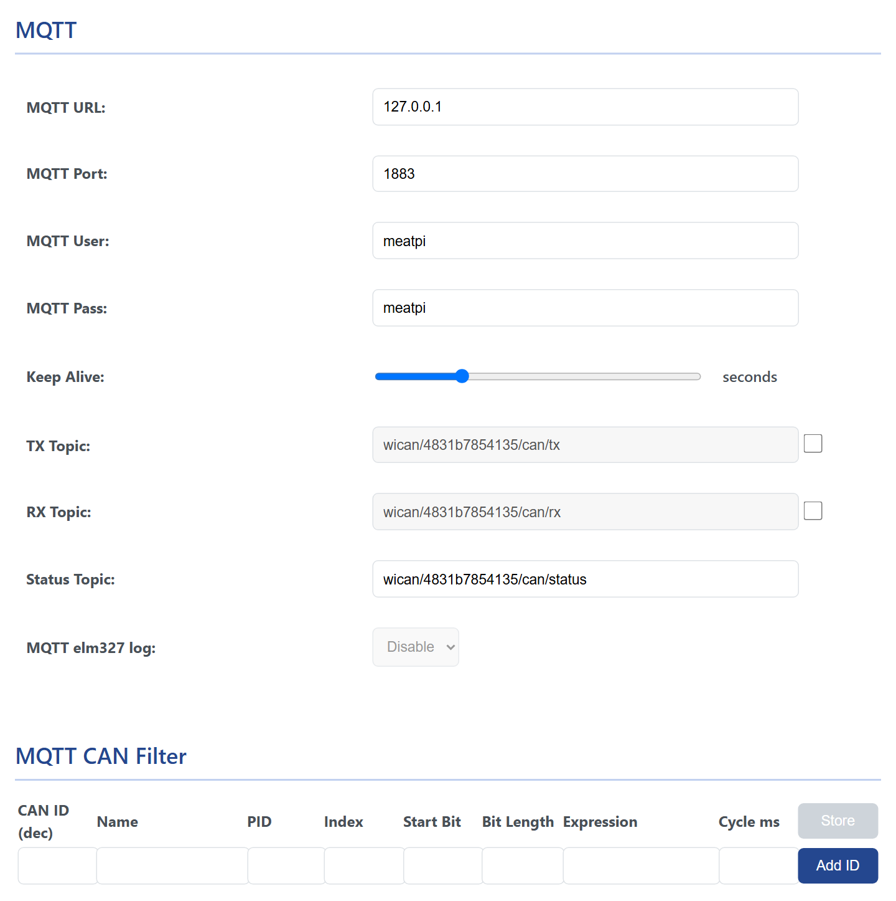
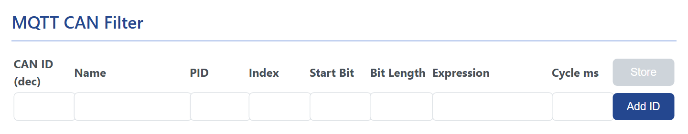

# MQTT

<p class="lead">WiCAN keeps one connection to an MQTT broker on your network and uses it for three things: raw CAN frames in both directions, the AutoPID values, and a small command channel. Home Assistant does not need it (it uses the webhook), but Node-RED, Grafana, openHAB and your own scripts do.</p>

## Set it up

<figure class="shot" markdown>
{ width="640" }
<figcaption>The MQTT card, shown under BLE once MQTT is set to Enable on the CAN card.</figcaption>
</figure>

1. Put WiCAN on your network: ==AP+Station== mode, see [WiFi](../connectivity/wifi.md). The MQTT client only starts once the station is connected.
2. Under ==Settings== › ==CAN==, set ==MQTT== to ==Enable==. The ==MQTT== card appears below the BLE card.
3. Fill in the broker and press ==Submit Changes==.

<dl class="facts" markdown>
<dt>MQTT URL</dt><dd>The broker's address or host name, without a scheme: `192.168.1.20` or `homeassistant.local`. WiCAN speaks plain MQTT only, no TLS, so use a broker on your own network, never a public one.</dd>
<dt>MQTT Port</dt><dd>1883 unless your broker listens elsewhere.</dd>
<dt>MQTT User, MQTT Pass</dt><dd>The login the broker expects. A broker that allows anonymous clients ignores them.</dd>
<dt>Keep Alive</dt><dd>2 to 120 seconds, 30 from the factory: how quickly the broker notices that WiCAN is gone.</dd>
<dt>TX Topic</dt><dd>`wican/<device id>/can/tx`: frames published here by anyone are sent onto the bus. The checkbox switches this on; off, WiCAN does not subscribe.</dd>
<dt>RX Topic</dt><dd>`wican/<device id>/can/rx`: the frames WiCAN hears on the bus, in batches. The checkbox switches the raw frames on; the AutoPID values use this topic too when no other destination is set.</dd>
<dt>Status Topic</dt><dd>`wican/<device id>/can/status`: `{"status": "online"}` when WiCAN connects, retained, and `{"status": "offline"}` from the broker when it drops off (the last will).</dd>
<dt>MQTT elm327 log</dt><dd>Only with ==Protocol== ==elm327==: the frames the ELM327 interpreter sends and receives for an app are copied to `wican/<device id>/elm327`, for watching what an app asks the car. Raw frames are not published while it is on.</dd>
</dl>

The topics can be renamed, 1 to 32 characters each. The device id in them lets several WiCANs share one broker.

!!! note "MQTT and Bluetooth do not mix"
    Enabling Bluetooth LE switches MQTT off: the page hides the card and the firmware does not start the client. MQTT also needs AP+Station mode, in which Bluetooth is not available, so the two never run together.

## What WiCAN publishes

The topics on the bench device, as seen with `mosquitto_sub -v` on the broker, with AutoPID reading three standard PIDs and two custom PIDs:

```text
wican/4831b7854135/can/status {"status": "online"}
wican/4831b7854135/rpm {"RPM_custom":716}
wican/4831b7854135/speed 173.00
wican/4831b7854135/autopid {"RPM_custom":716,"Speed_wallbox":173,"0C-EngineRPM":716,"0D-VehicleSpeed":173,"05-EngineCoolantTemp":21}
```

| Topic | Payload | When |
| --- | --- | --- |
| `<status topic>` | `{"status": "online"}`, retained; `{"status": "offline"}` from the broker when the connection is lost | on connect; on loss |
| `<rx topic>` | batches of raw frames, `{"bus":"0","type":"rx","ts":34610,"frame":[{"id":2024,"dlc":8,"rtr":false,"extd":false,"data":[4,65,12,26,248,170,170,170]}]}` | with the RX checkbox on, as frames arrive |
| the AutoPID ==Destination== | the grouped snapshot, retained | every cycle, see [AutoPID](../vehicle-data/autopid.md) |
| a row's ==Send_to== | `{"name": value}` for the MQTT_Topic type, or the bare number for MQTT_WallBox, retained | every reading of that row |
| `<rx topic>` with a CAN filter | `{"EngineSpeed": 1165.000000}`, one message per filter rule | every rule's cycle, see below |
| `wican/<device id>/elm327` | frames of type `tx` and `rx` as above | with the elm327 log on |
| `wican/<device id>/cmd` | the answer to a command, next to the command itself | after a command |

The command topic takes a JSON object `{"cmd": "..."}` and answers on the same topic:

| Command | Does | Answer |
| --- | --- | --- |
| `reboot` | restarts WiCAN | `{"rsp": "ok"}` |
| `get_vbatt` | reads the battery voltage | `{"battery_voltage": 11.599999}` |
| `get_autopid_data` | asks for one AutoPID round when Polling is disabled | the values on their usual topics |

## Sending frames onto the bus

With the TX checkbox on, publish a frame to the TX topic and WiCAN transmits it:

```json
{"bus": "0", "type": "tx", "frame": [{"id": 2015, "dlc": 8, "rtr": false, "extd": false, "data": [2, 1, 70, 170, 170, 170, 170, 170]}]}
```

`id` is decimal (2015 is `0x7DF`, the OBD-II broadcast address; `0x18DB33F1` for 29-bit cars), `extd` true for a 29-bit id, `data` the bytes. The example asks for ambient air temperature (service `01`, PID `46`); the car's answer arrives on the RX topic. A frame published this way goes out whatever the protocol setting, as long as MQTT is connected.

## The MQTT CAN Filter: frames into values

<figure class="shot" markdown>
{ width="640" }
<figcaption>The CAN filter table under the MQTT card. Each row turns one field of one frame into a named value.</figcaption>
</figure>

Instead of publishing every raw frame, WiCAN can pick a field out of a frame, compute a value and publish it on its own schedule. As soon as one filter rule exists, raw frames are no longer published: only the values of the rules are.

| Column | What to enter |
| --- | --- |
| ==CAN ID (dec)== | The id of the frame, in decimal: `2024` for the engine's OBD answers (`0x7E8`). |
| ==Name== | The key of the value in the JSON, up to 16 characters. |
| ==PID== | For an OBD answer, the PID the frame answers (`12` for engine speed, `0x0C`); `-1` for a frame that is not an OBD answer. |
| ==Index== | Which byte of the frame holds the PID, `2` for standard OBD answers. |
| ==Start Bit==, ==Bit Length== | Where the field is, counting bits from the start of the 8 data bytes: byte 3 starts at bit 24. |
| ==Expression== | Arithmetic over `V`, the extracted field: `V*0.25` for engine speed. |
| ==Cycle ms== | How often the value is published, 100 to 10000 ms. |

==Add ID== adds the row, ==Store== writes the table (`CAN filter saved! Filter will take effect after submit.`), and ==Submit Changes== restarts WiCAN with it. Up to 100 rules.

Two worked examples, from the frames an engine sends in answer to the standard requests:

| | CAN ID | PID | Index | Start Bit | Bit Length | Expression |
| --- | --- | --- | --- | --- | --- | --- |
| Engine speed from `7E8 04 41 0C 12 34 ...` | 2024 | 12 | 2 | 24 | 16 | `V*0.25` |
| Vehicle speed from `7E8 03 41 0D 17 ...` | 2024 | 13 | 2 | 24 | 8 | `V` |

A frame that is not an OBD answer, say id `356` with the value in bytes 2 and 3: PID `-1`, Start Bit 16, Bit Length 16, and an expression such as `(V+10)/2.5`. The published value is `{"Name": value}` on the RX topic.

## Troubleshooting

| Symptom | Likely cause | What to do |
| --- | --- | --- |
| Nothing on the status topic | WiCAN is not on the network, Bluetooth is enabled, the broker address or port is wrong, or the broker refuses the login | the Status tab's ==WiFi Station==; ==BLE Status== Disable; the broker's log |
| `online` arrives, no frames | the RX checkbox is off, a filter rule exists, or the bus is quiet | the checkbox; the filter table; the ignition |
| `online` arrives, no AutoPID values | grouping off and rows of the Default type, or the protocol is not AutoPID | [AutoPID](../vehicle-data/autopid.md) |
| Frames published to the TX topic do nothing | the TX checkbox is off, or the JSON is not in the shape above | the checkbox; `id` and `data` as numbers, `rtr` and `extd` as booleans |
| The broker drops WiCAN every minute | keep alive too short for a weak WiFi link | a longer ==Keep Alive== |
| `Data length exceeds the data size` arrives | a message larger than WiCAN's buffer was requested | fewer rows per message: a shorter cycle, or fewer frames |
