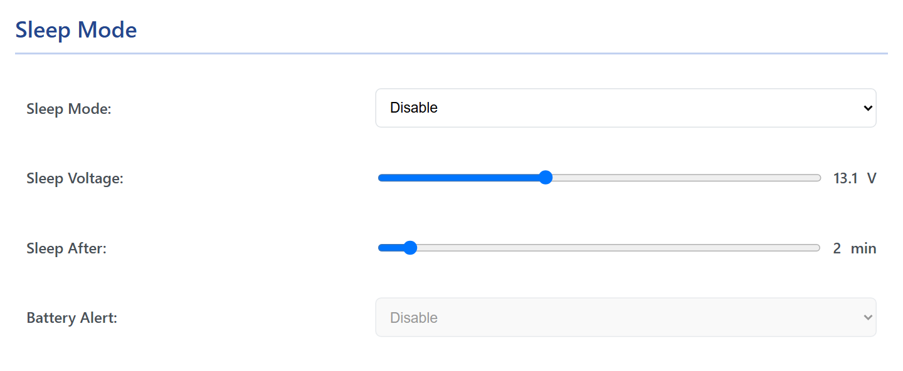
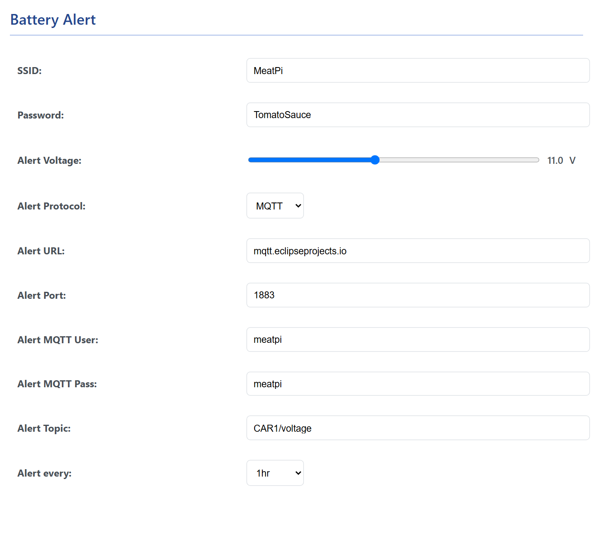

# Sleep and battery alert

<!-- --8<-- [start:main] -->
<p class="lead">WiCAN stays powered when the vehicle is parked, so it has to know when to stop drawing current. It reads the battery voltage: high while the engine charges, lower when the car rests. Below a voltage you choose, for a few minutes, it goes to sleep; when the voltage comes back it wakes and starts afresh. The same voltage can raise an alert over MQTT when the battery runs down. All of it is on the <mark>Power Saving</mark> tab.</p>

<figure class="shot" markdown>
{ width="640" }
<figcaption>Power Saving. Sleep mode is off from the factory; the sliders set the voltage and the delay.</figcaption>
</figure>

## How it decides

| Rule | What happens |
| --- | --- |
| **Sleep** | The voltage stays below the ==Sleep Voltage== for ==Sleep After== minutes: WiCAN switches the CAN controller, WiFi and Bluetooth off and sleeps. Factory values 13.1 V and 2 minutes. |
| **Wake** | Asleep, WiCAN measures the voltage every 2 seconds. Above the sleep voltage it restarts, like a fresh power-on. |

Asleep, WiCAN draws under 1 mA. It wakes by itself when the engine runs, because the alternator or the charger lifts the battery above the sleep voltage.

| Setting | Range | Factory |
| --- | --- | --- |
| ==Sleep Mode== | Enable, Disable | Disable |
| ==Sleep Voltage== | 12.0 to 15.0 V | 13.1 V |
| ==Sleep After== | 1 to 30 min | 2 min |

Typical numbers: a healthy 12 V battery rests at 12.4 to 12.8 V and charges at 13.8 to 14.8 V, so the factory 13.1 V sits between the two. Cars with a smart alternator sometimes charge lower than that for a while; if WiCAN falls asleep while driving, lower the sleep voltage towards 12.9 V. The ==Battery Voltage== on the Status tab is the reading sleep mode works with.

!!! danger "Keep sleep on in a parked car"
    With sleep mode off WiCAN draws power continuously. A car that is driven every day will not notice; a car that sits for weeks will.

!!! note "Everything stops while asleep"
    Polling, MQTT, the web interface and the apps are all off until the voltage comes back; Home Assistant keeps the last values. There is no way to wake WiCAN from the network. Enable sleep mode only once the rest of the setup is done.

## The battery alert

With sleep mode on and Bluetooth off, ==Battery Alert== can be set to ==Enable==. While WiCAN sleeps, if the battery sinks below the ==Alert Voltage==, it wakes briefly, joins the WiFi named in the alert settings, publishes one MQTT message and goes back to sleep. It repeats the alert every 1, 6, 12 or 24 hours while the voltage stays low.

<figure class="shot" markdown>
{ width="640" }
<figcaption>The Battery Alert card, shown once Battery Alert is set to Enable.</figcaption>
</figure>

| Setting | What it is |
| --- | --- |
| ==SSID==, ==Password== | The WiFi WiCAN joins to send the alert: your home network, if the car is parked in its range. The station settings of the Settings tab are not used for this. |
| ==Alert Voltage== | 8.0 to 15.0 V, 11.0 V from the factory: a 12 V lead-acid battery below 11.5 V at rest is nearly flat. |
| ==Alert Protocol== | MQTT is the only one. |
| ==Alert URL==, ==Alert Port==, ==Alert MQTT User==, ==Alert MQTT Pass== | The broker, as on the MQTT card; plain MQTT only. The factory values point at a public test broker, `mqtt.eclipseprojects.io`, which is fine for a try and wrong for a real car: use your own broker. |
| ==Alert Topic== | Where the message goes, `CAR1/voltage` from the factory. |
| ==Alert every== | 1 hour, 6 hours, 12 hours or 1 day. |

The message:

```json
{"alert": "low_battery", "battery_voltage": 11.400000}
```

A broker on your home network and an automation that sends you a notification turn it into a text on your phone before the battery is too flat to start the car.
<!-- --8<-- [end:main] -->

<!-- --8<-- [start:usb] -->
## On WiCAN USB

The voltage sleep mode reads is the one on ==Vin==. Two consequences:

- Powered from the USB cable alone, Vin reads near zero, so with sleep mode on WiCAN sleeps after the delay and cannot wake. Enable sleep mode only when Vin is wired to the vehicle battery.
- On a 24 V vehicle the reading sits above the 15 V ceiling of the slider, so WiCAN would never sleep: leave sleep mode off there.
<!-- --8<-- [end:usb] -->

<!-- --8<-- [start:troubleshooting] -->
## Troubleshooting

| Symptom | Likely cause | What to do |
| --- | --- | --- |
| WiCAN sleeps while driving | the car charges below the sleep voltage for stretches (a smart alternator) | lower ==Sleep Voltage== a little below the lowest charging voltage you see on the Status tab |
| WiCAN never sleeps | sleep mode off, or the resting voltage sits above the sleep voltage | ==Sleep Mode== Enable; read the resting voltage on the Status tab and set the sleep voltage above it |
| WiCAN wakes and sleeps repeatedly at night | the resting voltage hovers around the sleep voltage | raise the sleep voltage by a tenth or two |
| No alert arrives | the alert WiFi is out of range of the parked car, the broker is unreachable from that network, or the voltage never fell below the alert voltage | a network the car can reach; a broker on it; the voltage |
| The Status tab shows a voltage that makes no sense | WiCAN OBD hardware version 2.10, which has no voltage measurement | sleep mode is not available on it |
<!-- --8<-- [end:troubleshooting] -->
