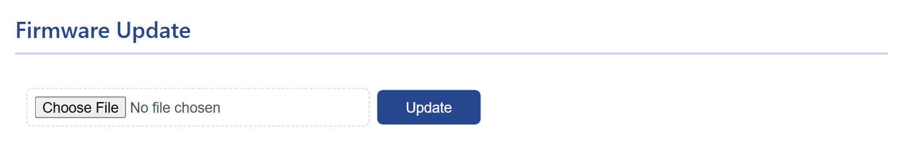

# Firmware update

A firmware update is one file uploaded from the <mark>System</mark> tab. WiCAN writes it to its spare slot and restarts into it; an upload that fails leaves the running firmware untouched. Expect the settings to need attention afterwards: some releases reset the configuration, so download a backup first.

## Get the file

Releases are at `https://github.com/meatpiHQ/wican-fw/releases`. Every release that supports WiCAN OBD and WiCAN USB has one zip per device; download the one for yours and unzip it.

| Device | Zip | The file to upload |
| --- | --- | --- |
| WiCAN OBD | `wican-fw_obd_vXXX.zip` | `wican-fw_obd_vXXX.bin` |
| WiCAN USB | `wican-fw_usb_vXXXu.zip` | `wican-fw_usb_vXXXu.bin` |

The ==About== tab tells which you have (`WiCAN-OBD` or `WiCAN-USB`) and which version runs now. The other three files in the zip, `bootloader.bin`, `partition-table.bin` and `ota_data_initial.bin`, are for [recovery over USB](usb-flash.md), not for this page. Releases named with a `p` (`v4.51p`, `v6.00p`) are for WiCAN PRO and will not run on these devices.

## Update

1.  **Read the release notes and back up**

    The notes say what changed and whether the update resets the configuration. ==System== › ==Download Configuration== saves every setting to a file, see [Backup and restore](backup-and-restore.md).

2.  **Switch MQTT off if it is on**

    The release notes ask for it: ==Settings== › ==CAN== › ==MQTT== ==Disable==, then ==Submit Changes==. Turn it back on after the update.

3.  **Power that will not go away**

    The car's ignition on, or a supply on the bench. The upload takes about a minute; a power cut in the middle costs the attempt, not the device, but do not provoke it.

4.  **==System== › ==Firmware Update== › ==Choose File==, then ==Update==**

    Pick the `.bin` for your device. The page shows `Updating please wait...`, sends the file after a few seconds and waits for the device.

    <figure class="shot" markdown>
    { width="640" }
    <figcaption>System, Firmware Update.</figcaption>
    </figure>

5.  **Wait for the restart**

    When the whole file has been written and checked, WiCAN restarts into the new firmware; the page reloads by itself or shows an error. Reconnect to the access point if your phone dropped off it.

6.  **Check ==About==**

    ==Firmware ver== shows the new version. Then check the Settings tab: if the release reset the configuration, upload the backup or set WiCAN up again, see [First setup](../getting-started/first-setup.md).

## Troubleshooting

| Symptom | Likely cause | What to do |
| --- | --- | --- |
| `No files selected!` | the file chooser is empty | ==Choose File== first |
| The page shows an error after the upload, the old version still runs | the file is not a WiCAN image (the zip itself, a PRO image), or the connection broke during the upload | the `.bin` for your device from the zip; closer to the device, or over the access point rather than the home network |
| The device comes back with factory settings | the release resets the configuration, or the stored configuration was refused by the new firmware | upload the backup from the System tab |
| The device comes back with Bluetooth or MQTT off | MQTT was switched off for the update, or Bluetooth settings were reset | enable them again |
| No web interface after the update | the device is on its access point with the factory password, or asleep | join `WiCAN_<device id>` with `@meatpi#`; the ignition |
| The device does not come back at all | the write was interrupted at a bad moment | [Recovery over USB](usb-flash.md) |
