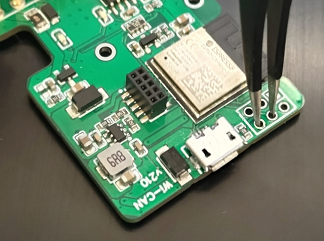
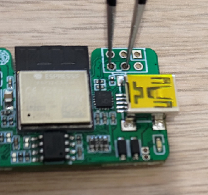

# Recovery over USB

<!-- --8<-- [start:intro] -->
<p class="lead">When the web interface is out of reach, a forgotten access point password, a configuration that locked you out, an update that did not complete, the firmware can be written over the USB cable with Espressif's flashing tool. Erasing the flash on the way is the factory reset: the device starts again as new, with the access point `WiCAN_<device id>` and the password `@meatpi#`.</p>

<dl class="facts" markdown>
<dt>You need</dt><dd>A USB data cable, a computer, the firmware zip for your device from `https://github.com/meatpiHQ/wican-fw/releases`, and the flashing tool: the web tool at `https://espressif.github.io/esptool-js/` in Chrome or Edge, or `esptool.py` (`pip install esptool`)</dd>
<dt>The files</dt><dd>The four files in the zip: `bootloader.bin`, `partition-table.bin`, `ota_data_initial.bin` and the firmware `.bin`</dd>
<dt>Keeps</dt><dd>Nothing, if you erase first: every setting and the Automate tables are gone. Flashing without the erase keeps them</dd>
</dl>

## Put the device in download mode

The device enters download mode when two pads on the board are shorted while power is applied. Open the case, hold the two pads together with tweezers or a jumper wire, and plug in the USB cable while holding them; one LED lights to say the device is waiting for the download. Release the pads once the cable is in.
<!-- --8<-- [end:intro] -->

<!-- --8<-- [start:obd-pins] -->
<figure class="shot" markdown>
{ width="480" }
<figcaption>WiCAN OBD: the two pads to short are next to the module, beside the micro USB connector.</figcaption>
</figure>
<!-- --8<-- [end:obd-pins] -->

<!-- --8<-- [start:usb-pins] -->
<figure class="shot" markdown>
{ width="480" }
<figcaption>WiCAN USB: the two pads to short are on the small header above the mini USB connector.</figcaption>
</figure>
<!-- --8<-- [end:usb-pins] -->

<!-- --8<-- [start:flash] -->
The computer sees a serial port: a COM port on Windows, `/dev/ttyACM0` or `/dev/ttyUSB0` on Linux, `/dev/cu.usbmodem...` on macOS. On an old Windows without a driver for it, install the WCH CH343 serial driver package.

## Flash

The four files go to four addresses:

| File | Address |
| --- | --- |
| `bootloader.bin` | `0x0` |
| `partition-table.bin` | `0x8000` |
| `ota_data_initial.bin` | `0xd000` |
| `wican-fw_obd_vXXX.bin` or `wican-fw_usb_vXXXu.bin` | `0x10000` |

**With the web tool**: open `https://espressif.github.io/esptool-js/`, ==Connect==, pick the port. ==Erase== first when the configuration is the problem. Then add the four files with their addresses and ==Program==. Unplug and replug the cable when it is done.

**With esptool.py**, with the port name of your computer:

```text
esptool.py --chip esp32c3 --port COM5 erase_flash
esptool.py --chip esp32c3 --port COM5 write_flash 0x0 bootloader.bin 0x8000 partition-table.bin 0xd000 ota_data_initial.bin 0x10000 wican-fw_obd_vXXX.bin
```

Leave out the first line to keep the settings. After the second line, unplug and replug the cable: WiCAN starts the new firmware, with the factory settings if the flash was erased. Join `WiCAN_<device id>` with `@meatpi#` and set it up again, see [First setup](../getting-started/first-setup.md).

## Troubleshooting

| Symptom | Likely cause | What to do |
| --- | --- | --- |
| No serial port appears | a charge-only cable, or no driver | a data cable; the driver |
| The tool cannot connect, `Failed to connect` | the device is not in download mode | unplug, hold the pads shorted, plug in again, then connect |
| The tool connects but writing fails half way | a loose cable, or power from the car at the same time | the cable; nothing but USB during the flash |
| The device starts but the web interface is odd | the wrong image (an `obd` image on a USB device or the other way round) | the image for your device |
| The old settings are still there | the flash was not erased | erase, then flash |
<!-- --8<-- [end:flash] -->
