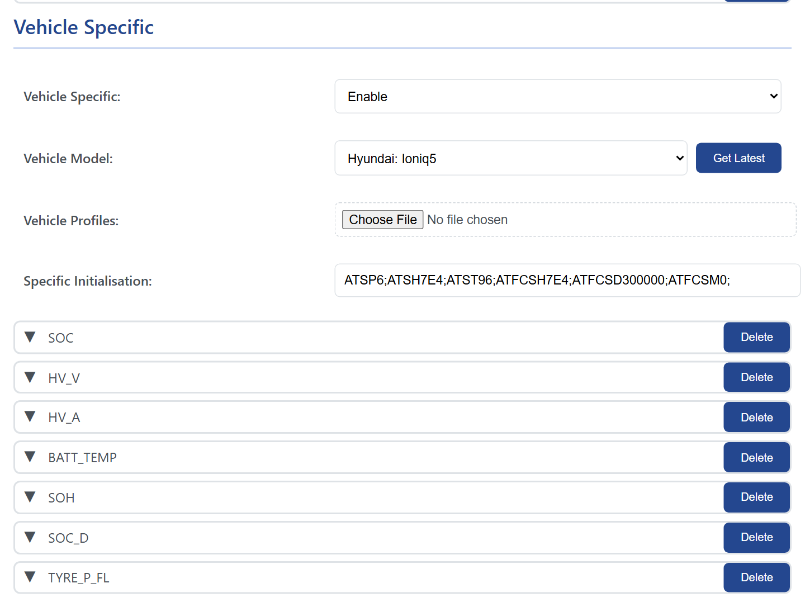
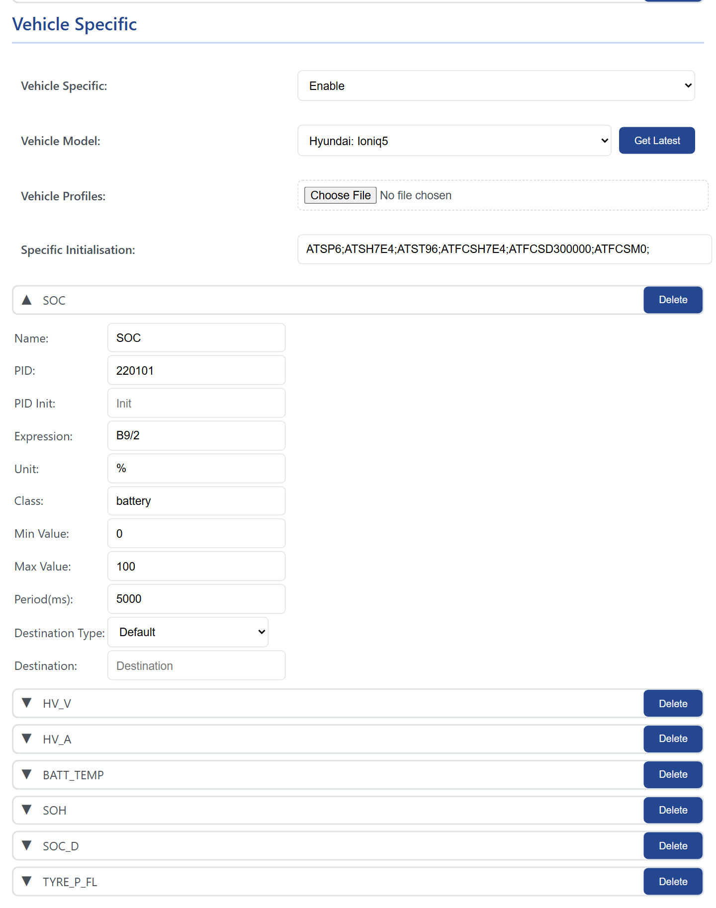

# Vehicle profiles

<p class="lead">A vehicle profile is a ready-made set of requests for one make and model: battery state of charge, state of health, cell voltages, charging state, cabin temperature, the things standard OBD does not expose. Profiles are shared by the community in the WiCAN repository and loaded from the Automate tab. Combustion cars mostly get by on the standard PIDs; EVs and hybrids want a profile.</p>

## Load a profile

<figure class="shot" markdown>
{ width="640" }
<figcaption>A profile loaded: its initialisation commands and its parameters, one row each.</figcaption>
</figure>

<div class="steps" markdown>

1.  **Open the list**

    On ==Automate==, under ==Vehicle Specific==, set ==Vehicle Specific== to ==Enable== and press ==Get Latest==. The browser fetches the current list of profiles from the WiCAN repository and fills ==Vehicle Model== with the makes and models.

    !!! note "The phone needs internet for this"
        It is the browser that fetches the list, not WiCAN. On the WiCAN access point the phone has no internet, so either do this with WiCAN on your home network and the phone on the same network, or load the profile as a file (below).

2.  **Pick the model**

    Choose your car in ==Vehicle Model==. The ==Specific Initialisation== field fills with the profile's AT commands and the parameters appear as rows below, one per value. Click a row to see its request, expression, unit, class, limits and period.

3.  **Store and restart**

    Press ==Store==, then restart WiCAN (==System== › ==Reboot==). With the ignition on, the values appear at `/autopid_data`, on MQTT and in Home Assistant like the standard PIDs.

</div>

**From a file.** ==Vehicle Profiles== › ==Choose File== takes a `.json` file instead of the download: the whole published list `vehicle_profiles.json` from the repository, or a single car's profile file. A single-car file is converted in the browser; with internet it also fetches the parameter descriptions, without internet it loads the bare profile. Then pick the model and store as above.

<figure class="shot" markdown>
{ width="640" }
<figcaption>A parameter of the profile. The request, the expression and the unit come from the profile; the period and the destination can be changed per row.</figcaption>
</figure>

## What a profile contains

A profile is a JSON object with the car's name, an initialisation sent once before the requests, and the requests with their decode expressions:

```json
{
  "car_model": "Hyundai: Ioniq5/Ioniq6 (2021-2024)",
  "init": "ATSH7E4;ATST96;",
  "pids": [
    {
      "pid": "220101",
      "pid_init": "ATSH7E4;",
      "parameters": [
        { "name": "SOC", "expression": "B9/2", "unit": "%", "class": "battery" },
        { "name": "HV_V", "expression": "[B14:B15]/10", "unit": "V", "class": "voltage" }
      ]
    }
  ]
}
```

<dl class="facts" markdown>
<dt>car_model</dt><dd>`Make: Model`, as shown in the list.</dd>
<dt>init</dt><dd>AT commands sent once before the profile's requests, separated by `;`: the protocol, the header of the module to ask (`ATSH7E4` is the battery management system on a Hyundai), the timeout.</dd>
<dt>pid</dt><dd>The request as sent to the module, `220101` or `2101`. Its own `pid_init` is sent before it, for a request that goes to another module.</dd>
<dt>expression</dt><dd>How a value is computed from the bytes of the answer: `B9` is byte 9, `[B14:B15]` two bytes as one number, `S16` a signed byte, with arithmetic around it. [Custom PIDs and expressions](custom-pids.md) has the whole syntax and how the bytes are counted.</dd>
<dt>unit, class</dt><dd>The unit shown with the value, and the device class Home Assistant gives the entity (`battery`, `temperature`, `voltage`, `current`, `power`, `speed`, `pressure`, `distance`, `energy`). Profiles use the shared parameter names of the repository (`SOC`, `HV_V`, `BATT_TEMP`, `ODOMETER`), so the same thing is called the same across cars.</dd>
<dt>min, max, period</dt><dd>Optional limits, and the period for that parameter when it should differ from the others.</dd>
</dl>

## Contribute a profile

Profiles live in the `vehicle_profiles` folder of the WiCAN repository at `https://github.com/meatpiHQ/wican-fw`, one file per car model, and the published list is built from them. The way to write one for a car nobody has done yet: read the car with an app that already knows it, Car Scanner for example, export the app's log, and copy the requests and initialisation it used into a profile; then decode the bytes with expressions and check them against the values the app showed. A profile you have tested on your own car is a pull request away from helping the next owner of the same model.
