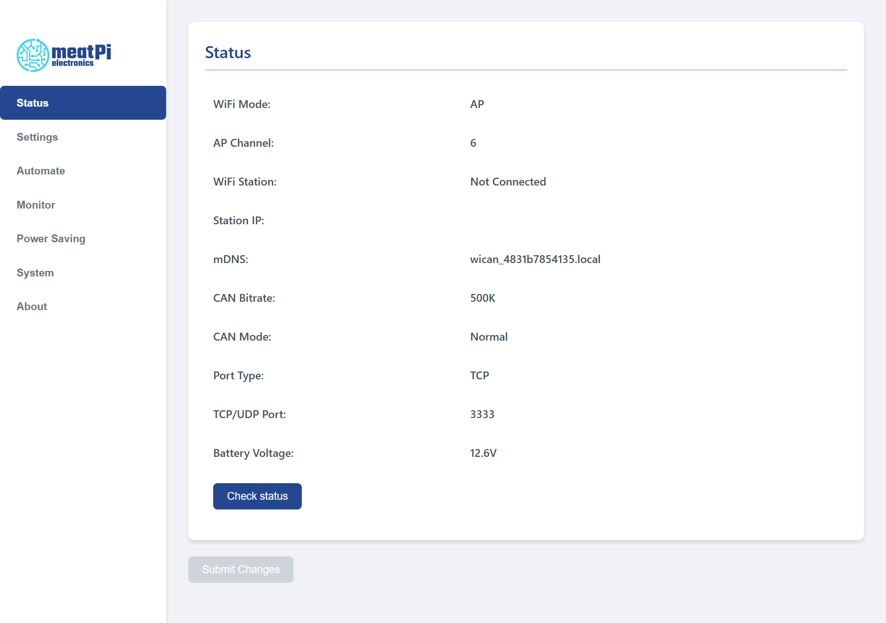
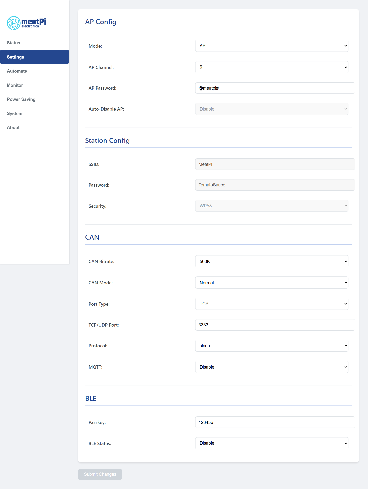

# The web interface

Everything WiCAN does is set up and watched from one web page the device serves itself. Open it from any phone or computer on the same network, no app and no account needed. This chapter is a tour of its seven tabs; each gets its own chapter later in the manual.

## Opening it

| Where you are | Address |
| --- | --- |
| On WiCAN's own access point | `http://192.168.80.1` |
| On your network (AP+Station mode) | the address your router gave WiCAN: the Status tab shows it as ==Station IP==, the router's device list shows it under the name `WiCAN_<device id>`, and on most networks `http://wican_<device id>.local` works too |

There is no login. Anyone on the same network can open the page, which is why the first thing to do on a new device is to change the access point password.

## The layout

<figure class="shot" markdown>
{ width="760" }
<figcaption>The Status tab. The sidebar lists the tabs; Submit Changes sits under the content of every tab.</figcaption>
</figure>

- **The sidebar** on the left lists the seven tabs. On a phone it moves above the content.
- **The content** is one card per tab, with the settings in rows.
- **==Submit Changes==**, under the content of every tab, is grey until something on the ==Settings== or ==Power Saving== tab has changed and every field is valid. Pressing it saves all of those settings to the device, which restarts: the page shows `Configuration saved! Rebooting...` and WiCAN is back about 20 seconds later.
- **Messages** appear across the top of the content: green when something was saved, red when a value is out of range (the message says which one and what the limits are).

## The tabs

| Tab | What it is for |
| --- | --- |
| ==Status== | The live overview: WiFi mode and channel, whether the station is connected and its address, the mDNS name, the CAN bit rate and mode, the port type and number, the battery voltage. ==Check status== reads them again. |
| ==Settings== | ==AP Config== (mode, channel, the access point password, Auto-Disable AP), ==Station Config== (your WiFi), ==CAN== (bit rate, mode, port type and number, the protocol, MQTT on or off), ==BLE==, and with MQTT enabled the ==MQTT== card and the ==MQTT CAN Filter== table. [WiFi](../connectivity/wifi.md), [Bluetooth LE](../connectivity/bluetooth.md), [MQTT](../send-data/mqtt.md). |
| ==Automate== | AutoPID: the Home Assistant webhook, the user destinations (grouping, MQTT topic, cycle), standard PIDs, the vehicle-specific profile, custom PIDs. It has its own ==Store== button. [AutoPID](../vehicle-data/autopid.md). |
| ==Monitor== | A live list of the frames on the CAN bus. [CAN Monitor](../tools/can-monitor.md). |
| ==Power Saving== | Sleep mode and the battery alert. [Sleep and battery alert](../power/sleep-and-wake.md). |
| ==System== | Reboot, download and upload the configuration, firmware update. [Update](../firmware/update.md), [Backup and restore](../firmware/backup-and-restore.md). |
| ==About== | The firmware, hardware and git versions. |

<figure class="shot" markdown>
{ width="760" }
<figcaption>The Settings tab on a new device. The MQTT card appears below BLE once MQTT is set to Enable.</figcaption>
</figure>

## Three things to know

- **Two save buttons.** ==Submit Changes== saves the Settings and Power Saving tabs and restarts WiCAN. ==Store== on the Automate tab writes the AutoPID tables to the device without a restart; they take effect at the next start, so press ==Submit Changes== or ==System== › ==Reboot== afterwards. Submit Changes also stores the Automate tab on its way.
- **Submit Changes may be blue right after the page loads** on a device with AutoPID tables, because the page re-checks the form while it fills the Automate tab. Pressing it then saves what is on the page and restarts; nothing is lost.
- **The Monitor tab takes the bus for itself.** Restart WiCAN after using it, as the page reminds you, or the protocol you configured may not run as expected.
