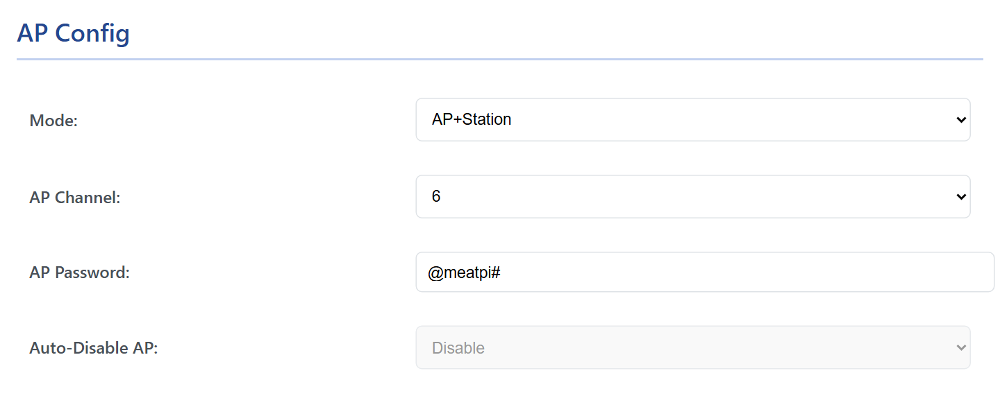

# WiFi

WiCAN has two WiFi faces: its own access point, which phones and laptops join directly, and a station that joins your network. This chapter covers both, the Auto-Disable AP switch, how WiCAN is found on a network, and how to get back in when something goes wrong.

All of it lives under ==Settings== › ==AP Config== and ==Station Config==. Changes apply from ==Submit Changes==, which restarts WiCAN.

## WiFi mode

| Mode | What it means |
| --- | --- |
| ==AP== | WiCAN is an access point and nothing else. Your phone or laptop joins it; there is no internet on it. The mode a new device starts in, and the only mode in which Bluetooth LE can be enabled. |
| ==AP+Station== | WiCAN also joins your WiFi. You reach it through your network, Home Assistant and MQTT work, and the access point stays on unless Auto-Disable AP turns it off. Bluetooth LE is not available in this mode. |

There is no station-only mode; Auto-Disable AP is how the access point goes away.

<figure class="shot" markdown>
{ width="640" }
<figcaption>AP Config with AP+Station chosen. Auto-Disable AP becomes available in this mode.</figcaption>
</figure>

## The access point

<dl class="facts" markdown>
<dt>Name</dt><dd>`WiCAN_` followed by the device id, twelve hexadecimal characters. It cannot be changed.</dd>
<dt>Password</dt><dd>`@meatpi#` from the factory; 8 to 63 characters of your own. Change it on a new device: the factory password is the same on every WiCAN.</dd>
<dt>Security</dt><dd>WPA2, with WPA3 accepted from phones that have it.</dd>
<dt>Address</dt><dd>`192.168.80.1`. WiCAN hands out addresses in `192.168.80.x` to the devices that join.</dd>
<dt>Channel</dt><dd>1 to 14, 6 from the factory. In AP+Station the access point follows the channel of the network the station joined, whatever this setting says.</dd>
<dt>Clients</dt><dd>Up to 4 at a time.</dd>
</dl>

!!! note "A phone on the access point switches Bluetooth off"
    With Bluetooth LE enabled, the moment a phone joins the access point WiCAN stops advertising over Bluetooth, and starts again when the phone leaves. The other way round, a phone connected over Bluetooth switches the access point off. See [Bluetooth LE](bluetooth.md).

## Your network (the station)

Type the ==SSID== and ==Password== of your network and choose its ==Security==:

| Security | When |
| --- | --- |
| ==WPA3== | Your router runs WPA3 (or WPA2/WPA3 mixed mode with WPA3 on). The factory setting. |
| ==WPA2== | Your router runs WPA2, which is most home routers. A WPA2-only network is not joined while WPA3 is selected. |

WiCAN joins 2.4 GHz networks only. After the restart it takes an address from your router and keeps trying every second until it gets one; the Status tab shows ==WiFi Station== `Connected` and the ==Station IP==.

<figure class="shot" markdown>
{ width="640" }
<figcaption>Station Config. Pick the security your router uses.</figcaption>
</figure>

### Finding WiCAN on the network

- **The router's device list** shows it as `WiCAN_<device id>`, the same name as the access point.
- **mDNS**: `wican_<device id>.local` (lower case) resolves to the station address on networks that carry mDNS, which is most home networks; the Status tab shows the name under ==mDNS==. Home Assistant's WiCAN integration finds the device this way.
- **The Status tab**, reached over the access point while it is still on, shows the ==Station IP==.

## Auto-Disable AP

In AP+Station mode, ==Auto-Disable AP== set to ==Enable== switches the access point off as soon as the station has an address from your router. WiCAN is then reachable through your network only, and the radio is free for it. If the station loses the network and cannot rejoin, the access point comes back so you can still reach the device.

With ==Disable==, the factory setting, the access point stays on next to the station.

!!! tip "Turn it on once your network works"
    Keep the access point on during setup. Once WiCAN is reachable on your network, enabling Auto-Disable AP removes an open door near the car; you can always get the access point back by changing the setting over the network, or by taking the network away.

## Getting back in

WiCAN has no button. When you cannot reach the web interface:

| Situation | Way in |
| --- | --- |
| AP mode, you forgot the new access point password | [Recovery over USB](../firmware/usb-flash.md): flashing with the erase step returns the factory password |
| AP+Station with Auto-Disable AP, the access point is gone | WiCAN is on your network: open its address there. Away from that network, the access point comes back by itself once the station gives up on it |
| A phone was connected over Bluetooth and the access point disappeared | Expected: disconnect the phone and power cycle WiCAN; the access point is back |
| The settings you submitted were wrong (a bad WiFi password, a mistyped SSID) | In AP+Station the access point stays reachable unless Auto-Disable AP is on; fix the settings there. Otherwise recovery over USB |
| WiCAN went quiet in a parked car | Sleep mode: it wakes when the engine runs, see [Sleep and battery alert](../power/sleep-and-wake.md) |

## Troubleshooting

| Symptom | Likely cause | What to do |
| --- | --- | --- |
| The station never connects | the wrong ==Security== (a WPA2 router with WPA3 selected), a 5 GHz-only network, a mistyped password | choose WPA2; a 2.4 GHz network; retype the password |
| It connected once, now the Status tab says `Not Connected` | the router changed channel or restarted; WiCAN retries by itself | wait a minute; power cycle WiCAN if it stays off |
| `wican_<id>.local` does not open | the network blocks mDNS, or the computer does not resolve `.local` names | use the address from the router's device list |
| Settings came back as factory after a restart | a value the firmware refuses, for example a WiFi password shorter than 8 characters: the whole configuration file is replaced by defaults | enter the settings again within the limits |
| The access point is on a different channel than set | AP+Station: the access point follows the station's channel | nothing to fix |
