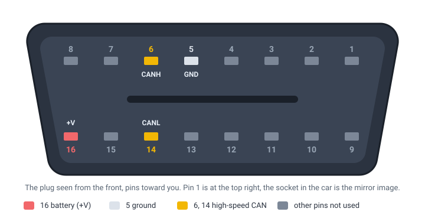

# Pinout

The four pins of the OBD-II plug that WiCAN OBD uses: battery, ground and the two wires of the high-speed CAN bus.

WiCAN OBD plugs into the car's OBD-II socket (SAE J1962) and uses four of the sixteen pins.

<figure class="shot" markdown>
{ width="720" }
<figcaption>The plug of WiCAN OBD seen from the front, pins toward you: pin 1 is at the top right. The socket in the car is the mirror image.</figcaption>
</figure>

| Pin | Marking | Signal |
| --- | --- | --- |
| 16 | +V | Battery, +12 V, with or without the ignition. Also the voltage shown on the Status tab. |
| 5 | GND | Ground. |
| 6 | CANH | CAN high of the high-speed CAN bus (ISO 15765-4), where the engine and most modules answer. |
| 14 | CANL | CAN low of the same bus. |

The other pins are not connected. WiCAN OBD does not reach the medium-speed CAN bus on pins 3 and 11, GM's single-wire CAN on pin 1, or the K line on pin 7; those need [WiCAN PRO](../../wican-pro/hardware/pinout.md).

Power, the USB port, the LEDs and the CAN controller are on the [Hardware](../getting-started/hardware.md) page.
