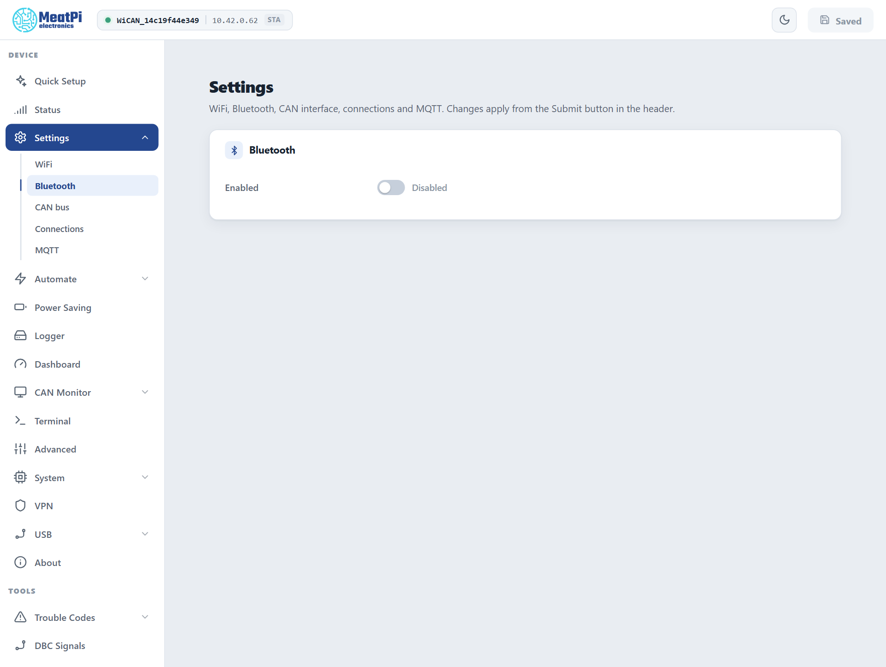

# Bluetooth LE

Facts checked against the device's settings schema and the firmware's BLE reference, firmware v6.00p_alfa-02, 2026-10-09; enabling, pairing with the passkey and the app tunnel exercised on air by the firmware's BLE bench the same day.

Bluetooth Low Energy is the way a phone talks to WiCAN PRO without any WiFi: an OBD app such as Car Scanner, a diagnostic app, or an app of your own that uses the whole WiCAN API over the air. It is off until you turn it on.

## Turning it on

<figure class="shot" markdown>
{ width="640" }
<figcaption>Settings, Bluetooth. Off on a new device.</figcaption>
</figure>

1. Open ==Settings== › ==Bluetooth== and switch ==Enabled== on.
2. Press ==Submit== in the header. WiCAN restarts with Bluetooth on.

WiCAN then advertises as `WiC_<device id>`, the same twelve characters as in the access point name. The Status page shows the name under ==Bluetooth ID==.

## Pairing a phone

WiCAN pairs with a 6-digit passkey, `123456` by default. Change it on the Bluetooth page once Bluetooth is on (the setting is `passkey` in the `ble_manager` document).

- The phone asks for the passkey the first time an app reads or writes anything. Some apps start the pairing themselves when they connect; otherwise accept the phone's pairing prompt.
- A paired phone is remembered (bonded): it reconnects without the passkey, also after restarts and power cycles. Up to 3 phones are remembered; a fourth replaces the oldest.
- One phone at a time. While a phone is connected, WiCAN is invisible to other scanners and advertises again when the phone disconnects.
- WiCAN uses a private Bluetooth address that changes over time. Apps find it by name, not by address.

!!! note "After a factory reset or a fresh firmware install"
    The device forgets its pairings. The phone still remembers the old one and will fail to connect until you remove WiCAN from the phone's Bluetooth list (Forget this device) and pair again.

## Bluetooth and WiFi share one radio

Two rules, on by default under ==Settings== › ==WiFi== › ==Radio Arbitration==:

- **While a phone is connected over Bluetooth, WiCAN pauses its WiFi station.** It drops off your home network and rejoins a few seconds after the phone disconnects. A phone in the car gets a clean radio; Home Assistant and MQTT wait meanwhile. An app that needs the WiCAN API while connected has it over Bluetooth, see below.
- **A phone on WiCAN's own access point stops Bluetooth**, and the other way round: whichever a phone connects to wins; the other comes back when it leaves.

Turn the first rule off if you want WiFi and Bluetooth up together. It works, with less radio time for each.

## What an app can do over Bluetooth

| Use | How |
| --- | --- |
| **OBD apps** (Car Scanner, Torque and other ELM327 apps) | Add a connection on ==Settings== › ==Connections== that puts the OBD chip on Bluetooth, then pick WiCAN in the app as a Bluetooth LE adapter. The app talks ELM327 as it would to any BLE OBD dongle. See [Apps over WiFi and BLE](../send-data/apps.md). |
| **CAN tools** | A connection can put the CAN bus on Bluetooth instead, as slcan, SavvyCAN's GVRET, RealDash frames or a compact binary record with bus timestamps. |
| **Your own app** | Every route of the HTTP API is reachable over Bluetooth, framed in a small protocol: settings, status, files, the UDS terminal, firmware updates. [BLE API](../reference/ble-api/index.md) and [HTTP over BLE](../reference/ble-api/http-over-ble.md). |
| **PC diagnostic apps on a phone** | With the J2534 server enabled, the same PassThru protocol the Windows driver uses is also served over Bluetooth. |
| **The command line** | WiCAN's console is a pair of characteristics too, for short status commands. |

## Advanced settings

In the `ble_manager` document (==All Settings== lists it, the Bluetooth page shows the common ones):

| Setting | Default | Meaning |
| --- | --- | --- |
| `passkey` | `123456` | the 6-digit pairing code |
| `tx_power_dbm` | 9 | transmit power, -12 to 9 dBm |
| `pairing_at_boot` | on | accept new pairings; off keeps only already-paired phones |
| `bonding` | on | remember paired phones; off asks for the passkey every time |
| `sc_only` | on | refuse the old (pre-2014) pairing method; turn off only for a very old accessory |
| `conn_profile` | `ios` | the connection timing WiCAN asks for; `android_fast` halves command round trips on Android phones (iPhones ignore it) |
| `phy` | `1m` | Bluetooth 5 radio mode: `2m` is faster for a phone that supports it, `coded` reaches further, `auto` lets the phone choose |
| `advertising` | `legacy` | `extended` or `both` add a Bluetooth 5 advertisement; keep `legacy` for apps that only scan the old way |

## Troubleshooting

| Symptom | Likely cause | What to do |
| --- | --- | --- |
| The phone does not see WiCAN | Bluetooth is off, a phone is on WiCAN's access point, or another phone is already connected | check the Status page: ==Bluetooth ID== shows the name when Bluetooth is on; disconnect the other phone or leave the access point |
| A previously paired phone does not see it in a scan | a bonded device is reached directly, not by scanning | open the app and connect; the phone's own list has it |
| Pairing fails right after connecting | the phone has a stale pairing from before a reset or reflash | remove WiCAN in the phone's Bluetooth settings and pair again |
| An app sees fewer services after a firmware update | the phone cached the old service list | remove and pair again (iPhone), or clear the app's cache (Android) |
| A Windows program cannot pair | Windows needs the program to supply the passkey itself | the program must pair with a provided PIN; the reference clients in the firmware repository show how |
| Home Assistant goes quiet while the phone is connected | expected: WiFi pauses for the phone | wait for the phone to disconnect, or turn the station pause off under Radio Arbitration |
