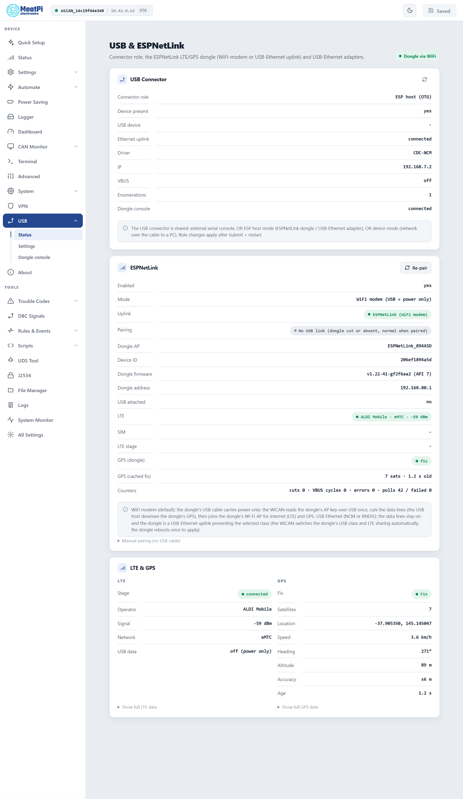
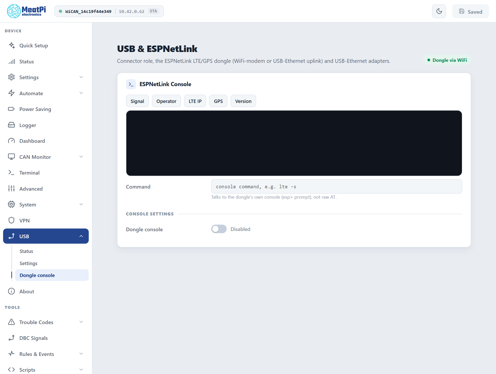
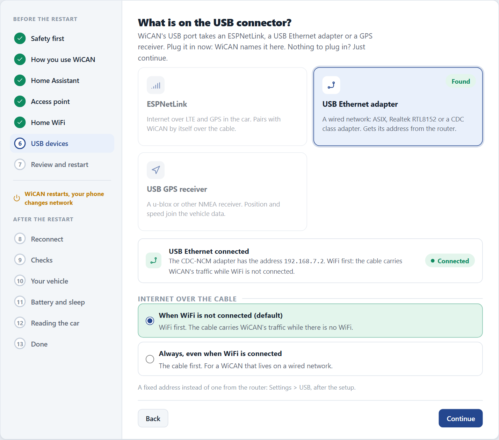
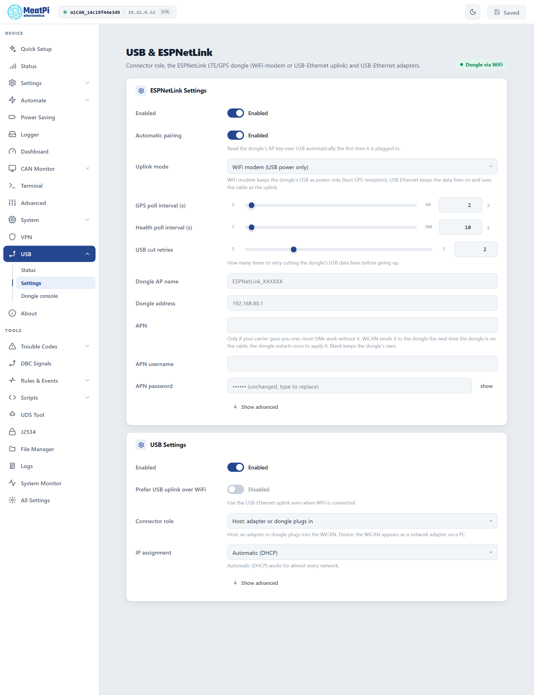

# USB accessories

The USB connector gives WiCAN PRO a second life beyond the OBD port: an ESPNetLink dongle for internet and GPS away from home, a USB Ethernet adapter for a wired network, or a plain USB GPS receiver. The same connector is the serial console for a PC, and can turn WiCAN itself into a USB network adapter.

Everything about it lives under ==USB== in the sidebar: ==Status==, ==Settings== and ==Dongle console==. Quick Setup also has a ==USB devices== step that names whatever is plugged in and asks the one question each accessory has.

## What the connector does

Out of the box the connector waits for an accessory. With nothing plugged in it is a serial port for a PC (firmware flashing, the command line). The moment an accessory is attached WiCAN switches the connector to it and powers it; unplug it and the connector is a serial port again. Changing the ==Connector role== to ==Device== makes WiCAN the accessory instead: it then shows up on a PC as a network adapter.

| Accessory | What it gives WiCAN | What to do |
| --- | --- | --- |
| **ESPNetLink** (MeatPi's LTE and GPS dongle) | Internet anywhere, and a GPS position | Plug it in. WiCAN pairs with it by itself. |
| **USB Ethernet adapter** (ASIX, or any CDC-ECM, CDC-NCM or RNDIS class adapter) | A wired network connection | Plug it in. WiCAN takes an address by DHCP. |
| **USB GPS receiver** (an NMEA receiver on a USB serial port, such as a u-blox 7) | A GPS position | Switch the ==Dongle console== on so WiCAN reads it. Quick Setup does this when it finds a receiver. |

One accessory at a time. The position from a dongle or a receiver becomes a set of parameters (`gps_latitude`, `gps_longitude`, `gps_altitude`, `gps_speed`, `gps_heading`, `gps_satellites`) that flow wherever vehicle parameters go: the Dashboard, the Logger, Home Assistant's device tracker, rules and ABRP. Only a live fix is published; a remembered position is never reported as current.

<figure class="shot" markdown>
{ width="640" }
<figcaption>USB, Status, on a device paired with an ESPNetLink in WiFi modem mode. The connector card is first, the dongle's state and its LTE and GPS panels follow.</figcaption>
</figure>

## ESPNetLink

The dongle can work two ways. The ==Uplink mode== on ==USB== › ==Settings== chooses:

| Mode | How it works | When to pick it |
| --- | --- | --- |
| ==WiFi modem== (the default) | The USB cable carries power only. WiCAN joins the dongle's own WiFi network (`ESPNetLink_<id>`, at `192.168.80.1`) and the dongle routes it onto LTE. GPS is read over that WiFi link. | Always, unless you need the cable as the network link. The USB data link disturbs the dongle's GPS reception; with power only the dongle gets a fix. |
| ==USB Ethernet== (NCM or RNDIS) | The data lines stay on and the dongle is a USB Ethernet adapter on the cable. WiCAN sets the dongle's USB class and LTE sharing to match; the dongle restarts once. | A car with no GPS need, or a bench. Expect a slow or no GPS fix in this mode. |

### Pairing, the first time

Nothing to type. With ==Automatic pairing== on (the default):

1.  **Plug the dongle in** and give it power (the car's ignition, or the bench supply).

2.  **WiCAN reads the dongle's WiFi key over the cable**, about 15 seconds after the dongle powers up. In WiFi modem mode it then asks the dongle to cut its USB data lines, and the dongle does so on every later boot by itself.

3.  **WiCAN restarts once**, only when the key is new. From then on the dongle's network is one of WiCAN's backup networks: the home network stays first, the dongle takes over when the home network is out of range, and WiCAN looks for the home network again every few minutes while it is on the dongle.

4.  **The Status page shows the dongle**: its id, firmware, SIM, operator, signal, internet and GPS. The ==Uplink== row says which link is carrying traffic.

!!! note "A fresh device pairs after its access point password is changed"
    WiCAN refuses to store anything in its WiFi settings while the factory access point password is in place, and the dongle's key is a WiFi setting. The Status page says so on the dongle's card (`pairing on hold`). Quick Setup changes the password on its ==Secure the access point== step; the next time the dongle is seen WiCAN pairs by itself.

**Carrier settings.** Most SIMs work without an APN. When your carrier gave you one, type it under ==APN==, ==APN username== and ==APN password==: WiCAN sends it to the dongle the next time the dongle is on the cable, and the dongle restarts once to apply it. Blank keeps the dongle's own.

**Re-pair.** The ==Re-pair== button on the Status page power-cycles the dongle's USB and reads its key again: use it when the dongle was set up afresh and its WiFi password changed. ==Manual pairing (no USB cable)== under the card stores a dongle's network name and password by hand.

**Dongle firmware.** WiCAN needs a dongle firmware with API level 7 or newer. An older dongle shows as `unsupported` with the name of the missing route and a note to update it; the dongle's own manual covers the update.

### The dongle console

==USB== › ==Dongle console== sends commands to the dongle's own command line and shows the reply: ==Signal==, ==Operator==, ==LTE IP==, ==GPS== and ==Version== are one click each, and the ==Command== field takes any of the dongle's commands (`lte -s`, `gps -p`, `ver`). The console needs the ==Dongle console== switch on, and a data link on the cable: in WiFi modem mode the dongle's USB is cut once paired, so the console answers only in the USB Ethernet modes.

<figure class="shot" markdown>
{ width="640" }
<figcaption>USB, Dongle console. The same switch makes WiCAN read a plain GPS receiver.</figcaption>
</figure>

## A USB Ethernet adapter

Plug it in. WiCAN brings the adapter up, asks for an address by DHCP and shows ==Ethernet uplink==, ==Driver== and ==IP== on the Status page. A fixed address is set under ==USB== › ==Settings== › ==IP assignment== (address, netmask and gateway under ==Show advanced==).

WiFi stays WiCAN's default route while it is connected; the wire carries traffic when WiFi is down. Switch ==Prefer USB uplink over WiFi== on to use the wire whenever it has an address. A broker or server reached only through the wire also wants MQTT's ==Connect when== set to ==Any network== ([MQTT](../send-data/mqtt.md)).

!!! tip "Same subnet twice"
    When the wired network uses the same address range as the WiFi network WiCAN is on, the wired address is put on hold until the WiFi moves to another range. Give the two networks different ranges.

## A USB GPS receiver

A receiver that streams NMEA sentences over a USB serial port works without any driver: WiCAN recognises the first well-formed sentence and reads the fix from then on (position, speed, heading, altitude, satellites, accuracy). Two things to know:

- WiCAN only reads the receiver while the ==Dongle console== switch is on (the same reader serves both). Quick Setup's ==USB devices== step turns it on when it finds a receiver; by hand it is ==USB== › ==Dongle console== › ==Dongle console==, then ==Submit==.
- The Status page's USB Connector card names the receiver (vendor and product ids) and the ==Dongle console== row says `GNSS receiver, NMEA` with the sentence count once it is being read.

<figure class="shot" markdown>
{ width="640" }
<figcaption>Quick Setup's USB devices step reads the connector live and names what it finds.</figcaption>
</figure>

## WiCAN as a USB device

==USB== › ==Settings== › ==Connector role== › ==Device== turns the connector around: after ==Submit== a PC on the cable sees WiCAN as a USB network adapter and the web interface is reachable over that link. ==USB device class== under ==Show advanced== picks ==CDC-NCM== (Linux, macOS, Windows 11), ==RNDIS== (older Windows) or ==CDC serial== (a serial port instead of a network adapter). Quick Setup offers to switch the role back to ==Host== when it finds the connector in device mode.

## Settings reference

<figure class="shot" markdown>
{ width="640" }
<figcaption>USB, Settings. Changes apply from Submit in the header.</figcaption>
</figure>

**ESPNetLink Settings**

<dl class="facts" markdown>
<dt>Enabled</dt><dd>The dongle link runs. On by default.</dd>
<dt>Automatic pairing</dt><dd>Read the dongle's WiFi key over USB the first time it is plugged in. On by default; off means manual pairing only.</dd>
<dt>Uplink mode</dt><dd>==WiFi modem (USB power only)==, ==USB Ethernet (NCM)== or ==USB Ethernet (RNDIS)==. A dongle already paired keeps the mode it was paired with until you change it.</dd>
<dt>GPS poll interval</dt><dd>1 to 60 s, 2 s by default.</dd>
<dt>Health poll interval</dt><dd>5 to 300 s, 10 s by default: SIM, signal, operator, internet.</dd>
<dt>USB cut retries</dt><dd>1 to 5, 2 by default: attempts at cutting the dongle's data lines before a power cycle of the dongle.</dd>
<dt>Dongle AP name, Dongle address</dt><dd>Filled in by pairing. The address is only needed when the dongle is not reached at its usual place.</dd>
<dt>APN, APN username, APN password</dt><dd>Carrier settings relayed to the dongle; blank keeps the dongle's own.</dd>
</dl>

**USB Settings**

<dl class="facts" markdown>
<dt>Enabled</dt><dd>The connector watches for an accessory. On by default.</dd>
<dt>Prefer USB uplink over WiFi</dt><dd>Use the wired link even when WiFi is connected. Off by default.</dd>
<dt>Connector role</dt><dd>==Host== (an accessory plugs into WiCAN) or ==Device== (WiCAN plugs into a PC).</dd>
<dt>IP assignment</dt><dd>==Automatic (DHCP)== or a static address, netmask and gateway (under ==Show advanced==).</dd>
<dt>USB device class</dt><dd>Device role only: CDC-NCM, RNDIS or CDC serial.</dd>
</dl>

!!! note "Sleep"
    The connector's power is off while WiCAN sleeps ([Sleep and wake](../power/sleep-and-wake.md)). An accessory restarts when WiCAN wakes; a dongle needs a minute or so to be back on LTE and to get a fix.

## Troubleshooting

| Symptom | Likely cause | What to do |
| --- | --- | --- |
| The dongle's card says pairing is on hold | the factory access point password is still in place | change it (Quick Setup, or ==Settings== › ==WiFi==); pairing follows by itself |
| The dongle shows as `unsupported` | dongle firmware older than API level 7 | update the dongle |
| The dongle never gets a GPS fix | USB Ethernet mode, or no view of the sky | use ==WiFi modem==; park where the sky is visible |
| The Status page says `No USB link (dongle cut or absent, normal when paired)` | nothing wrong: in WiFi modem mode the cable is power only once paired | nothing |
| A USB Ethernet adapter shows no address | no DHCP server on that network, or the same address range as the WiFi network | set a static address, or change one of the ranges |
| A GPS receiver is named but gives no fix | the reader is off, or no fix yet | switch ==Dongle console== on and ==Submit==; wait for the first fix with a view of the sky |
| The PC's serial port disappeared | an accessory is attached: the connector belongs to it | unplug the accessory to get the console back |
