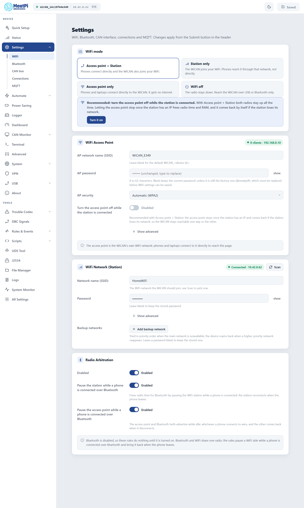

# WiFi

Facts checked against the device's settings schema and the firmware's WiFi reference, firmware v6.00p_alfa-02, 2026-10-09. Screens from the web interface preview.

WiCAN PRO has two WiFi faces: its own access point, which phones and laptops join directly, and a station that joins your network. This chapter covers both, the networks list with backups, trusted networks, and how to get back in when something goes wrong.

All of it lives under ==Settings== › ==WiFi==. Changes are staged on the page and applied from ==Submit== in the header, which restarts WiCAN.

<figure class="shot" markdown>
{ width="640" }
<figcaption>The WiFi page on a device in Access point + Station mode, joined to a home network.</figcaption>
</figure>

## WiFi mode

| Mode | What it means |
| --- | --- |
| ==Access point + Station== | Phones connect directly to WiCAN and WiCAN also joins your WiFi. The mode a new device starts in. |
| ==Station only== | WiCAN joins your WiFi and you reach it through that network. Its own access point stays off. The mode Quick Setup recommends once the home network works. |
| ==Access point only== | Phones and laptops connect directly to WiCAN. It gets no internet. |
| ==WiFi off== | The radio stays down. Reach WiCAN over USB or Bluetooth only. |

With Access point + Station both radios stay up all the time. The page recommends ==Turn the access point off while the station is connected==: the access point stops once the station has an address and comes back by itself if the station loses its network, so WiCAN stays reachable one way or the other and the radio has more time for your network.

!!! note "One radio"
    The access point and the station share one radio, so in Access point + Station the access point moves to the channel of the network the station joined. A phone on the access point may lose it for a moment while the station connects.

## The access point

<dl class="facts" markdown>
<dt>Name</dt><dd>`WiCAN_` followed by the device id (twelve hex characters). Leave the field blank for that default or type your own.</dd>
<dt>Password</dt><dd>8 to 63 characters. The factory password `@meatpi#` must be replaced before WiFi settings can be saved at all; Quick Setup does this on its Access point step.</dd>
<dt>Security</dt><dd>==Automatic== is WPA2. WPA2, WPA2 + WPA3 or WPA3 can be forced. An open access point is not offered.</dd>
<dt>Address</dt><dd>`192.168.0.10`. WiCAN hands out addresses in `192.168.0.x` to the devices that join.</dd>
<dt>Clients</dt><dd>Up to 4 at a time by default (1 to 10 under the advanced options).</dd>
<dt>Channel</dt><dd>6 by default. In Access point + Station the access point follows the station's channel as soon as the station is connected.</dd>
</dl>

Under ==Show advanced==: a hidden network name (clients must know it), 20 or 40 MHz bandwidth, the client limit, the channel and the address.

!!! tip "Why 192.168.0.10"
    It is the address OBD apps expect from a WiFi adapter out of the box. An app configured for `192.168.0.10`, port `35000`, finds WiCAN's OBD server without any setup.

## Your network (the station)

Type the network name or pick one with ==Scan==, then the password. WiCAN joins it after the restart, takes an address from your router, and shows up in the router's device list as `wican_<device id>`. On the same network it also answers to `wican_<device id>.local`.

Quick Setup can test a network before anything is saved: WiCAN joins it with the credentials you typed, reports the address it got (or the exact failure: wrong password, not found, no address), and lets go. Nothing is written.

### Backup networks

==Add backup network== adds up to five more networks. They are tried in priority order when the main one is unavailable: the home network first, then the car's hotspot, then the office. While WiCAN is on a backup network it looks for a higher-priority one every 5 minutes and moves back when it reappears.

A network whose last three connection attempts failed is only moved to the back of the list for two minutes, never banned, and when it is the only one in range it keeps being tried.

### Trusted networks

Each network has a ==trusted== flag, on by default. On a network you mark as not trusted, WiCAN refuses every request that arrives through that network: the web interface and the API answer `403 configuration disabled on this network`. WiCAN still works on that network (it still sends vehicle data to your broker or Home Assistant); it just cannot be configured from there. The access point and the USB link keep full access. The use: configure at home, keep WiCAN muted on a shared or office network.

### Addresses

Each network, main or backup, can take a fixed address instead of one from the router (==Show advanced==: address, netmask, gateway). One custom DNS server can be set for all networks, for a Pi-hole or a public resolver; WiCAN also falls back to `1.1.1.1` when the router's DNS does not answer.

## WiFi and Bluetooth: radio arbitration

Bluetooth shares the same radio. Two rules, both on by default, decide who wins:

- ==Pause the station while a phone is connected over Bluetooth==: WiCAN drops off your network while a phone is connected over BLE and rejoins when it leaves. A phone in the car gets a clean radio; the HTTP API stays reachable to that phone through BLE.
- ==Pause the access point while a phone is connected over Bluetooth==: the access point and Bluetooth both advertise while idle; whichever a phone connects to wins, and the other comes back when the phone disconnects.

Both rules do nothing until Bluetooth is turned on. See [Bluetooth LE](bluetooth.md).

## Getting back in

WiCAN never opens its access point by itself when it cannot join your network: an attacker could otherwise force it open by jamming the connection. Two ways in exist instead.

**Hold the button for 5 seconds while WiCAN runs.** The configured access point comes up with your password, whatever the WiFi mode, Bluetooth stops, and the LED alternates yellow and blue. Join it, open `http://192.168.0.10`, fix the settings. After 10 minutes without a client WiCAN restarts into its configured state; while a client is connected the access point stays up.

**Hold the button while plugging WiCAN in.** The LED turns sky blue; keep holding for 5 seconds until it turns yellow. This is safe mode: a bare recovery boot with the factory access point `WiCAN_<device id>`, password `@meatpi#`, address `192.168.0.10`, whatever the stored settings say. Its page offers a firmware upload, a factory reset and the crash report. Idle for 10 minutes, it restarts normally.

## The settings behind the page

For scripts and backups, the WiFi page edits the `wifi_manager` document of the [settings API](../reference/http-api/settings.md). The live state is `GET /api/wifi/status`; the network list `GET /api/wifi/scan`; the connection test `POST /api/wifi/try`. All of it is on [Device and connectivity](../reference/http-api/device.md#wifi).
