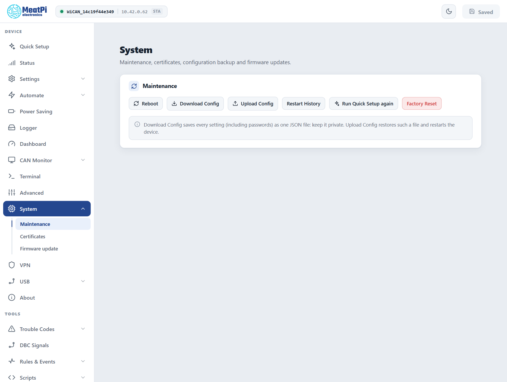

# Backup and restore

The backup document's shape and the restore rules from the firmware's settings reference; the settings list from the bench device; the page from the preview, firmware v6.00p_alfa-02, 2026-10-10. No restore was performed for this page; the firmware's benches restore the bench device from such files routinely.

Every setting of the device in one JSON file: download it before an experiment, keep it as a record, move it to a replacement device. The file carries passwords and keys, so keep it private.

## Back up

==System== › ==Maintenance== › ==Download Config== saves `wican-<device id>-settings.json`: one entry per component (WiFi, MQTT, AutoPID settings, sleep, rules, destinations ...) with its settings version, as the device will apply them after its next restart.

<figure class="shot" markdown>
{ width="640" }
<figcaption>System, Maintenance.</figcaption>
</figure>

**What is not in it.** Files are not settings: the vehicle tables and profiles (`/data/autopid`), certificate sets (`/data/certs`), scripts, DBC files, trouble-code databases, the dashboard layout and the SD card's logs. Download those with the [File Manager](../tools/files.md); the PID tables also export from ==Automate== › ==Parameters== › ==Raw Config==.

## Restore

==Upload Config== takes the file and restarts the device when anything changed. The restore is all or nothing: every component is checked first (a backup from an older firmware is migrated on the way), and one bad entry rejects the whole file with the reason per component, leaving the device as it was. Components this firmware does not know are skipped and listed; a backup from a newer firmware is refused with `update the firmware first`.

!!! note "After the restart"
    The device comes back with the restored network settings: on the backup's WiFi, with its access point name and password. Look for it there, not where it was.

**To another WiCAN Pro.** The same file restores onto another device. Names derived from the device id (the access point `WiCAN_<id>`, the hostname, the Bluetooth name) follow the new device; a name typed by hand in the backup is copied as it is, so two devices on one network should not share one.

## By API

`GET /api/settings/backup` returns the document, `POST /api/settings/backup` restores it, with the same all-or-nothing rule and `{"restored": N, "skipped": [...], "reboot": true}` as the answer. One component at a time: `GET` and `PUT /api/settings/<name>`, then `POST /api/settings/submit` ([Settings](../reference/http-api/settings.md)). ==All Settings== in the sidebar shows every component's form for the same purpose in the browser.

## Troubleshooting

| Symptom | Likely cause | What to do |
| --- | --- | --- |
| `backup rejected` with a list of errors | a value out of range for this firmware, or a newer settings version | fix the named entry in the file, or update the firmware |
| `not a WiCAN settings backup` | the wrong file (a PID export, a profile) | the file from ==Download Config== |
| The device is gone after the restore | it joined the backup's network | reach it there, or on its access point |
| Vehicle parameters are missing after a restore | they are files, not settings | ==Raw Config== or the File Manager |
