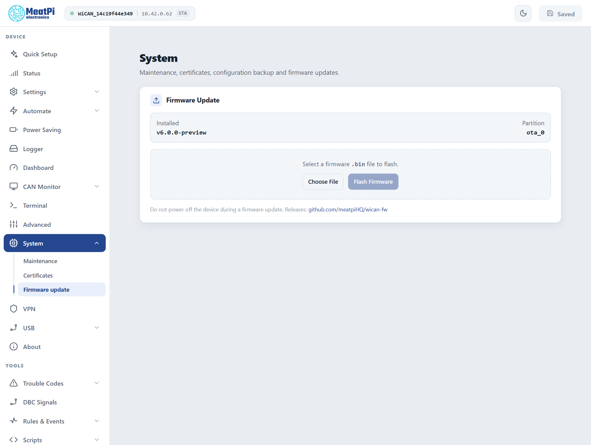

# Firmware update

<p class="lead">A firmware update is one file uploaded from the web interface. WiCAN writes it to its spare slot, checks it, switches to it and restarts; a failed or interrupted upload never touches the firmware that is running. Settings, files and the SD card stay as they are.</p>

## Get the file

Releases are at `https://github.com/meatpiHQ/wican-fw/releases`. Download the WiCAN PRO image, a `.bin` file named like `wican-fw_obd_pro_v6.00.bin`, and read the release notes. ==About== and ==System== › ==Firmware update== show the version installed now.

## Update

<div class="steps" markdown>

1.  **Power that will not go away.** The car's ignition on, or a bench supply. The write takes seconds; a power cut in the middle only costs the attempt, but do not provoke it.

2.  **==System== › ==Firmware update== › ==Choose File==**, pick the `.bin`, ==Flash Firmware==.

3.  **Wait.** A progress bar follows the upload; the LED blinks red fast while the image is written. When the upload is checked and accepted the page says it is rebooting and reconnects by itself.

4.  **Check.** ==About== shows the new version, and the ==Partition== row on the Firmware update page has flipped (`ota_0` to `ota_1`, or back). If the browser still shows the old pages, reload them once: a page loaded from a previous build may be cached.

</div>

<figure class="shot" markdown>
{ width="640" }
<figcaption>System, Firmware update.</figcaption>
</figure>

## From the command line

For a script or a PC without a browser, the same route takes the file as a form upload or as the raw body:

```text
curl -F firmware=@wican-fw_obd_pro_v6.00.bin http://192.168.0.10/api/ota/upload
curl --data-binary @wican-fw_obd_pro_v6.00.bin -H "Content-Type: application/octet-stream" http://192.168.0.10/api/ota/upload
```

The answer names the partition written and the device restarts a second later; `GET /api/ota/status` reports the progress meanwhile ([HTTP API](../reference/http-api/logs-files-firmware.md)).

## Coming from the v4.5x firmware

The first v6 firmware installed over the factory v4.5x firmware rewrites WiCAN's partition layout at its first start (one extra restart, recorded as `partition_migrate` in the restart history) and starts with factory settings: run [Quick Setup](../getting-started/quick-setup.md) again. The old configuration is not converted. Going back to the legacy firmware through the same page works too; it then starts as a fresh device.

## When the web interface is out of reach

Hold the button while applying power: WiCAN starts in safe mode (LED solid yellow after a few seconds), opens its factory access point `WiCAN_<device id>` with the password `@meatpi#`, and serves a small recovery page at `http://192.168.0.10/` with a firmware upload on it. See [Factory reset](factory-reset.md) for the whole safe mode.

## Troubleshooting

| Symptom | Likely cause | What to do |
| --- | --- | --- |
| `image validation failed` | not a WiCAN PRO v6 image (a zip, another product's file) | the `.bin` for WiCAN PRO from the releases page |
| `short image (connection dropped?)` | the WiFi link broke during the upload | closer to the device, or over the USB link; try again |
| `update already in progress` | a second upload while one runs | wait for the first |
| The page does not come back | the device restarted and the browser kept the old connection | wait 30 s and reload; the address may have changed with the network |
| The old interface still shows | a cached page from the previous build | reload the page |
| `Unexpected resets` climbs after the update | the new firmware crashes on something in your setup | the [crash report](../troubleshooting/crash-report.md); go back to the previous release through the same page |
