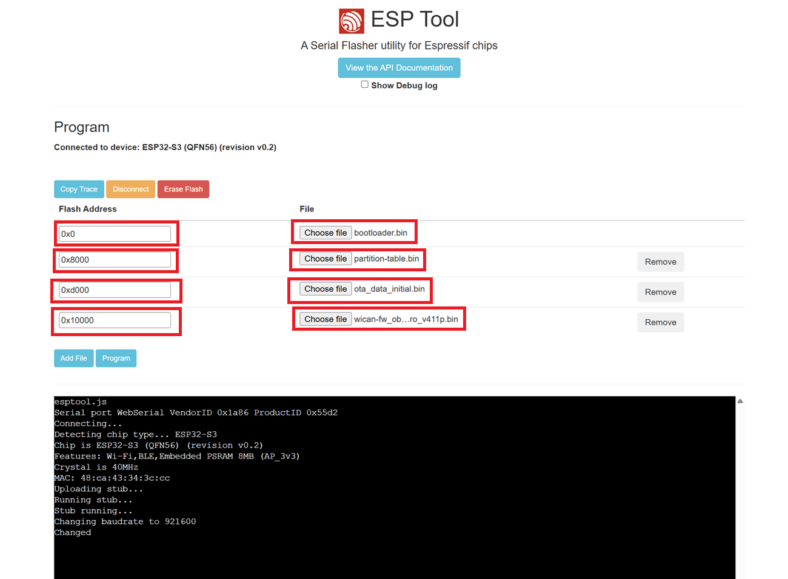

# Recovery over USB

<p class="lead">The last resort for a WiCAN PRO whose flash is corrupted: a firmware that does not start, a device that does not even reach safe mode, an update that was cut off half way. The whole firmware is written again over the USB-C cable with Espressif's flashing tool, and the flash is erased on the way, so the device starts as new.</p>

Try the gentler ways first. [Factory reset](factory-reset.md) has safe mode, which recovers from a bad configuration and from a firmware that crashes at start with nothing but the button. USB flashing is for when safe mode does not come up either.

<dl class="facts" markdown>
<dt>You need</dt><dd>A USB-C data cable, a computer, power for the device from its OBD-II plug (the car, or a bench supply: the USB-C port does not power WiCAN PRO), the firmware zip from the releases page, and the flashing tool</dd>
<dt>The files</dt><dd>The four files in the zip: `bootloader.bin`, `partition-table.bin`, `ota_data_initial.bin` and the firmware `wican-fw_obd_pro_vXXX.bin`</dd>
<dt>The tool</dt><dd>ESP Tool in the browser at `https://espressif.github.io/esptool-js/` (Chrome or Edge), or `esptool.py` on the command line (`pip install esptool`)</dd>
<dt>Keeps</dt><dd>The SD card only. The erase wipes the settings, the files (vehicle tables, certificates, scripts, the dashboard, DBC files), the Bluetooth pairings and the crash report</dd>
</dl>

## Get the files

Releases are at `https://github.com/meatpiHQ/wican-fw/releases`. The zip of a release, `wican-fw_obd_pro_vXXX.zip`, holds the four files. The `.bin` published on its own is for the web interface's [update](update.md) and is not enough for a recovery. A pre-release may come without a zip: flash the latest release, then update to the pre-release from the web interface.

## Install the serial driver

The USB-C port of WiCAN PRO is a WCH CH342 dual serial converter. Windows needs WCH's `CH343SER` driver from `https://www.wch-ic.com/downloads/CH343SER_EXE.html` (it covers the CH342). WCH's drivers for macOS and Linux are at `https://github.com/WCHSoftGroup/ch34xser_macos` and `https://github.com/WCHSoftGroup/ch343ser_linux`; check first whether your system shows the two ports without them.

## Connect

<div class="steps" markdown>

1.  **Power first.** Plug WiCAN PRO into the car's OBD-II port, or a bench supply on the plug. It does not run from USB.

2.  **Then the USB-C cable** to the computer. Two serial ports appear: use the first one, Serial-A. Windows lists them in the Device Manager as `USB-Enhanced-SERIAL-A` and `USB-Enhanced-SERIAL-B` with their COM numbers; Linux and macOS show two serial devices as well, Serial-A being the first of the pair.

3.  **Open the tool**: `https://espressif.github.io/esptool-js/` in Chrome or Edge, ==Connect==, pick the Serial-A port in the browser's dialog. The page then says `Connected to device: ESP32-S3`.

</div>

## Erase and flash

<div class="steps" markdown>

1.  **==Erase Flash==.** This is what makes it a recovery: a corrupt configuration, a half-written update, whatever is wrong in the flash goes with it. It takes a few seconds.

2.  **Add the four files**, one row each, with these addresses:

    | File | Address |
    | --- | --- |
    | `bootloader.bin` | `0x0` |
    | `partition-table.bin` | `0x8000` |
    | `ota_data_initial.bin` | `0xd000` |
    | `wican-fw_obd_pro_vXXX.bin` | `0x10000` |

3.  **==Program==.** The log under the buttons shows the four writes. The firmware is the long one, about a minute at 921600 baud.

4.  **Unplug the USB cable, then power the device off and on** (out of the OBD-II port and back in). It starts as a new device: join `WiCAN_<device id>` with `@meatpi#` and run [Quick Setup](../getting-started/quick-setup.md). A firmware newer than the zip you flashed goes on afterwards from the web interface, see [Update](update.md).

</div>

<figure class="shot" markdown>
{ width="640" }
<figcaption>ESP Tool in the browser, ready to program. The picture comes from the legacy documentation; the file in the last row is the firmware of the release you flash.</figcaption>
</figure>

## With esptool.py

The same from the command line, with the name of your Serial-A port:

```text
esptool.py --chip esp32s3 --port COM5 erase_flash
esptool.py --chip esp32s3 --port COM5 write_flash 0x0 bootloader.bin 0x8000 partition-table.bin 0xd000 ota_data_initial.bin 0x10000 wican-fw_obd_pro_vXXX.bin
```

Leave out the first line only when the flash is not the problem and the settings are worth keeping. For a recovery, erase.

## Troubleshooting

| Symptom | Likely cause | What to do |
| --- | --- | --- |
| No serial port appears | a charge-only cable, no driver, or the device is not powered | a data cable, the driver, OBD-II power before the cable |
| Two ports, and the tool does not connect | the second port, Serial-B, was picked | pick Serial-A; if in doubt, try the other one |
| `Failed to connect` | the tool did not catch the chip | unplug the USB cable and plug it in again, then ==Connect== at once |
| The write stops half way | a loose cable, or the supply dropped | the cable; a steady supply on the OBD-II plug |
| ESP Tool says the browser is not supported | Firefox or Safari | Chrome or Edge, which have Web Serial |
| The device starts and asks to be set up | expected after an erase | [Quick Setup](../getting-started/quick-setup.md), then a [backup](backup-and-restore.md) if you have one |
