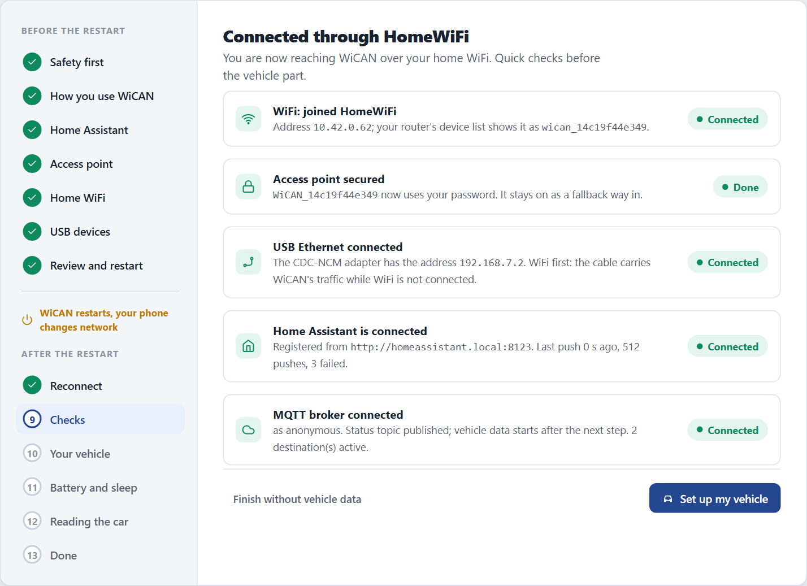
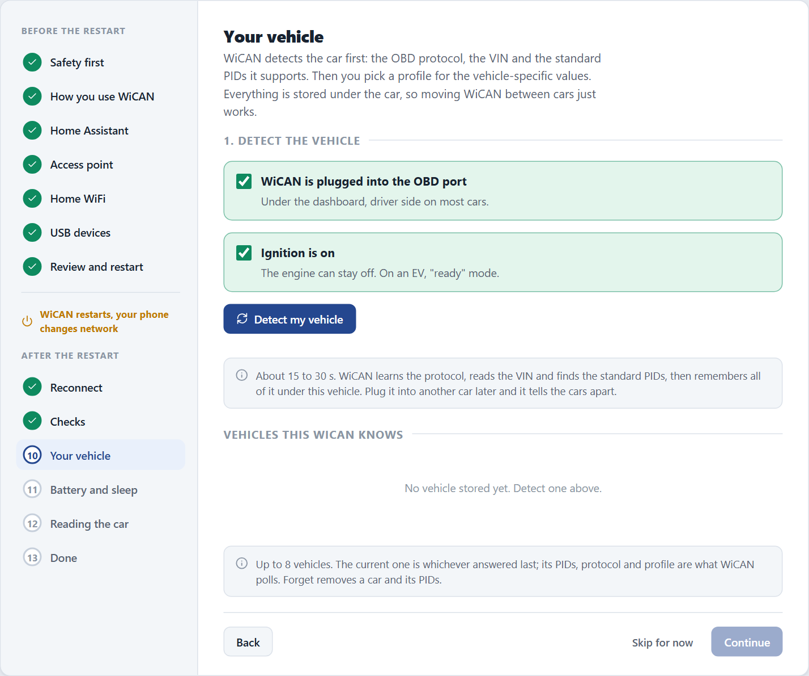
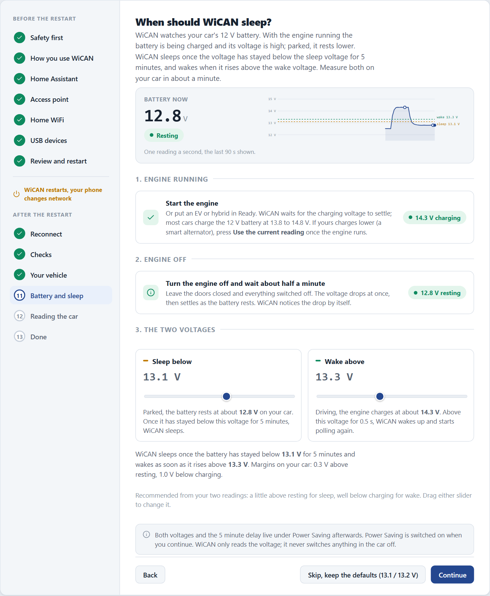
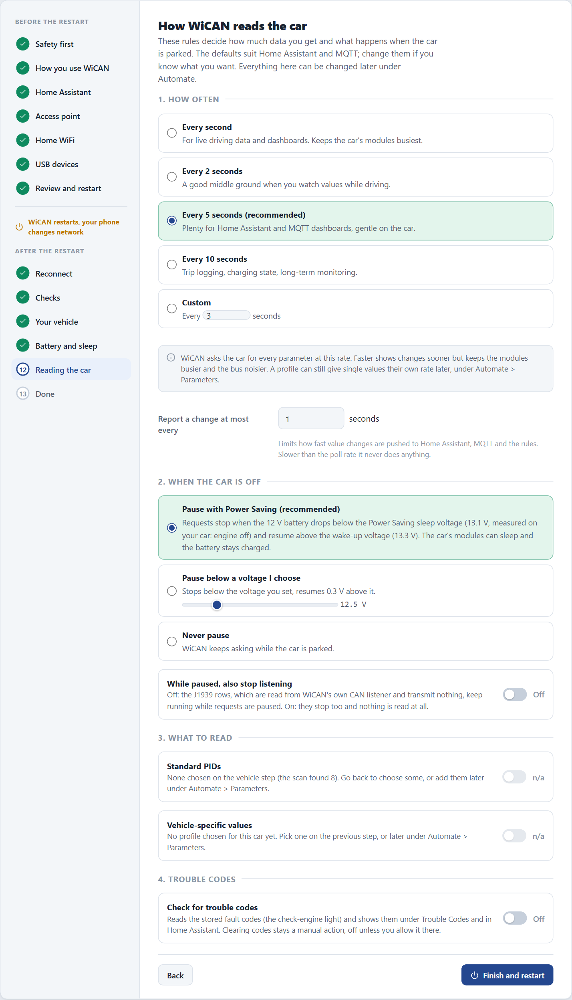
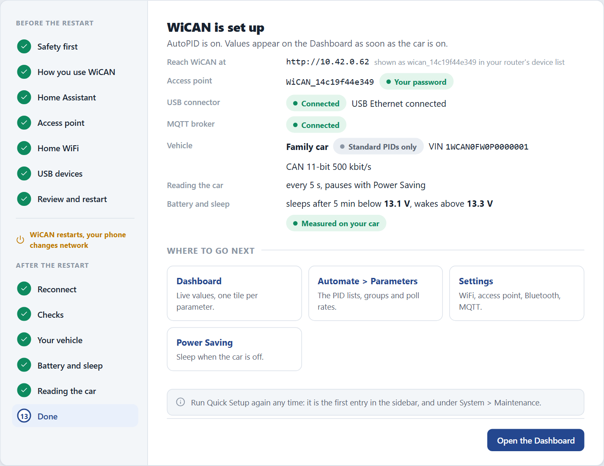

# Quick Setup, after the restart

Screens from the web interface preview; facts checked against WiCAN Pro firmware v6.00p_alfa-02, 2026-10-09

The second half of Quick Setup runs on your home network: a few checks, your vehicle, the battery voltages that decide when WiCAN sleeps, how the car is read, done. Six steps, with the car parked and the ignition on.

This part starts when you open the link from the [reconnect screen](quick-setup.md) with your phone on the same network as WiCAN. The step list on the left continues at step 8.

1.  **Check the connections**

    The first screen lists what is already working: the home WiFi with WiCAN's address and the name your router shows it under, the access point with your password, anything on the USB connector, Home Assistant or your MQTT broker.

    <figure class="shot" markdown>
    { width="640" }
    <figcaption>Everything green means the first half landed. Set up my vehicle continues; Finish without vehicle data stops here.</figcaption>
    </figure>

    Tap ==Set up my vehicle==.

2.  **Detect the vehicle**

    Tick ==WiCAN is plugged into the OBD port== and ==Ignition is on== (the engine can stay off; put an EV in ready mode), then tap ==Detect my vehicle==. Detection takes 15 to 30 seconds: WiCAN learns the OBD protocol, reads the VIN and finds the standard PIDs the car answers, and remembers all of it under this vehicle.

    <figure class="shot" markdown>
    { width="640" }
    <figcaption>WiCAN keeps up to 8 vehicles. Plug it into another car later and it tells them apart by the VIN.</figcaption>
    </figure>

3.  **Name the car, choose its PIDs and a profile**

    The result shows the VIN, the protocol that answered and how many standard PIDs the car supports. Give the car a name: it appears on the Status page and in Home Assistant.

    <figure class="shot" markdown>
    { width="640" }
    <figcaption>A new vehicle with 8 standard PIDs found and no profile yet.</figcaption>
    </figure>

    - ==Choose PIDs== opens the picker for the standard values: speed, RPM, coolant temperature, fuel level and the like. Each chosen PID is one request per polling round, so fewer means faster updates for the ones you keep. Choosing none is allowed; add them later under ==Automate== › ==Parameters==.
    - A **profile** adds the values the standard PIDs do not carry, such as battery state of charge or charging power on an EV. When WiCAN knows the manufacturer code of the VIN it suggests matching profiles; ==Choose profile== searches all of them, ==Test profile== tries one against the car before you keep it. ==Keep it without a profile== is fine for now.

    Tap ==Continue==.

4.  **Measure the battery**

    WiCAN watches the car's 12 V battery: high while the engine charges it, lower when the car rests. It sleeps once the voltage has stayed below the sleep voltage for 5 minutes and wakes when it rises above the wake voltage. This step measures both on your car in about a minute.

    <figure class="shot" markdown>
    { width="640" }
    <figcaption>After the two readings WiCAN proposes the sleep voltage a little above resting and the wake voltage well below charging.</figcaption>
    </figure>

    1. Start the engine, or put an EV or hybrid in ready mode, and wait for the charging voltage to settle. Most cars charge at 13.8 to 14.8 V. If yours charges lower, press ==Use the current reading== once the engine runs.
    2. Turn the engine off, leave the doors closed and everything switched off, and wait about half a minute. WiCAN notices the drop by itself.
    3. Check the two voltages and drag a slider if you want a different margin.

    Tap ==Continue==. Power Saving is switched on with these voltages. ==Skip, keep the defaults== keeps 13.1 V and 13.2 V and still switches Power Saving on.

    !!! note "WiCAN only reads the voltage"
        It never switches anything in the car off. The sleep delay and both voltages can be changed later under ==Power Saving==.

5.  **Decide how WiCAN reads the car**

    The defaults suit Home Assistant and MQTT. Everything here can be changed later under ==Automate==.

    <figure class="shot" markdown>
    { width="560" }
    <figcaption>Every 5 seconds and pause with Power Saving are the recommended choices.</figcaption>
    </figure>

    | Choice | What it means |
    | --- | --- |
    | ==How often== | How often every parameter is asked for. Every second for live driving data, every 5 seconds for Home Assistant and MQTT dashboards, every 10 seconds for trip logging. `Report a change at most every` limits how fast value changes are pushed on. |
    | ==When the car is off== | ==Pause with Power Saving== stops requests when the battery drops below the sleep voltage and resumes above the wake voltage, so the car's modules can sleep. Or pause below a voltage you choose, or never pause. |
    | ==What to read== | The standard PIDs you chose and the vehicle-specific values of the profile. Either reads `n/a` when nothing was chosen. |
    | ==Check for trouble codes== | Reads the stored fault codes behind the check engine light and shows them under Trouble Codes and in Home Assistant. Clearing codes stays a manual action. |

    Tap ==Finish and restart==. WiCAN saves everything and restarts once more; the page waits for it.

6.  **Done**

    The last screen sums up what WiCAN is now: its address on your network, the access point, the USB connector, the broker, the vehicle, the polling rate, the sleep and wake voltages.

    <figure class="shot" markdown>
    { width="640" }
    <figcaption>AutoPID is on: values appear on the Dashboard as soon as the car is on.</figcaption>
    </figure>

    Tap ==Open the Dashboard==. You can run Quick Setup again any time: it is the first entry in the sidebar, and under ==System== › ==Maintenance==.

## If detection finds nothing

- The ignition must be on. On many cars the modules answer only with the ignition on, engine running or not.
- Right after a restart the OBD chip takes about 15 seconds to get ready. Wait and tap ==Detect my vehicle== again.
- A truck or bus that speaks J1939 is detected from what it broadcasts; see [J1939 and WWH-OBD](../vehicle-data/j1939-wwh-obd.md).
- ==Skip for now== leaves the vehicle part for later. WiCAN runs detection by itself the first time it meets an unknown car.
