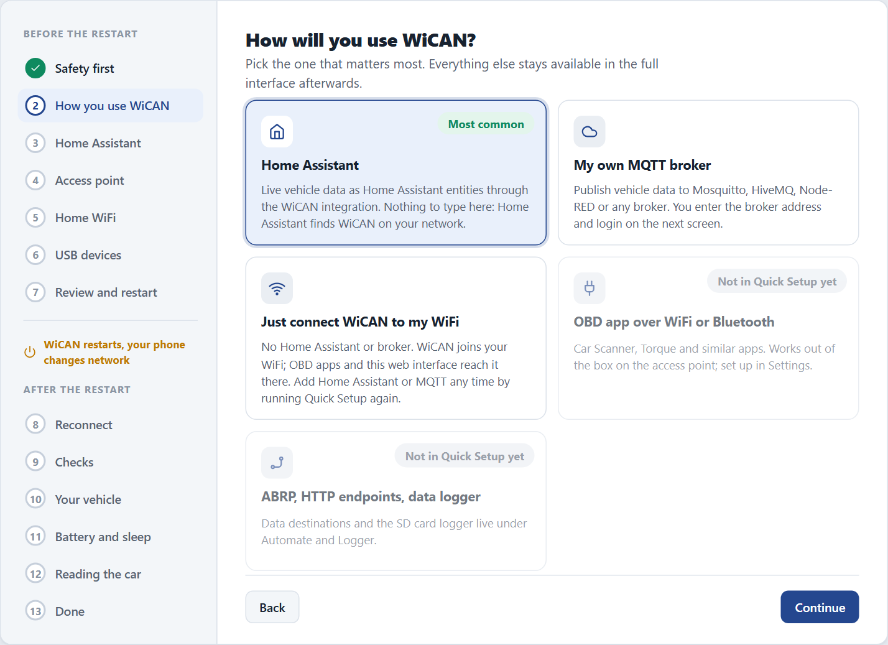
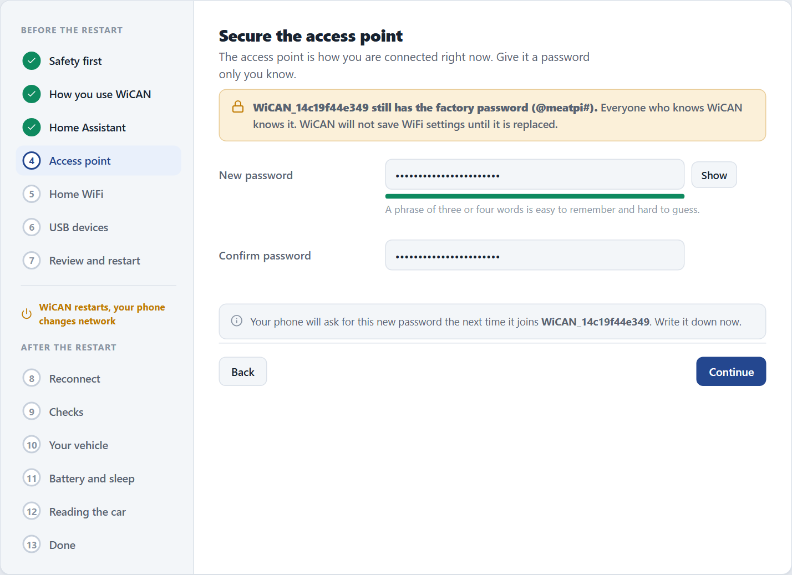
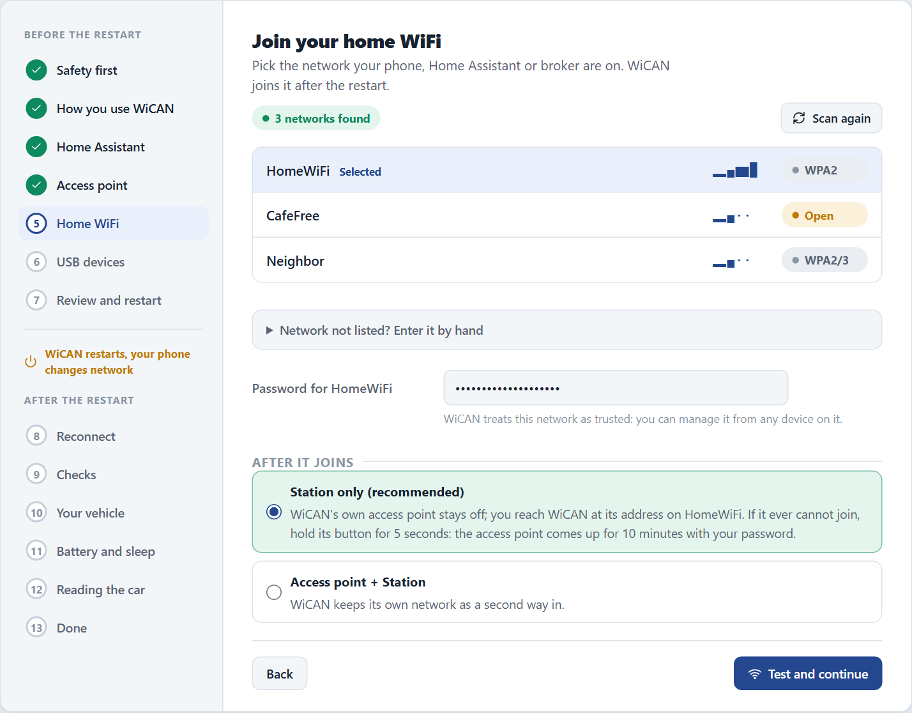
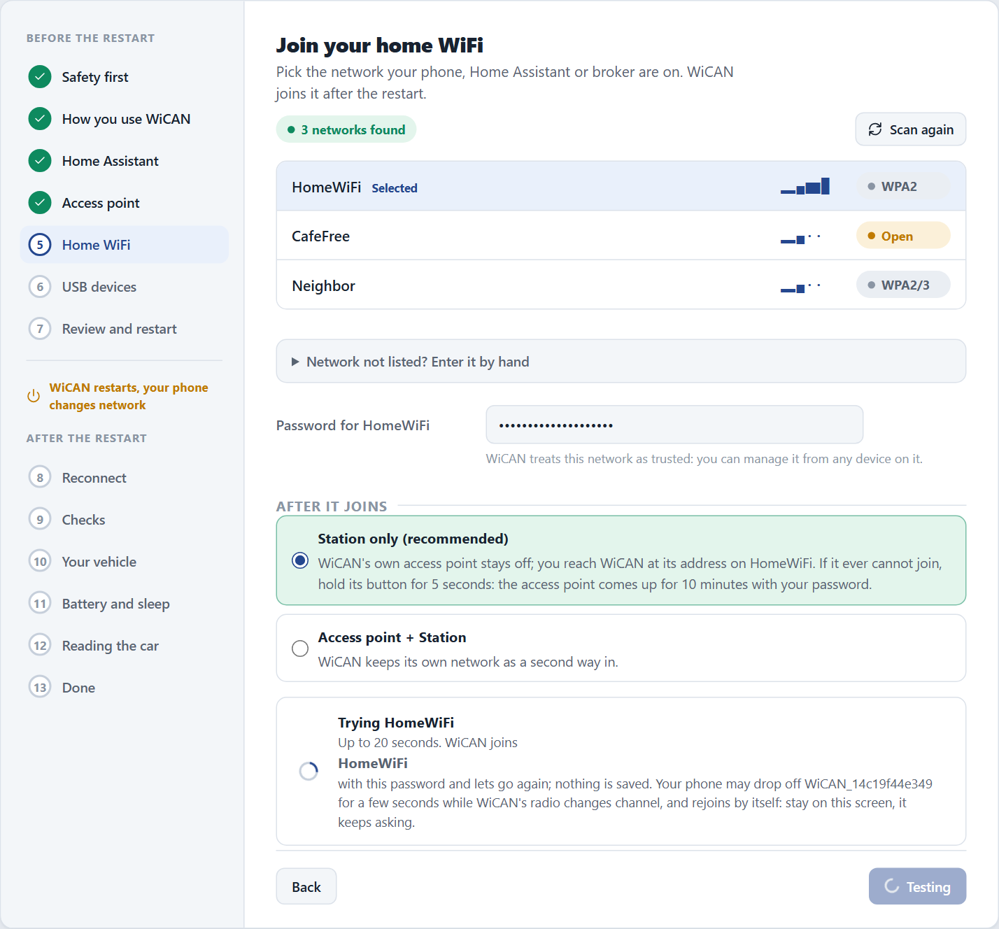
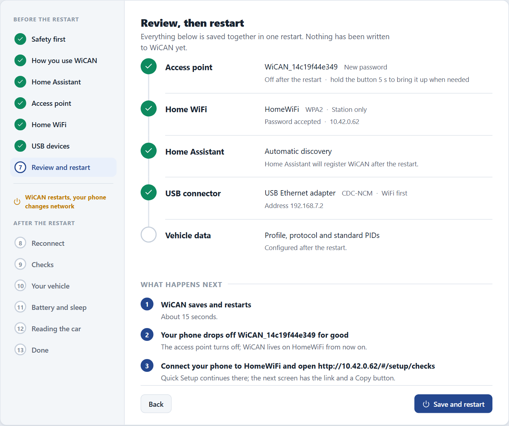
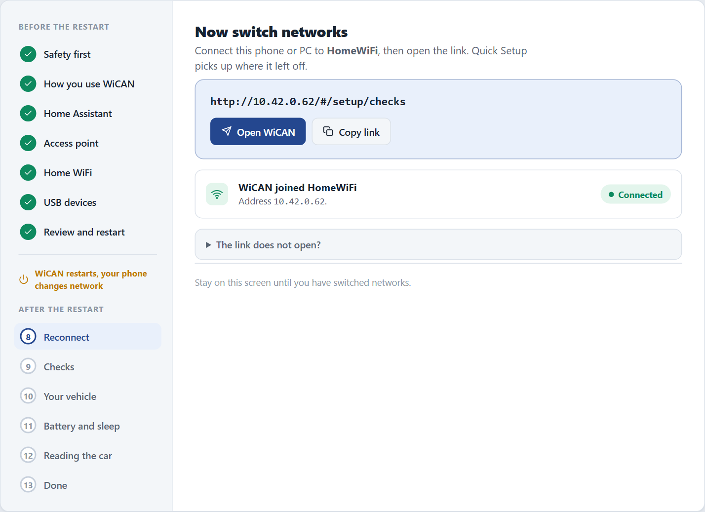

# Quick Setup

Screens from the web interface preview; facts checked against WiCAN PRO firmware v6.00p_alfa-02, 2026-10-09

Quick Setup gets a new WiCAN PRO onto your home WiFi, talking to Home Assistant or your MQTT broker, reading your vehicle and sleeping when the car is parked. It takes about six minutes and runs in your phone's browser.

<dl class="facts" markdown>
<dt>You need</dt><dd>A phone or laptop with WiFi, the password of your home WiFi, the car parked with the ignition on</dd>
<dt>Access point</dt><dd>`WiCAN_` followed by twelve letters and digits, factory password `@meatpi#`</dd>
<dt>Setup address</dt><dd>`http://192.168.0.10`</dd>
<dt>Saves</dt><dd>Nothing until the Review step: you can leave at any time with ==Exit setup==</dd>
</dl>

!!! warning "Parked, not driving"
    Do all of this with the car parked. Quick Setup needs the ignition on for the vehicle step, not the engine running.

## Before the restart

1.  **Plug WiCAN PRO into the OBD-II port**

    On most cars the port is under the dashboard on the driver side, sometimes behind a small cover. The LED on WiCAN lights within a few seconds.

2.  **Join the WiCAN access point**

    On your phone, open the WiFi settings and pick the network whose name starts with `WiCAN_`. The factory password is `@meatpi#`.

    !!! tip
        Your phone may warn that this network has no internet. Stay connected anyway. Quick Setup changes this password before anything else is saved.

3.  **Open the setup page**

    In a browser, go to `http://192.168.0.10`. A new WiCAN opens Quick Setup by itself. The list on the left shows every step, before and after the restart.

    <figure class="shot" markdown>
    { width="760" }
    <figcaption>Quick Setup on a new device. The header shows the access point name and the setup address.</figcaption>
    </figure>

4.  **Accept the three rules**

    Read the three rules and tick each one. ==Continue== turns blue once all three are ticked.

    <figure class="shot" markdown>
    { width="640" }
    <figcaption>WiCAN stays on private networks only, keeps its password private, and diagnostics are for your own vehicle.</figcaption>
    </figure>

5.  **Choose how you will use WiCAN**

    Pick the one that matters most. Everything else stays available in the full interface afterwards.

    <figure class="shot" markdown>
    { width="640" }
    <figcaption>Home Assistant is preselected. The MQTT broker tile adds a step for the broker address and login.</figcaption>
    </figure>

    | Choice | What it sets up |
    | --- | --- |
    | ==Home Assistant== | Nothing to type. Home Assistant finds WiCAN on your network after the restart. |
    | ==My own MQTT broker== | A step for the broker address, user name and password. |
    | ==Just connect WiCAN to my WiFi== | WiFi only. Add Home Assistant or MQTT later by running Quick Setup again. |

6.  **Home Assistant: nothing to type**

    This screen explains how the WiCAN integration registers your device. Read it and tap ==Continue==.

    <figure class="shot" markdown>
    { width="640" }
    <figcaption>Home Assistant discovers WiCAN on your network; the integration guide covers the Home Assistant side.</figcaption>
    </figure>

7.  **Set a new access point password**

    Type a password of your own twice. It replaces the factory password from the restart on.

    <figure class="shot" markdown>
    { width="640" }
    <figcaption>Pick something you can type on a phone: you will need it whenever you bring the access point back.</figcaption>
    </figure>

8.  **Join your home WiFi and test it**

    Pick your network from the list (or open ==Network not listed? Enter it by hand==), type its password and keep ==Station only== selected. Tap ==Test and continue==: WiCAN tries the network now, before anything is saved.

    <figure class="shot" markdown>
    { width="640" }
    <figcaption>Station only is the recommended mode: the WiCAN access point turns off after the restart.</figcaption>
    </figure>

    <figure class="shot" markdown>
    { width="640" }
    <figcaption>The test takes up to 20 seconds. Your phone may drop off the WiCAN network for a moment while the radio changes channel; it rejoins by itself.</figcaption>
    </figure>

    !!! warning "Private networks only"
        Use your home network, never a public, hotel, cafe or guest network. WiCAN joins 2.4 GHz networks.

9.  **USB devices**

    Anything on the USB connector (an ESPNetLink, a USB Ethernet adapter, a GPS receiver) is named here. Nothing plugged in? Just tap ==Continue==.

    <figure class="shot" markdown>
    { width="640" }
    <figcaption>A found device shows its details; an Ethernet adapter also asks when the cable should carry WiCAN's traffic.</figcaption>
    </figure>

10. **Review, then restart**

    Check the summary. Everything below it is saved together in one restart. Tap ==Save and restart==, then switch your phone to your home WiFi and open the link on the next screen.

    <figure class="shot" markdown>
    { width="640" }
    <figcaption>Nothing has been written to WiCAN before this point.</figcaption>
    </figure>

    <figure class="shot" markdown>
    { width="640" }
    <figcaption>WiCAN joined the home network. Connect your phone to the same network and tap Open WiCAN, or copy the link.</figcaption>
    </figure>

## After the restart

Quick Setup picks up where it left off on your home network: a few checks, your vehicle, battery and sleep, how the car is read. Continue with [Quick Setup, after the restart](after-the-restart.md).

??? info "The link does not open?"
    Make sure the phone is on the home network you chose, not still on the WiCAN network. The address is the one WiCAN received from your router; the reconnect screen shows it.
