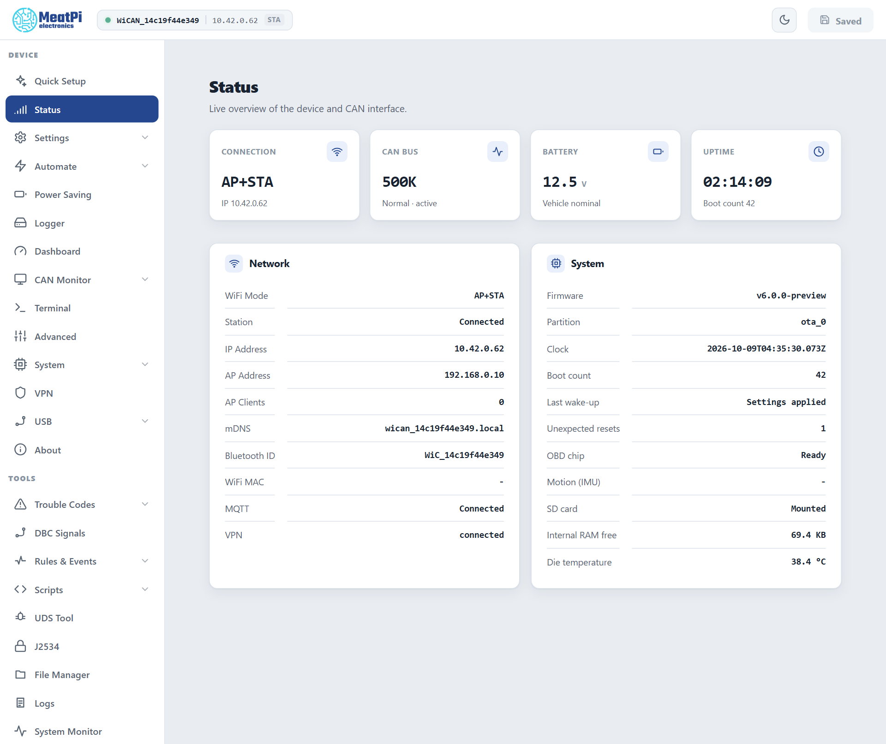
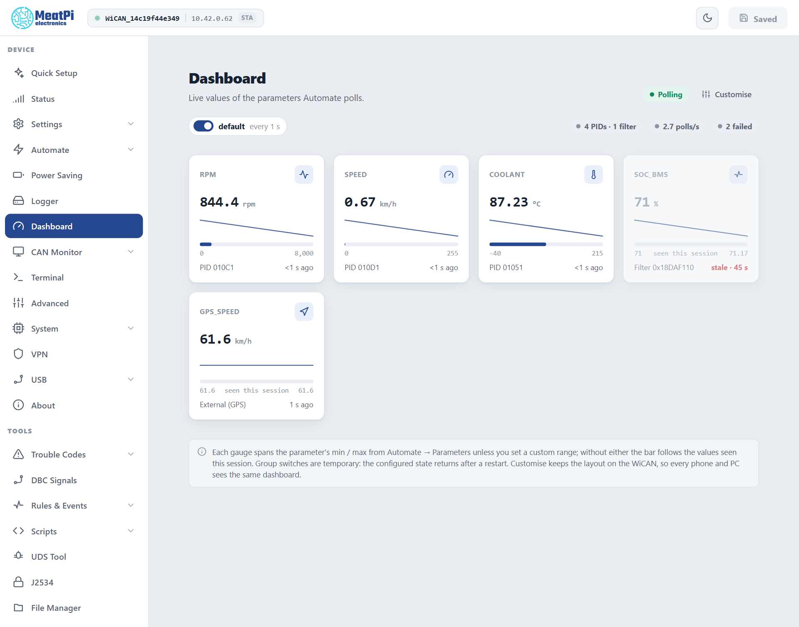

# The web interface

Screens from the web interface preview; the page list checked against firmware v6.00p_alfa-02, 2026-10-09

Everything WiCAN Pro does is set up and watched from one web page that the device itself serves. Open it from any phone or computer on the same network, no app and no account needed. This chapter is a tour; each page gets its own chapter later in the manual.

## Opening it

| Where you are | Address |
| --- | --- |
| On WiCAN's own access point | `http://192.168.0.10` |
| On your home network | the address your router gave WiCAN, shown on the Done screen of Quick Setup and in the router's device list as `wican_<device id>`, or `http://wican_<device id>.local` |
| Over Bluetooth | the same pages are not served over BLE, but a phone app can use the whole API through the [BLE tunnel](../reference/ble-api/http-over-ble.md) |

There is no login. Anyone on the same private network can open the page, which is why Quick Setup asks you to keep WiCAN on private networks and to set your own access point password.

## The layout

<figure class="shot" markdown>
{ width="760" }
<figcaption>The Status page. The header shows the device, its address and how you are connected; the sidebar lists every page.</figcaption>
</figure>

- **The header**: the access point name, the address you are reaching WiCAN through and how (==STA== for your network, ==AP== for the access point), a warning badge when something needs attention (the factory password still set, a fault, a sleep countdown), the light and dark theme switch, and ==Submit==. Settings pages stage their changes; ==Submit== saves them all and restarts WiCAN. It reads ==Saved== when nothing is pending.
- **The sidebar** has two groups. ==Device== is setup and daily use; ==Tools== is diagnostics. Entries with a chevron open a sub-list.
- **The page**: cards. A card with a status chip at its top right (==Connected==, ==Polling==, ==0 clients==) shows live data; a card with fields is settings.

## The Device pages

| Page | What it is for |
| --- | --- |
| ==Quick Setup== | The guided setup, [both halves](quick-setup.md). Run it again any time; it is also under ==System==. |
| ==Status== | The live overview: connection, CAN bus, battery, uptime; the network details (mode, addresses, the mDNS name, the Bluetooth name, MQTT and VPN state) and the system details (firmware, clock, boot count, the OBD chip, motion, SD card, free memory, temperature). |
| ==Settings== | ==WiFi== (modes, access point, your networks, [the WiFi chapter](../connectivity/wifi.md)), ==Bluetooth==, ==CAN bus== (the native CAN interface), ==Connections== (the TCP servers and bridges apps connect to), ==MQTT== (the broker). All apply from ==Submit==. |
| ==Automate== | ==Settings== and ==Parameters== for the vehicle data loop ([AutoPID](../vehicle-data/autopid.md)), ==Data destinations== (cyclic pushes to MQTT, HTTP and ABRP), ==Home Assistant== (the integration's webhook). |
| ==Power Saving== | Sleep and wake: the two battery voltages, the delays, periodic wake-up, the critical floor, keep awake. [Sleep and wake](../power/sleep-and-wake.md). |
| ==Logger== | The SD card logger: what to record, in which format, rotation. |
| ==Dashboard== | One tile per parameter with its live value, a sparkline and the age of the reading, group switches, a layout you can customise and that every phone and PC then shares. |
| ==CAN Monitor== | A live view of the CAN bus, PCAN style: frames, filters, send. |
| ==Terminal== | The device's command line in the browser. |
| ==Advanced== | Motion detection: significant motion marks the car as moving, wake on motion, sensitivity. |
| ==System== | Maintenance: firmware update, backup and restore, factory reset, restart, the time. |
| ==VPN== | WireGuard or Tailscale, so WiCAN can be reached away from home. |
| ==USB== | What is on the USB connector: an ESPNetLink, an Ethernet adapter, a GPS receiver. |
| ==About== | Versions, the device id, licences. |

<figure class="shot" markdown>
{ width="760" }
<figcaption>The Dashboard. The chip at the top right says whether polling runs; the counters say how many PIDs and filters are read and how many polls failed.</figcaption>
</figure>

## The Tools pages

| Page | What it is for |
| --- | --- |
| ==Trouble Codes== | Scan the car for stored, pending and permanent codes, with descriptions from code databases you upload; clear them when allowed. |
| ==DBC Signals== | Upload `.dbc` files and turn their signals into parameters read from broadcast frames. |
| ==Rules & Events== | The rules engine: when an event happens or a value crosses a line, do something (publish, log, run a script, switch the LED). |
| ==Scripts== | Berry scripts that run on the device: the editor, the examples, the reference. |
| ==UDS Tool== | Send one diagnostic request to an ECU and read the answer; open a tester session. |
| ==J2534== | The PassThru server for PC diagnostic tools and the Windows driver. |
| ==File Manager== | Browse, upload, download and delete files on the internal flash and the SD card. |
| ==Logs== | The device's log ring, the first thing to attach to a support request, with log levels per module. |
| ==System Monitor== | Tasks, memory and CPU load, for those who want to see inside. |
| ==All Settings== | Every component's settings document as a form built from its schema, including the ones no page covers. |

## Three things to know

- **Nothing applies until Submit.** Settings pages stage. The header turns from ==Saved== into ==Submit== when something is pending, and WiCAN restarts when you press it. The exception is the Parameters page, which applies live.
- **The sleep countdown shows in the header.** When the battery is below the sleep voltage, a bar counts down to sleep and offers ==Keep awake== for ten more minutes, three times per start.
- **The theme follows you.** The switch at the top right picks light or dark; the preview pictures in this manual use the light theme.
