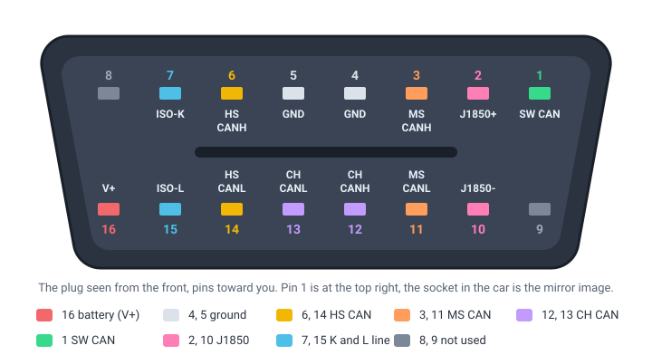

# Pinout

The sixteen pins of the WiCAN PRO plug and what each one carries: power, three CAN buses, the single-wire CAN, the J1850 pair and the K and L lines.

WiCAN PRO plugs into the car's OBD-II socket (SAE J1962) and uses fourteen of the sixteen pins.

<figure class="shot" markdown>
{ width="720" }
<figcaption>The plug of WiCAN PRO seen from the front, pins toward you: pin 1 is at the top right. The socket in the car is the mirror image.</figcaption>
</figure>

| Pin | Marking | Signal |
| --- | --- | --- |
| 16 | V+ | Battery, 7 V to 18 V. The only power source of WiCAN PRO, see [Power](datasheet.md#power). |
| 4, 5 | GND | Ground. |
| 6, 14 | HS CANH, HS CANL | High-speed CAN: ISO 15765-4 on most cars, SAE J1939 on trucks, raw CAN (ISO 11898). |
| 3, 11 | MS CANH, MS CANL | Medium-speed CAN (MS-CAN). |
| 12, 13 | CH CANH, CH CANL | The third CAN bus, GM's second high-speed bus. |
| 1 | SW CAN | Single-wire CAN (GMLAN). |
| 2, 10 | J1850+, J1850- | SAE J1850 PWM and VPW. |
| 7, 15 | ISO-K, ISO-L | K line and L line: ISO 9141-2 and ISO 14230-4 (KWP2000). |
| 8, 9 | - | Not used. |

The electrical and radio figures, the comparison with WiCAN and the PDF itself are on the [Datasheet](datasheet.md) page.
