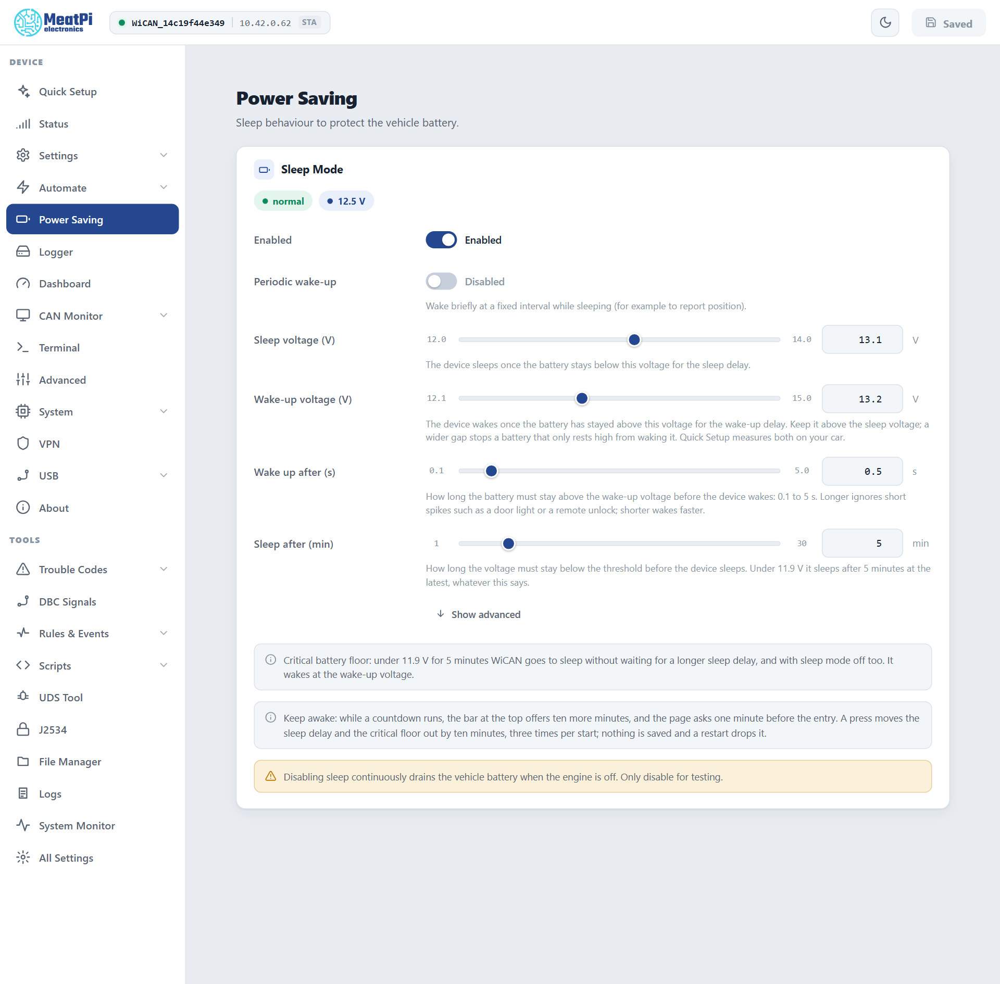

# Sleep and wake

Facts checked against the device's settings schema and the firmware's sleep reference, firmware v6.00p_alfa-02, 2026-10-09. Screens from the web interface preview.

WiCAN PRO stays plugged in when the car is parked, so it has to know when to stop drawing power. It reads the 12 V battery: high while the engine charges it, lower when the car rests. Below a sleep voltage for a few minutes it goes to sleep; above a wake voltage it wakes. The page for this is ==Power Saving==.

<figure class="shot" markdown>
{ width="700" }
<figcaption>The defaults: sleep below 13.1 V after 5 minutes, wake above 13.2 V after half a second.</figcaption>
</figure>

## How it decides

| Rule | What happens |
| --- | --- |
| **Sleep** | The battery stays below the ==Sleep voltage== for ==Sleep after== minutes: WiCAN goes to sleep. Default 13.1 V and 5 minutes. |
| **Wake** | The battery stays above the ==Wake-up voltage== for ==Wake up after== seconds: WiCAN restarts. Default 13.2 V and 0.5 s. A longer delay ignores short spikes such as a door light or a remote unlock. |
| **Critical floor** | Under 11.9 V for 5 minutes WiCAN sleeps whatever the settings say, sleep mode off included, and whatever a longer sleep delay would allow. The protection against a flat battery. |

Asleep, the radios are off and the device draws very little. It wakes by itself when the car is started, because the alternator or the charger lifts the voltage above the wake voltage.

!!! warning "Keep sleep on"
    With sleep disabled WiCAN draws power continuously while the engine is off. Disable it only for testing on a bench supply.

## Setting the two voltages

Quick Setup measures both on your car: the resting voltage with the engine off and the charging voltage with it running, then proposes the sleep voltage a little above resting and the wake voltage well below charging. See [Measure the battery](../getting-started/after-the-restart.md). On the Power Saving page you can move either slider, or type a value:

| Setting | Range | Default |
| --- | --- | --- |
| ==Sleep voltage== | 12.0 to 14.0 V | 13.1 V |
| ==Wake-up voltage== | 12.1 to 15.0 V | 13.2 V |
| ==Wake up after== | 0.1 to 5 s | 0.5 s |
| ==Sleep after== | 1 to 30 min | 5 min |

Keep the wake voltage above the sleep voltage; WiCAN enforces a gap of at least 0.1 V. A wider gap stops a battery that only rests high from waking the device.

Typical numbers: a healthy battery rests at 12.4 to 12.8 V and charges at 13.8 to 14.8 V. Cars with a smart alternator charge lower at times, which is why Quick Setup measures instead of assuming.

## The countdown and keep awake

While the battery is below the sleep voltage, the header shows a bar counting down to sleep. ==Keep awake== gives ten more minutes, up to three times per start; the page also asks one minute before the end. A hold is not saved: a restart drops it.

## Periodic wake-up

==Periodic wake-up== makes a sleeping WiCAN wake briefly at a fixed interval (5 minutes to 24 hours, default 30 minutes), for example to report its position from a GPS accessory, then sleep again if the battery is still low.

## What else sleep touches

- **AutoPID** pauses with Power Saving by default: requests stop below the sleep voltage and resume 0.3 V above it, so the car's modules can sleep too. The [Automate settings](../vehicle-data/autopid.md#the-automate-settings) choose another pause voltage or none.
- **Motion** does not wake WiCAN. The motion sensor marks the car as moving and can publish a bump event for the rules, but a sleeping device wakes on voltage only.
- **Home Assistant** keeps the last values while WiCAN sleeps and marks them stale.

## Watching it from a script

`GET /api/sleep` gives the state, the countdown and the holds used; `POST /api/sleep/hold` is the keep-awake button. Both are on [Device and connectivity](../reference/http-api/device.md#sleep). The settings behind the page are the `sleep_manager` document.

## Troubleshooting

| Symptom | Likely cause | What to do |
| --- | --- | --- |
| WiCAN sleeps while driving | the car charges below the wake voltage, or the sleep voltage is set above the resting voltage of a charging battery | run Quick Setup's battery step again, or lower the sleep voltage |
| WiCAN never sleeps | sleep mode off, or the resting voltage sits above the sleep voltage | check ==Enabled==; read the resting voltage on the Status page and set the sleep voltage a little above it |
| WiCAN wakes in the night | a short voltage rise (a door light, a remote unlock) | raise ==Wake up after== |
| WiCAN went to sleep during setup | the battery was under 11.9 V for 5 minutes, the critical floor | charge the battery or run the engine; ==Keep awake== buys ten minutes |
