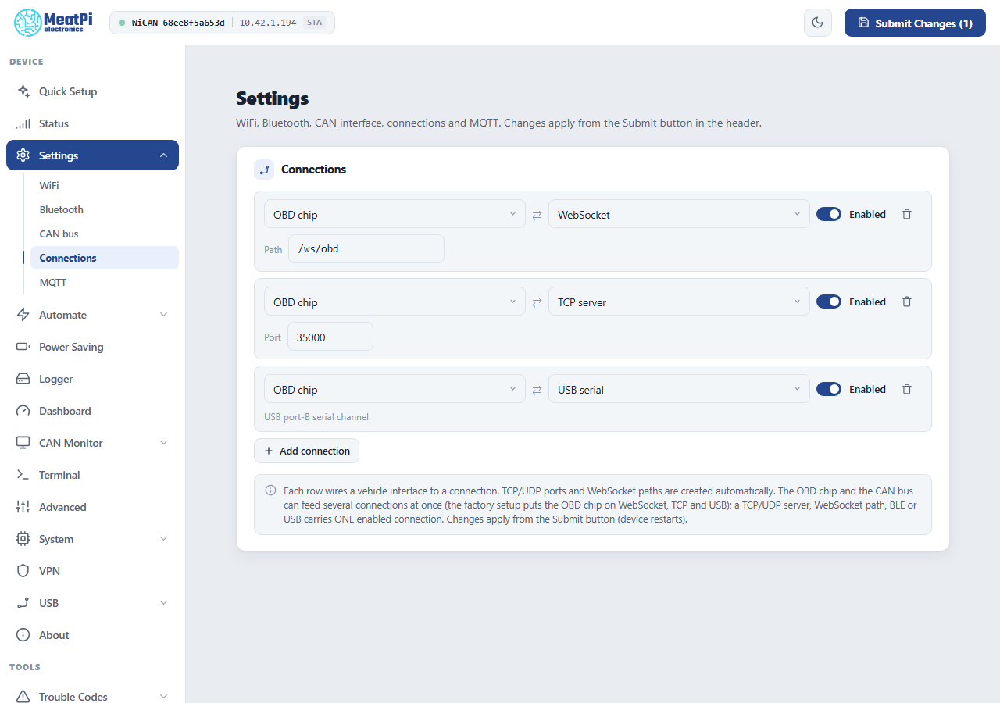

# Apps over WiFi and BLE

<p class="verified pending">Device side (the connections, their ports and the factory setup) read from the bench device, firmware v6.00p_alfa-02, 2026-10-09. The app-side steps are carried over from the earlier WiCAN guides and have not been re-checked in the apps' current versions.</p>

<p class="lead">WiCAN Pro works with the OBD and CAN apps you already use. Out of the box it is an ELM327 WiFi adapter for Car Scanner, Torque and the like; a connection row turns it into a RealDash, SavvyCAN or slcan device, over WiFi or Bluetooth.</p>

## Connections: how apps reach the car

==Settings== › ==Connections== is where a vehicle interface is wired to a way in. Each row has two ends:

- **The interface**: the ==OBD chip== (the ELM327-compatible interpreter, which talks every OBD protocol) or the ==CAN bus== (WiCAN's own CAN controller, raw frames).
- **The connection**: a TCP or UDP port, a WebSocket path, Bluetooth, or the USB serial link. Ports and paths are created automatically.

Between the two sits a protocol: plain ELM327 text for the OBD chip; for the CAN bus a choice of slcan, GVRET (SavvyCAN), RealDash frames, or a compact binary record with timestamps for your own tools. The OBD chip and the CAN bus can feed several connections at once; a port, a path, Bluetooth or USB carries one connection each. Rows apply from ==Submit== (WiCAN restarts).

<figure class="shot" markdown>
{ width="640" }
<figcaption>Settings, Connections, with the factory rows. Each row is an interface, a connection and a switch. Picture taken on the bench device.</figcaption>
</figure>

**The factory setup** puts the OBD chip on three connections at once:

| Connection | Where | For |
| --- | --- | --- |
| TCP port `35000` | WiFi (the access point or your network) | ELM327 apps: the classic WiFi OBD adapter address `192.168.0.10:35000` |
| WebSocket `/ws/obd` | WiFi | browser apps and the web interface's own tools |
| USB serial | the USB connector in device mode | a PC with a cable |

Three more servers are prepared but switched off, for the CAN bus: TCP `3333` (slcan), TCP `23` (GVRET), UDP `17`.

!!! note "AutoPID steps aside"
    While an app talks to the OBD chip, WiCAN's own polling pauses and resumes 10 seconds after the app's last command, so the two never talk over each other. Dashboard values and Home Assistant updates stop meanwhile.

## Car Scanner, Torque and other ELM327 apps

Nothing to configure on WiCAN. In the app, add a WiFi adapter:

| App setting | On WiCAN's access point | On your home network |
| --- | --- | --- |
| Connection type | WiFi | WiFi |
| Address | `192.168.0.10` | WiCAN's address on your network (the Status page shows it) |
| Port | `35000` | `35000` |

The phone must be on the same network as WiCAN: joined to WiCAN's access point, or on the home network WiCAN is on. In Station only mode the access point is off, so it is the home network.

**Over Bluetooth**: add a connection with the ==OBD chip== on ==Bluetooth==, turn Bluetooth on ([Bluetooth LE](../connectivity/bluetooth.md)), pair the phone, then choose a Bluetooth LE adapter in the app and pick `WiC_<device id>`. Remember that WiFi pauses while the phone is connected over Bluetooth.

## RealDash

RealDash can use WiCAN two ways:

- **As an OBD2 adapter** (no WiCAN setup): in RealDash, ==Garage== › your dashboard › ==Add connection== › ==Adapters (OBD2)== › WiFi, address `192.168.0.10` (or the home network address), port `35000`. Pick the car's OBD2 protocol in the connection settings and enable ==Request Only First Reply==.
- **As a RealDash CAN device** (raw frames, for a RealDash XML channel file): on WiCAN add a connection with the ==CAN bus==, protocol ==RealDash==, on a TCP port of your choice, enable the CAN bus under ==Settings== › ==CAN bus== with the car's bit rate, and ==Submit==. In RealDash: ==Add connection== › ==Adapters (CAN/LIN)== › ==RealDash CAN== › ==WIFI/LAN== › WiCAN's address and that port. Bluetooth works the same way with a Bluetooth connection on WiCAN (Android and iOS; RealDash on Windows uses WiFi only).

## SavvyCAN

SavvyCAN speaks GVRET. On WiCAN add a connection with the ==CAN bus==, protocol ==GVRET==, TCP port `23` (the prepared server), enable the CAN bus with the car's bit rate, ==Submit==. In SavvyCAN: ==Connection== › ==Open Connection Window== › ==Add New Device== › ==Network Connection==; on the same network it finds WiCAN by itself, otherwise type the address. ==Create New Connection==, then tick ==Enable Bus==.

## SocketCAN on Linux

WiCAN as a `can0` interface, over the slcan protocol. On WiCAN add a connection with the ==CAN bus==, protocol ==slcan==, TCP port `3333`, enable the CAN bus with the car's bit rate, ==Submit==. On the Linux machine, make the TCP stream a serial port and attach slcand to it (replace the address with WiCAN's address on your network when it is not the access point):

```text
sudo socat pty,link=/dev/netcan0,raw tcp:192.168.0.10:3333 &
sudo slcand -o -c -s8 /dev/netcan0 can0
sudo ip link set can0 txqueuelen 1000
sudo ip link set can0 up
```

`-s8` is slcand's code for 1 Mbit/s; it only tells slcand the rate WiCAN is already using (`-s6` is 500 kbit/s, `-s5` 250 kbit/s). Then `candump can0`, `cansend`, python-can and the rest work as on any CAN interface.

## BUSMASTER

BUSMASTER connects through the VSCom CAN-API driver to an slcan stream. On WiCAN add a connection with the ==CAN bus==, protocol ==slcan==, TCP port `3333`, enable the CAN bus, ==Submit==. In BUSMASTER: ==Driver Selection== › ==VSCom CAN-API==, then ==Channel Configuration== › ==Advanced==, address and port `192.168.0.10:3333`, tick ==Hardware Timestamps==, choose the bit rate, ==OK== and ==Connect==.

## Your own program

- **ELM327 over TCP**: connect to port `35000`, send `ATZ\r`, then OBD requests such as `010C\r`; read until the `>` prompt. The dialect is ELM327 ASCII.
- **Raw CAN with timestamps**: a CAN bus connection with the binary record protocol gives 10 to 18 bytes per frame with the bus-side receive time, described under [the data pipe](../reference/ble-api/index.md#the-binary-can-record-can-raw) (the same bytes flow over TCP, WebSocket or Bluetooth).
- **Everything else** (status, settings, files, the UDS terminal, scripts): the [HTTP API](../reference/http-api/index.md), also [over Bluetooth](../reference/ble-api/http-over-ble.md).

## Troubleshooting

| Symptom | Likely cause | What to do |
| --- | --- | --- |
| The app cannot connect | the phone is not on WiCAN's network, or the port is wrong | check the phone's WiFi; `35000` for ELM apps, the port of your connection row otherwise |
| The app connects but gets no data | ignition off, or a CAN connection with the CAN bus disabled or at the wrong bit rate | ignition on; ==Settings== › ==CAN bus== enabled with the car's rate, or ==auto== |
| Two apps fight over the chip | the OBD chip answers one conversation at a time | one OBD app at a time; CAN connections can run beside it |
| Dashboard values freeze while the app runs | expected: AutoPID yields to the app | they resume 10 seconds after the app's last command |
