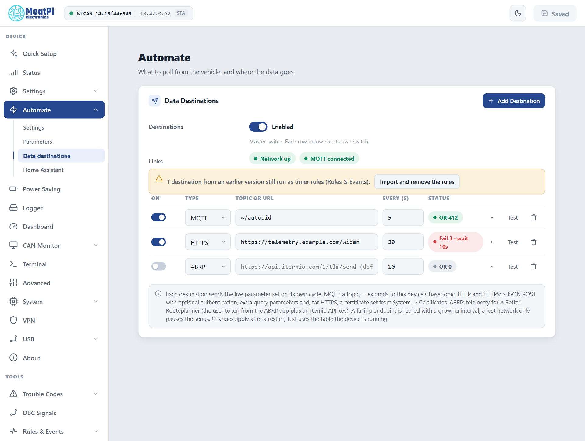
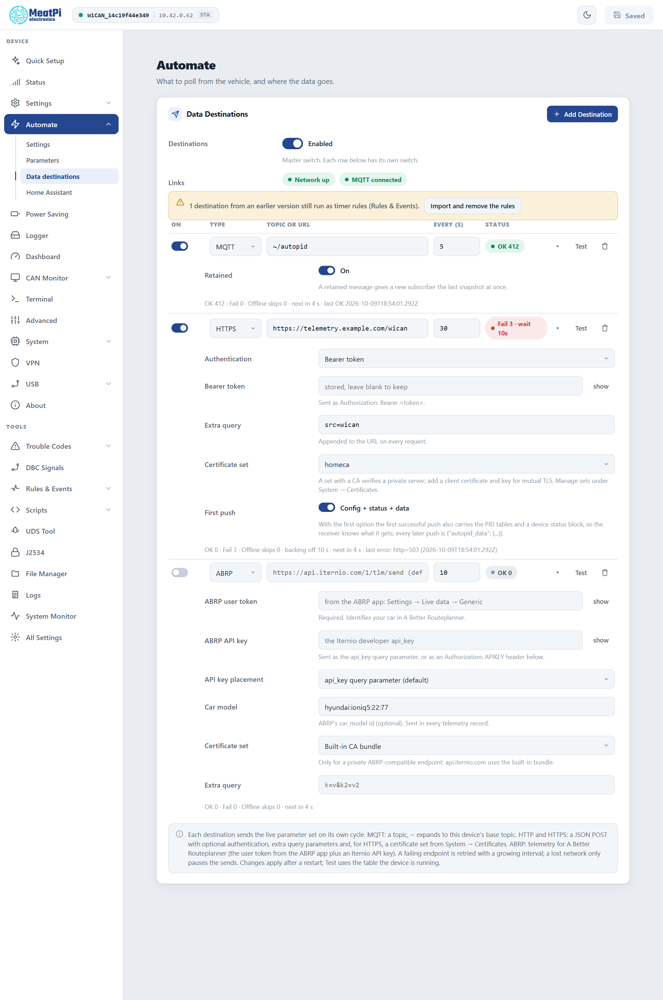

# Data destinations

<p class="lead">A destination is a place the live parameter set is sent to on a cycle: an MQTT topic, an HTTP or HTTPS endpoint (your own server, a cloud ingest), or ABRP, A Better Routeplanner, for EV route planning. Up to 8 of them, each with its own interval and switch, on ==Automate== › ==Data destinations==.</p>

<figure class="shot" markdown>
{ width="640" }
<figcaption>Automate, Data destinations. One row per place the data goes.</figcaption>
</figure>

## The page

- **==Destinations==** is the master switch; each row has its own.
- **Links** shows whether the network is up and the MQTT session connected. An MQTT row needs the second, HTTP, HTTPS and ABRP rows the first.
- **A row**: on or off, the type, the topic or URL, the interval in seconds, and a status chip: `OK n` (deliveries), `Fail n · wait Ns` (failing, with the current back-off). The caret opens the row's options and its counters; ==Test== delivers once, right now, with the table the device is running; the bin removes the row.
- **==Add Destination==** adds a row. Rows apply from ==Submit== in the header (WiCAN restarts).

A device set up before the destinations table existed may show a banner about destinations that still run as timer rules; ==Import and remove the rules== moves them here.

<figure class="shot" markdown>
{ width="640" }
<figcaption>Every row expanded: the options differ by type.</figcaption>
</figure>

## MQTT

Needs [MQTT](mqtt.md) configured under ==Settings== › ==MQTT==. The topic defaults to `~/autopid` (`~` is the device's topic prefix, `wican/<device id>`); ==Retained== (on by default) gives a new subscriber the last snapshot at once. The payload is flat, one key per parameter, plus the time:

```json
{"EngineCoolantTemp":90,"EngineRPM":800,"VehicleSpeed":0,"timestamp":1791570316}
```

This row is what Quick Setup's ==MQTT broker== use case creates. The bench device has carried it since: `OK 708` deliveries, `0` failures, and `61` laps skipped while the network was away.

## HTTP and HTTPS

A JSON `POST` to your URL on every cycle. A bare host gets the scheme of the type; an `https` row refuses an `http://` URL.

<dl class="facts" markdown>
<dt>Authentication</dt><dd>None, a bearer token (`Authorization: Bearer ...`), an API key in a header (name `x-api-key` by default) or in the query string (`api_key` by default), or basic authentication with a username and password. Tokens and passwords are write-only once saved.</dd>
<dt>Extra query</dt><dd>`k=v&k2=v2`, appended to the URL on every request.</dd>
<dt>Certificate set</dt><dd>HTTPS only. Blank verifies the server against the built-in bundle (public certificates). A set from ==System== › ==Certificates== with your CA verifies a private server; a client certificate and key in the set give mutual TLS. A server addressed by IP skips the name check.</dd>
<dt>First push</dt><dd>On by default: the first successful push also carries `config` (the PID tables) and `status` (device id, firmware, uptime, battery voltage, link state), so the receiver knows what it is getting. Every later push is the short form.</dd>
</dl>

What the bench device sent to a receiver on the bench Pi, with a bearer token and the extra query `src=wican`. The request line and headers:

```text
POST /wican?src=wican
User-Agent: WiCAN/6
Content-Type: application/json
Authorization: Bearer doc-check-token
```

The short form, every cycle:

```json
{"autopid_data":{"EngineCoolantTemp":90,"EngineRPM":800,"VehicleSpeed":0,"timestamp":1791570962}}
```

The first push with ==First push== on (the `config` object is the PID table, shortened here):

```json
{
  "config": {
    "groups": [{"name": "default", "enabled_default": true, "period_ms": 5000}],
    "pids": [{"name": "EngineCoolantTemp", "type": "std", "cmd": "0105", "group": "default",
              "parameters": [{"name": "EngineCoolantTemp", "expression": "B2-40", "unit": "degC", "class": "temperature", "min": -40, "max": 215}]}],
    "filters": []
  },
  "status": {
    "device_id": "68ee8f5a653d", "fw_version": "v6.00p_alfa-02", "hw_version": "WiCAN-PRO", "device_type": "wican_pro",
    "uptime": "00:00:08", "network_connected": true, "mqtt_connected": true, "ecu_status": "offline",
    "batt_voltage": 13.45, "timestamp": 1791570957
  },
  "autopid_data": {"EngineCoolantTemp": 90, "EngineRPM": 800, "VehicleSpeed": 0, "timestamp": 1791570957}
}
```

The first push goes out seconds after the restart, so its `ecu_status` can still read `offline` while the values are already there.

## ABRP (A Better Routeplanner)

Live telemetry for an EV's route planning. Leave the URL empty for Iternio's endpoint.

<dl class="facts" markdown>
<dt>ABRP user token</dt><dd>From the ABRP app: ==Settings== › ==Live data== › ==Generic==. Required.</dd>
<dt>ABRP API key</dt><dd>Iternio's developer key. Sent as the `api_key` query parameter by default, or as an `Authorization: APIKEY` header (==API key placement==).</dd>
<dt>Car model</dt><dd>ABRP's `car_model` id, optional, sent with every record.</dd>
<dt>Every</dt><dd>Iternio asks for a point every 5 seconds and discourages 30 or more.</dd>
</dl>

WiCAN maps the vehicle's parameters onto ABRP's fields by name, case-insensitive, values passed through unchanged. The vehicle profile therefore has to produce ABRP's units: `power` in kW with charging negative, `current` in A, `odometer` and `est_battery_range` in km, tyre pressure in kPa. `is_charging`, `is_dcfc` and `is_parked` become 0 or 1 from a boolean or an `on`/`off` value.

| Parameter name in WiCAN | ABRP field |
| --- | --- |
| `SOC` | `soc` |
| `HV_W` | `power` |
| `SPEED` | `speed` (the GPS speed when the vehicle has none) |
| `CHARGING`, `CHARGING_DC`, `PARK_BRAKE` | `is_charging`, `is_dcfc`, `is_parked` |
| `HV_CAPACITY_KWH`, `HV_CAPACITY_R`, `SOH` | `capacity`, `soe`, `soh` |
| `TMP_A`, `BATT_TEMP`, `T_CAB` | `ext_temp`, `batt_temp`, `cabin_temp` |
| `HV_V`, `HV_A` | `voltage`, `current` |
| `ODOMETER`, `RANGE` | `odometer`, `est_battery_range` |
| `TYRE_P_xx` | `tire_pressure_xx` |
| `gps_latitude`, `gps_longitude`, `gps_altitude`, `gps_heading` (from an [ESPNetLink or a USB receiver](../connectivity/usb-accessories.md)) | `lat`, `lon`, `elevation`, `heading` |

Iternio answers `{"status":"ok"}`; anything else is counted as a failure even on HTTP 200, and the row's last error shows the reason (`abrp: error ["missing utc"]` ...).

## How deliveries behave

- **No link, no failure.** While the network is down (or the broker is disconnected, for an MQTT row) the lap is skipped and counted as `Offline skips`; the next lap after the link returns delivers. The log gets one line per outage, not one per lap, so a car out of WiFi range does not fill it.
- **A failing endpoint backs off.** A transport error, a non-2xx reply or an ABRP `status` other than `ok` counts as a failure. From the third failure in a row the interval doubles from 10 s up to 8 times the row's period (at least 60 s, never above 10 minutes); the first success resets it. The chip reads `Fail 3 · wait 10s` meanwhile.
- **One poster, in order.** Rows are delivered one after the other each second. A slow or failing HTTPS row delays the rows after it by its request time (up to 6 s): keep an ABRP row's neighbours healthy, or give ABRP a table of its own.
- **Test** runs one delivery at once, ignoring the cycle and the back-off, and books it in the counters.

Conditions, templates and event-driven posts are not here: they live in ==Rules & Events==, where a timer or an event can publish to MQTT or post to a URL with a body you compose ([Automate rules](../tools/automate-rules.md)).

## Troubleshooting

| Symptom | Likely cause | What to do |
| --- | --- | --- |
| `Fail` with `http=401` or `403` | wrong or missing authentication | the token, key or basic credentials; the header or query name the server expects |
| `Fail` with `http=404` or `5xx` | the URL, or the server | check the URL in a browser; the server's log |
| `no network - waiting` in the log | the link is down | nothing: deliveries resume with the link |
| An MQTT row never delivers | the broker is not connected | ==Settings== › ==MQTT==; the `MQTT connected` chip |
| HTTPS fails on a private server | its certificate is not trusted | a certificate set with the CA, or the IP address instead of the host name |
| ABRP shows nothing | the user token, or the parameter names and units | the token from the app; a profile with ABRP's names; the row's last error |
