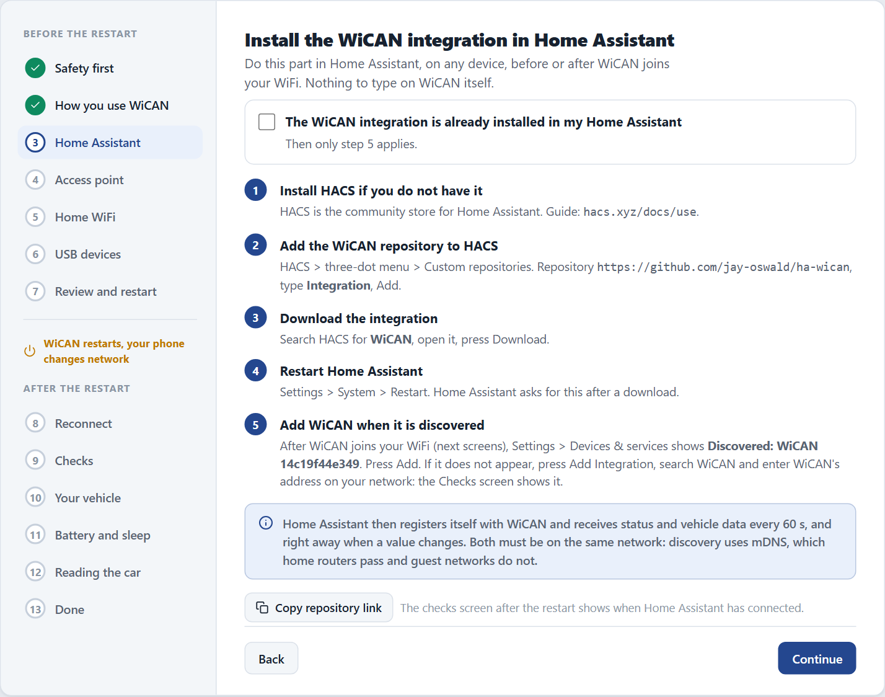

# Home Assistant

WiCAN PRO pushes its vehicle data straight into Home Assistant: one entity per parameter, a location tracker from GPS, and diagnostic sensors for the device itself. No MQTT broker is needed. The WiCAN integration finds the device on your network and registers itself; from then on WiCAN sends.

Two YouTube walkthroughs of WiCAN PRO with Home Assistant are on the [Videos](../videos.md) page.

## How it works

1. The WiCAN integration in Home Assistant discovers the device on the local network (it advertises itself as `_wican._tcp`), or you give it the address.
2. The integration registers its webhook on the device. The device remembers it across restarts.
3. Every few seconds WiCAN posts what changed: its status, the vehicle parameters, the parameter configuration, and the GPS fix when an accessory provides one. Home Assistant creates and updates the entities from that.

Because WiCAN sends, Home Assistant never has to poll a device that may be asleep in a parked car, and a device away from home can still deliver over a VPN.

## Before you start

- WiCAN on the same network as Home Assistant, set up with [Quick Setup](../getting-started/quick-setup.md). On the ==How will you use WiCAN== step choose ==Home Assistant==: nothing to type there.
- AutoPID switched on with at least one parameter (Quick Setup's vehicle step does this).
- HACS installed in Home Assistant.

<figure class="shot" markdown>
{ width="640" }
<figcaption>Quick Setup's Home Assistant step: the integration registers WiCAN after the restart; nothing to type.</figcaption>
</figure>

## Install the integration

1.  **Add the WiCAN integration in HACS**

    Open HACS, search for ==WiCAN== and download it. If your HACS does not list it, add the custom repository `https://github.com/jay-oswald/ha-wican` of type ==Integration== first.

2.  **Restart Home Assistant**

3.  **Add the device**

    Go to ==Settings== › ==Devices & services==. A discovered WiCAN shows up at the top: tap ==Configure==. Otherwise ==Add integration==, search for ==WiCAN==, and enter the device's address: `wican_<device id>.local` (the device id is the twelve characters after `WiCAN_` in the access point name) or its IP address. Repeat for every WiCAN you own.

4.  **Set the push interval**

    On the integration's card, ==Configure== sets the ==Post Interval==: how often WiCAN pushes, 15 seconds by default.

## What you get

| Entities | Source |
| --- | --- |
| One sensor per AutoPID parameter, with the unit and the name from the Parameters page | the vehicle data |
| Diagnostic sensors: sleep mode, CAN protocol, ECU PID count, AutoPID loop | the device status |
| A device tracker with the car's position | a GPS fix from an ESPNetLink or a USB GPS receiver |
| An update entity with the running firmware version | the device identity |

Entities keep their last values while the car is away or asleep: the integration caches a snapshot, and such values carry the attribute `wican_data_stale: true` plus `last_successful_update`, so a dashboard can show that the data is old instead of going empty.

## Changing things later

- **Units and names** come from WiCAN: change them on ==Automate== › ==Parameters==, not in Home Assistant.
- **After changing the car configuration** (new parameters, a profile), reload the integration. Entities for parameters that no longer exist stay until you delete them, or delete the device and add it again.
- **Push interval, data mode, compression** are on the device under ==Automate== › ==Home Assistant==: `changed` mode (the default) sends only values that changed; `full` sends everything every cycle; gzip compresses the posts for a cellular uplink.
- **Away from home**: with a VPN configured on WiCAN, its VPN address is included in every push and Home Assistant uses it when the home address is unreachable. A second webhook address (for example a Nabu Casa remote URL) can be set as a failover under the same page.

## Troubleshooting

| Symptom | Likely cause | What to do |
| --- | --- | --- |
| The device cannot be added | WiCAN is asleep or not reachable from Home Assistant | open WiCAN's page in a browser first; wake the car if Power Saving put it to sleep |
| Every entity reads Unavailable after a Home Assistant restart | Home Assistant restarted while WiCAN was away | once WiCAN is reachable, reload the integration |
| Values stop although the car is on | the webhook was rejected or paused | ==Automate== › ==Home Assistant== shows the last error and the success and failure counts; ==Devices & services== shows the integration's state. Removing and re-adding the device registers the webhook afresh |
| Entities missing after a firmware update or profile change | the entity list follows the parameter configuration | reload the integration, or remove and re-add the device |

The device side of the contract (`/api/webhook` and the push payload) is on [Data paths and automation](../reference/http-api/data.md#home-assistant-webhook) in the API reference.
