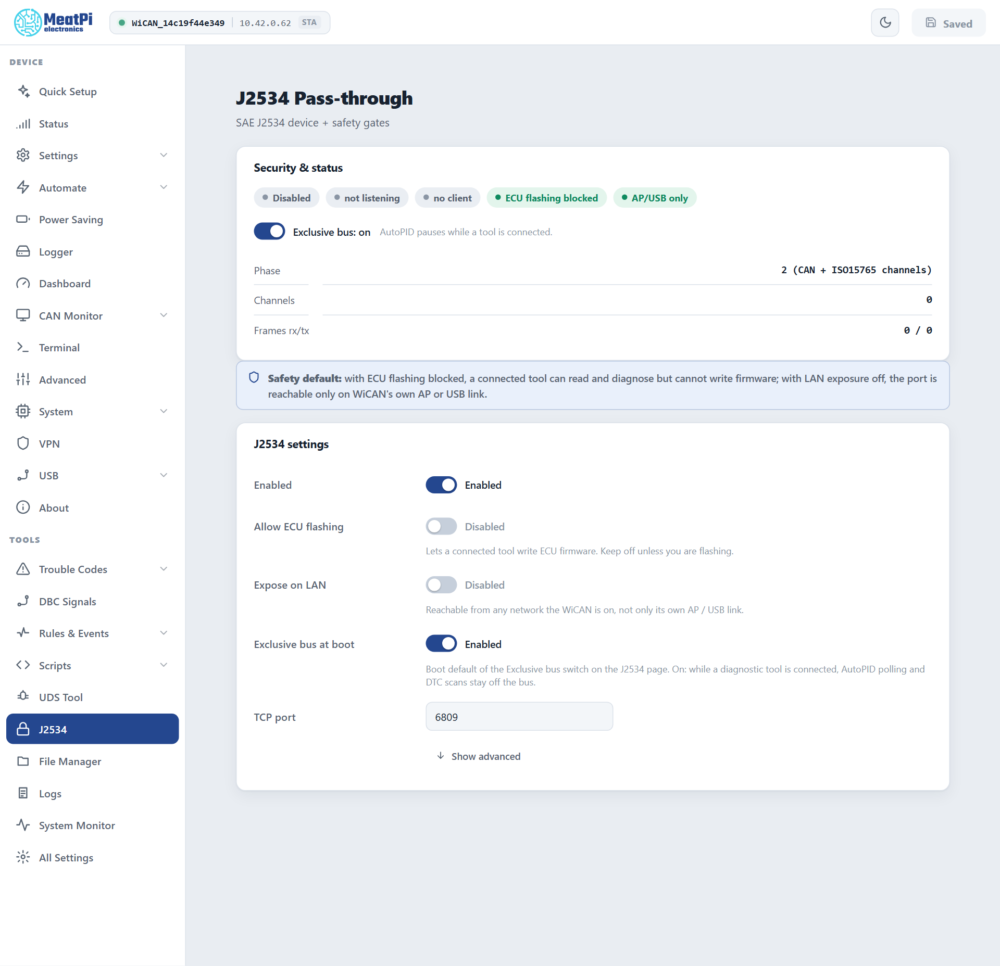

# J2534 PassThru

The server's status and settings documents read from the bench device (off there), firmware v6.00p_alfa-02, 2026-10-10; the page from the preview; the Windows driver facts from the installer's own README (version 1.1.0) and the firmware's J2534 reference. No tool session was run for this page; the firmware's benches cover sessions over TCP, USB serial and Bluetooth.

WiCAN Pro is a SAE J2534 PassThru device: diagnostic and reflash software on a Windows PC that expects a J2534 interface drives the car's CAN bus through WiCAN, over USB, WiFi or Bluetooth. CAN and ISO 15765 (ISO-TP) channels are supported; K-line and J1850 are not.

## Switch it on

The server is off out of the box, and two safety gates stay off even when it is on:

1.  **==J2534== › ==J2534 settings== › ==Enabled==**, then ==Submit== (WiCAN restarts).

2.  **Leave ==Allow ECU flashing== off** unless you are about to flash. With it off a tool can read and diagnose, but the UDS services that write ECU memory (`34` to `37`) are refused.

3.  **Leave ==Expose on LAN== off** unless the PC has to reach WiCAN through your home network. With it off, connections are accepted only from WiCAN's own access point and the USB link: the transport has no password.

<figure class="shot" markdown>
{ width="640" }
<figcaption>J2534, with the server enabled and both gates closed.</figcaption>
</figure>

<dl class="facts" markdown>
<dt>Exclusive bus</dt><dd>On by default. While a tool is connected, AutoPID polling and trouble-code scans stay off the bus so the two never talk over each other. The switch on the status card changes it for the session; ==Exclusive bus at boot== is its default.</dd>
<dt>TCP port</dt><dd>6809.</dd>
<dt>One tool at a time</dt><dd>Across USB, WiFi and Bluetooth. A second tool is answered `ERR_DEVICE_IN_USE`.</dd>
</dl>

## Install the Windows driver

The installer, `wican_j2534_setup_1.1.0.exe`, is in the `drivers/j2534` folder of the firmware repository at `https://github.com/meatpiHQ/wican-fw` and attached to every firmware release. It is not code-signed, so Windows SmartScreen asks before it runs.

1.  **Run the setup** and accept the prompt.

2.  **Pick how the PC reaches WiCAN**: the USB cable with WiCAN in network mode (recommended; WiCAN answers at `192.168.82.1` on that link), the USB cable as a COM port, WiCAN's own WiFi, or a custom address for a WiCAN on your network. For WiCAN's own WiFi type its address, `192.168.0.10`.

3.  **Done.** The 32-bit `wican_j2534.dll` goes to `C:\Program Files (x86)\WiCAN\` and the device is registered for 32-bit and 64-bit tools under the name `WiCAN`. The driver's manual (PDF) is installed next to it.

Run the installer again to change the address. Uninstall from ==Apps== › ==Installed apps==.

## Connect a tool

1.  **The link.** USB: ==USB== › ==Settings== › ==Connector role== ==Device== with the class ==CDC-NCM== ([USB accessories](../connectivity/usb-accessories.md)), then the cable to the PC. WiFi: the PC joined to WiCAN's access point, or ==Expose on LAN== on and the PC on the same network.

2.  **The bit rate.** The CAN bus runs at WiCAN's rate, ==Settings== › ==CAN bus== › ==Bit rate==, or the rate it measured with ==Automatic==. A tool that asks for another rate is told `ERR_INVALID_BAUDRATE`. With ==Automatic== and an ECU that stays silent until spoken to (one alone on a desk), set the rate by hand.

3.  **In the tool**, choose the J2534 device `WiCAN` and connect. The status card turns to `client connected`, counts the open channels and the frames each way, and names the link (`transport`: `tcp`, `serial` or `ble`).

## Over Bluetooth

Phone apps reach the same PassThru server over Bluetooth LE. The J2534 channel is only advertised while the server is enabled; the app pairs like any other ([Bluetooth LE](../connectivity/bluetooth.md)) and runs one session per link, the same single-tool rule applying. The wire protocol every transport speaks is documented for app developers in the firmware repository (`components/j2534_server/J2534_WIRE_PROTOCOL.md`); the Bluetooth binding is in the [BLE API](../reference/ble-api/index.md).

## Flashing an ECU

Switch ==Allow ECU flashing== on for the job and off again afterwards. Give the session every chance: WiCAN powered from the car with the battery charged or on a maintainer, the PC on USB rather than WiFi, nothing else talking to the car (==Exclusive bus== on). A reflash interrupted halfway is the tool's problem to recover, not WiCAN's.

## Status

`GET /api/j2534` carries the same facts as the page ([Vehicle](../reference/http-api/vehicle.md)): enabled, listening, a client connected, the transport, channels, frames, the gates and whether AutoPID is paused. `POST /api/j2534 {"exclusive": false}` flips the runtime switch.

## Troubleshooting

| Symptom | Likely cause | What to do |
| --- | --- | --- |
| The tool does not find WiCAN | the server is off, the wrong address in the driver, or the PC comes in over the LAN with the gate closed | ==Enabled== and ==Submit==; re-run the installer with the right address; ==Expose on LAN== |
| `ERR_DEVICE_IN_USE` | another session holds the device (a phone over Bluetooth, an earlier tool) | close it |
| `ERR_INVALID_BAUDRATE` | the tool asked for a rate other than WiCAN's | set ==Bit rate== to the vehicle's rate |
| Channel opens, every write fails | ==Automatic== and nothing on the bus to measure | set the rate by hand |
| Flashing is refused | ==Allow ECU flashing== is off | switch it on for the job |
| Dashboard values freeze during a session | ==Exclusive bus== is on, as intended | they resume when the tool disconnects |
