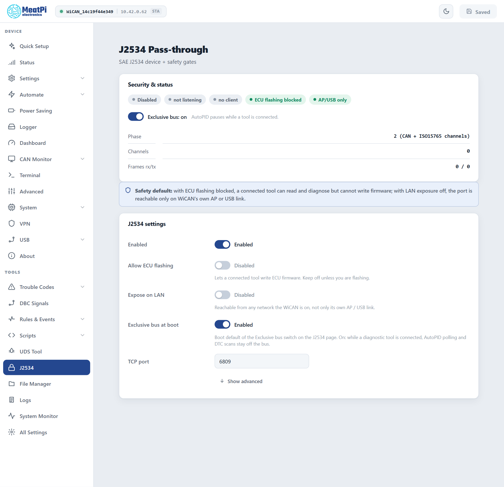

# J2534 PassThru

WiCAN PRO is a SAE J2534 PassThru device: diagnostic and reflash software on a Windows PC that expects a J2534 interface drives the car's bus through WiCAN, over USB, WiFi or Bluetooth. CAN and ISO 15765 (ISO-TP) channels run on WiCAN's CAN controller; J1850 VPW (GM Class 2) runs on the onboard OBD chip. J1850 PWM and the K-line protocols are not supported.

## Switch it on

The server is off out of the box. Switching it on is the consent: WiCAN then forwards whatever the tool sends, reads and reprogramming alike, like a cable, and counts the reprogramming services it saw on the status card. One exposure gate stays off even when the server is on:

1.  **==J2534== › ==J2534 settings== › ==Enabled==**, then ==Submit== (WiCAN restarts).

2.  **Leave ==Expose on LAN== off** unless the PC has to reach WiCAN through your home network. With it off, connections are accepted only from WiCAN's own access point and the USB link: the transport has no password.

Firmware before 27 October 2026 had a second switch, ==Allow ECU flashing==, which refused the UDS services that write ECU memory (`34` to `37`) and, on a raw CAN channel, could refuse ordinary frames of a tool with its own framing (VW TP 2.0). It is gone: update the firmware, or switch it on there for flashing work.

<figure class="shot" markdown>
{ width="640" }
<figcaption>J2534, with the server enabled and LAN exposure off (the picture predates 27 October 2026 and still shows the Allow ECU flashing switch).</figcaption>
</figure>

<dl class="facts" markdown>
<dt>Exclusive bus</dt><dd>On by default. While a tool is connected, AutoPID polling and trouble-code scans stay off the bus so the two never talk over each other. The switch on the status card changes it for the session; ==Exclusive bus at boot== is its default.</dd>
<dt>TCP port</dt><dd>6809.</dd>
<dt>One tool at a time</dt><dd>Across USB, WiFi and Bluetooth. A second tool is answered `ERR_DEVICE_IN_USE`.</dd>
</dl>

## Install the Windows driver

The installer, `wican_j2534_setup_1.5.0.exe`, is in the `drivers/j2534` folder of the firmware repository at `https://github.com/meatpiHQ/wican-fw` and attached to every firmware release. It is not code-signed, so Windows SmartScreen asks before it runs.

1.  **Run the setup** and accept the prompt.

2.  **Pick how the PC reaches WiCAN**: the USB cable with WiCAN in network mode (recommended; WiCAN answers at `192.168.82.1` on that link), the USB cable as a COM port, WiCAN's own WiFi, or a custom address for a WiCAN on your network. For WiCAN's own WiFi type its address, `192.168.0.10`.

3.  **Done.** The 32-bit `wican_j2534.dll` goes to `C:\Program Files (x86)\WiCAN\` and the device is registered for 32-bit and 64-bit tools under the name `WiCAN`. The driver's manual (PDF) is installed next to it, and the Start Menu gets ==WiCAN J2534 driver log==: the driver keeps a log of every message to and from the ECU in `C:\Users\Public\Documents\WiCAN\` (16 MB, one older copy kept), the file to send with a problem report.

Run the installer again to change the address. Uninstall from ==Apps== › ==Installed apps==.

## Connect a tool

1.  **The link.** USB: ==USB== › ==Settings== › ==Connector role== ==Device== with the class ==CDC-NCM== ([USB accessories](../connectivity/usb-accessories.md)), then the cable to the PC. WiFi: the PC joined to WiCAN's access point, or ==Expose on LAN== on and the PC on the same network.

2.  **The bit rate.** The CAN bus runs at WiCAN's rate, ==Settings== › ==CAN bus== › ==Bit rate==, or the rate it measured with ==Automatic==. A tool that asks for another rate is told `ERR_INVALID_BAUDRATE`. With ==Automatic== and an ECU that stays silent until spoken to (one alone on a desk), set the rate by hand.

3.  **In the tool**, choose the J2534 device `WiCAN` and connect. The status card turns to `client connected`, counts the open channels and the frames each way, and names the link (`transport`: `tcp`, `serial` or `ble`).

ISO 15765 messages travel exactly as SAE J2534-1 lays them out, the 4-byte CAN id first and the UDS bytes after it, in both directions, so udsoncan scripts and the OEM suites work unchanged. One tool talks to up to four ECUs per channel (one flow-control filter each), a single-frame request to a functional address such as `7DF` needs no filter, and the tool receives the TxDone and start-of-message indications the standard defines. Firmware built before 20 October 2026 expected the bare payload, and every standard tool timed out on its first request against it: update the firmware, the driver is unchanged.

## J1850 VPW (GM Class 2)

GM vehicles up to the mid-2000s use J1850 VPW rather than CAN, and WiCAN speaks it through its onboard OBD chip. Pick the `J1850VPW` protocol in the tool; a J1850 message is its three header bytes (priority, target, source) followed by the payload, with no CAN id. WiCAN handles the multi-frame segmentation for large transfers, so SPS/DPS-style programming works the same way flashing over CAN does.

Two limits are worth knowing. WiCAN answers J1850 requests and delivers the replies, but does not surface bus chatter sent between requests. And GM's 4x programming speed (service `$A1`, 41.6 kbit/s) is not implemented: programming runs at the standard 10.4 kbit/s, which is slower but complete. The CAN bit-rate setting does not apply to VPW.

## Over Bluetooth

Phone apps reach the same PassThru server over Bluetooth LE. The J2534 channel is only advertised while the server is enabled; the app pairs like any other ([Bluetooth LE](../connectivity/bluetooth.md)) and runs one session per link, the same single-tool rule applying. The wire protocol every transport speaks is documented for app developers in the firmware repository (`components/j2534_server/J2534_WIRE_PROTOCOL.md`); the Bluetooth binding is in the [BLE API](../reference/ble-api/index.md).

## Flashing an ECU

Nothing to switch on: the server forwards the reprogramming services like every other request and the status card counts them (==Reprogramming services seen==). Give the session every chance: WiCAN powered from the car with the battery charged or on a maintainer, the PC on USB rather than WiFi, nothing else talking to the car (==Exclusive bus== on). A reflash interrupted halfway is the tool's problem to recover, not WiCAN's.

## Status

`GET /api/j2534` carries the same facts as the page ([Vehicle](../reference/http-api/vehicle.md)): enabled, listening, a client connected, the transport, channels, frames, the writes the CAN node refused (`tx_refused`), the reprogramming services seen (`reflash_seen`), LAN exposure and whether AutoPID is paused. `POST /api/j2534 {"exclusive": false}` flips the runtime switch.

## Troubleshooting

| Symptom | Likely cause | What to do |
| --- | --- | --- |
| The tool does not find WiCAN | the server is off, the wrong address in the driver, or the PC comes in over the LAN with the gate closed | ==Enabled== and ==Submit==; re-run the installer with the right address; ==Expose on LAN== |
| `ERR_DEVICE_IN_USE` | another session holds the device (a phone over Bluetooth, an earlier tool) | close it |
| `ERR_INVALID_BAUDRATE` | the tool asked for a rate other than WiCAN's | set ==Bit rate== to the vehicle's rate |
| Channel opens, every write fails | ==Automatic== and nothing on the bus to measure | set the rate by hand |
| Every request times out (`P2 timeout`, `no response`) on a bus that answers other tools | firmware built before 20 October 2026, which expected the bare payload instead of the J2534-1 layout | update the firmware |
| Flashing is refused, or a tool with its own CAN framing gets `NotSupported (0x01)` now and then | firmware before 27 October 2026 (its ECU-flashing gate; on raw CAN it also refused ordinary frames of a VW TP 2.0 tool) | update the firmware; on old firmware switch ==Allow ECU flashing== on for the job |
| You need to see what the tool sent and what came back | | open the driver log (Start Menu ==WiCAN J2534 driver log==, driver 1.4 or later): every message both ways with its status; driver 1.5 also names the reason of every refusal in the tool's error text |
| Dashboard values freeze during a session | ==Exclusive bus== is on, as intended | they resume when the tool disconnects |
