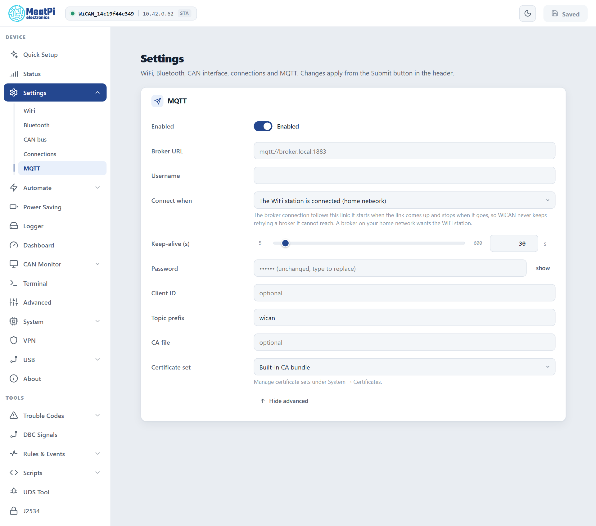

# MQTT

<p class="verified">Checked on the bench device against the bench broker (Mosquitto on the bench Pi), firmware v6.00p_alfa-02, 2026-10-10: the status topic and the vehicle snapshot every 5 seconds were watched on the broker; settings and defaults from the device's MQTT settings document. CAN over MQTT was not exercised for this page.</p>

<p class="lead">WiCAN Pro keeps one connection to an MQTT broker, and everything that publishes goes through it: the vehicle parameters, a status topic, messages from rules, and raw CAN frames if you want them. Home Assistant does not need it (it uses the webhook), but Node-RED, Grafana, openHAB, a fleet server or your own scripts do.</p>

## Set it up

==Settings== › ==MQTT==, then ==Submit== in the header (WiCAN restarts). Quick Setup's ==MQTT broker== use case fills in the same card and adds the vehicle data destination for you.

<figure class="shot" markdown>
{ width="640" }
<figcaption>Settings, MQTT, with the advanced fields shown.</figcaption>
</figure>

<dl class="facts" markdown>
<dt>Broker URL</dt><dd>`mqtt://host:1883` for a plain connection, `mqtts://host:8883` for TLS. A host name works when your network resolves it; an address always does.</dd>
<dt>Username, Password</dt><dd>When the broker asks for them. The password is write-only: the field shows dots once saved.</dd>
<dt>Connect when</dt><dd>==The WiFi station is connected== (the default: a broker on your home network) or ==Any network== (WiFi, a USB Ethernet adapter, the dongle). The connection starts when that link comes up and stops when it goes, so WiCAN never keeps retrying a broker it cannot reach.</dd>
<dt>Keep-alive</dt><dd>5 to 600 s, 30 s by default.</dd>
<dt>Client ID</dt><dd>Blank means `wican_<device id>`.</dd>
<dt>Topic prefix</dt><dd>Blank means `wican/<device id>`. Every topic below hangs off it.</dd>
<dt>Certificate set, CA file</dt><dd>For `mqtts://`. Public brokers verify against the built-in certificate bundle. A private broker wants a certificate set from ==System== › ==Certificates== with its CA; add a client certificate and key to the set for mutual TLS. ==CA file== takes a PEM file path instead of a set.</dd>
</dl>

The Status page shows `MQTT connected` once the session is up.

## What WiCAN publishes

The topics on the bench device, as seen with `mosquitto_sub -v` on the broker:

```text
wican/68ee8f5a653d/status {"status": "online"}
wican/68ee8f5a653d/autopid {"EngineCoolantTemp":90,"EngineRPM":800,"VehicleSpeed":0,"timestamp":1791570316}
```

| Topic | Payload | When |
| --- | --- | --- |
| `<prefix>/status` | `{"status": "online"}`, retained. The broker publishes `{"status": "offline"}` on the same topic by itself when WiCAN drops off (the last will). | On connect; on loss. |
| `<prefix>/autopid` | The live parameter set, flat, with a `timestamp` (seconds since 1970). Retained by default, so a new subscriber gets the last snapshot at once. | Every 5 s by default. This is a **data destination** row (==Automate== › ==Data destinations==): change its topic, interval and retain flag there, or add more rows. |
| Any topic | Whatever a rule publishes with its MQTT action: an alert when the battery drops, a code from a DTC scan. | When the rule fires ([Automate rules](../tools/automate-rules.md)). |
| `<prefix>/can/rx` | Batches of raw CAN frames. | Only with CAN over MQTT switched on, below. |

In a topic field `~` stands for the prefix: `~/autopid` is `wican/<device id>/autopid`.

A dashboard that wants a `dead` state for a parked car can watch `<prefix>/status`: it goes `offline` within the keep-alive time after WiCAN sleeps or loses its network.

## CAN over MQTT

Raw frames both ways, for a bus tool on another machine. The bridge is switched off and both directions are gated, so an enabled bridge moves nothing until each direction is allowed on purpose. Find it under ==All Settings== › ==CAN over MQTT==:

<dl class="facts" markdown>
<dt>Enabled</dt><dd>Creates the bridge. Off by default.</dd>
<dt>Allow RX</dt><dd>Frames heard on the bus may leave WiCAN on the publish topic. Off by default.</dd>
<dt>Allow TX</dt><dd>Frames received from the broker may go onto the bus. Off by default. Think before enabling this on a vehicle bus.</dd>
<dt>Publish topic, Subscribe topic</dt><dd>`~/can/rx` and `~/can/tx`.</dd>
<dt>Batching</dt><dd>Frames are gathered into one message per 50 ms or 24 frames, whichever comes first. Bigger batches cost fewer messages.</dd>
<dt>Filter, Mask</dt><dd>A CAN id filter on what is published (hex; empty = everything).</dd>
</dl>

The bus itself must be on: ==Settings== › ==CAN bus== with the car's bit rate. Frames are JSON, the same shape in both directions:

```json
{"bus":"0","type":"rx","ts":34610,"frame":[{"id":123,"dlc":8,"rtr":false,"extd":false,"data":[1,2,3,4,5,6,7,8]}]}
```

To transmit, publish the same shape with `"type":"tx"` to the subscribe topic; `ts` is ignored and `extd` is implied for ids above `0x7FF`.

## Troubleshooting

| Symptom | Likely cause | What to do |
| --- | --- | --- |
| `MQTT connected` never shows | wrong scheme or port, or the broker is not reachable from the network WiCAN is on | check `mqtt://` versus `mqtts://` and the port; try the broker from a phone on the same network |
| Connected at home, never in the car | ==Connect when== is WiFi and the car has no WiFi, or the broker is on the home LAN | a broker reachable from the internet (TLS and a password), and ==Any network== when the dongle or an adapter is the link |
| `mqtts://` fails | the broker's certificate is not trusted | a certificate set with the broker's CA under ==System== › ==Certificates== |
| `status` says online but no values | the vehicle destination row is off, polling is paused, or the ignition is off | ==Automate== › ==Data destinations==; ==Automate== › ==Settings==; ignition on |
| Frames missing at high bus load | the link cannot carry the message rate | raise the batch size, or filter what is published |
