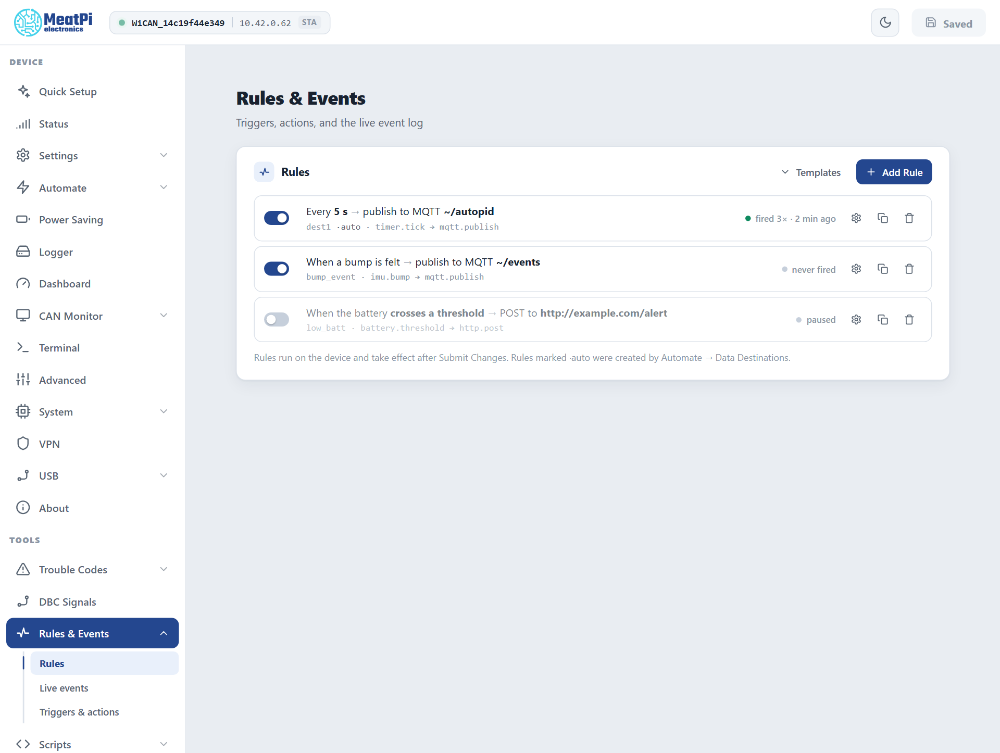

# Automate rules

<p class="verified pending">The triggers, actions and live values and the default rules read from the bench device, firmware v6.00p_alfa-02, 2026-10-10; the page from the preview; behaviours from the firmware's event manager reference. No rule was exercised for this page.</p>

<p class="lead">A rule is "when this happens, do that", running on the device itself: when the battery drops, publish an alert; while the car is at home, poll slowly; when a new trouble code appears, turn the LED red. Triggers are events the device raises, actions are things its components can do, and a rule can undo its action when the condition stops holding.</p>

Rules live under ==Rules & Events==: ==Rules== (the list and the builder), ==Live events== (the last events and which rules fired) and ==Triggers & actions== (everything a rule can use on this firmware).

<figure class="shot" markdown>
{ width="640" }
<figcaption>Rules and Events, Rules. Each rule reads as a sentence; the technical form is underneath.</figcaption>
</figure>

## Make a rule

<div class="steps" markdown>

1.  **==Add Rule==**, or pick a ==Template== (slow polling at home, extra PIDs while charging, alert on a value, LED on a new trouble code) and adjust it.

2.  **Name** it: letters, digits and underscores, up to 15 characters.

3.  **When**: the trigger. The picker lists every event the device raises, with the fields that identify it: the network for ==WiFi station==, the parameter name for ==Parameter changed==, the status bit, the MQTT topic, or a period for ==Timer== (which creates a timer named after the rule).

4.  **Only if**: up to four conditions, each a field, an operator (`==`, `!=`, `>`, `>=`, `<`, `<=`, `changed`, `contains`) and a value. Fields are the trigger's own (the value that changed, the edge, the state) and every live value the device offers, marked `LIVE`: a parameter, the battery voltage, the network name, the time. All conditions must hold.

5.  **Then**: the action and its form: the group and rate for ==Poll a group==, the colour and mode for ==LED==, the topic and payload for ==MQTT publish==, the URL and body for ==HTTP post==, the script name for ==Run script==.

6.  **Undo**, for actions that can reverse themselves (==Poll a group==, ==LED==): the rule becomes a *while* rule. The action runs when the conditions come true and reverses when they stop holding, on the next trigger or on the device's one-second re-check of live values.

7.  ==Add==. The rule is staged; ==Submit Changes== in the header applies it (WiCAN restarts).

</div>

==Edit as JSON== shows the rule in the form the device stores; the two round-trip.

## Triggers

| Trigger | Fields | Raised when |
| --- | --- | --- |
| `timer.tick` | `timer` | a timer of this rule set fires |
| `autopid.param` | `param`, `value`, `unit`, `group` | a polled parameter changed (rate-limited by the AutoPID event interval) |
| `autopid.pid_failed`, `autopid.scan_done` | `pid`, `streak`; `found` | a poll failed; the standard-PID scan finished |
| `autopid.vehicle_changed`, `autopid.vehicle_evicted` | `vin`, `name`, `known` | the current car changed; the store dropped a car |
| `autopid.dtc`, `autopid.dtc_scan`, `autopid.dtc_clear` | `code`, `status`, `mil`; `ok`, `stored`, `pending`, `permanent`, `new`, `mil`; `ok`, `cleared`, `before`, `after` | a new trouble code; a scan finished; a clear finished |
| `battery.threshold` | `edge`, `volts` | the battery crossed 12.0 V going down or 12.5 V going up, held 5 s |
| `imu.motion`, `imu.bump` | `state`; `axes` | sustained motion started or stopped; a knock or door slam |
| `wifi.sta` | `connected`, `ssid` | the station joined a network or lost it |
| `status.bit` | `bit`, `set` | any device status bit changed (`sta_connected`, `ble_connected`, `mqtt_connected`, `motion`, `time_synced` ...) |
| `mqtt.rx` | `topic`, `payload` | a message arrived on a topic a rule names |
| `vpn.state` | `connected` | the VPN tunnel came up or went down |
| `sleep.entering`, `sleep.state` | `volts`; `state`, `volts` | the device is about to sleep; the sleep ladder moved |
| `usb.device`, `usb.eth` | `attached`; `connected`, `ip` | a USB accessory came or went; the wired uplink got or lost an address |
| `obd.response`, `uds.response` | `cmd`, `response`; `ok`, `nrc`, `len`, `data`, `req` | the answer to an OBD or UDS request action |
| `script.done` | `value` | a script emitted its result |
| `logger.rotated`, `logger.error` | `file`; `count` | a log file rotated; a storage write failed |

## Actions

| Action | Parameters | Does |
| --- | --- | --- |
| `mqtt.publish` | `topic`, `payload`, `qos`, `retain` | publishes through the MQTT connection; `~/x` is relative to the device's prefix |
| `http.post` | `url`, `body`, `content_type` | posts a body to a URL (no retries) |
| `log.note` | `message` | writes a line to the device log |
| `led.indicate` (undoable), `led.clear` | `r`, `g`, `b`, `mode` | lights the LED's alert slot; clears it |
| `autopid.group` (undoable) | `group`, `enabled`, `period_ms` | switches a polling group on or off or changes its rate until the undo or the next restart |
| `autopid.dtc_scan`, `autopid.dtc_clear` | ; `codes`, `mode` | a trouble-code scan; a clear with the same modes as the page |
| `logger.enable`, `logger.disable`, `logger.write` | ; ; `source`, `name`, `value` | pause or resume the logger; write one value to the parameter stream |
| `obd.request`, `uds.request` | `cmd`; `tx`, `rx`, `req`, `ext` | an OBD chip command; a UDS request (the answer comes back as a trigger) |
| `script.run` | `name` | runs a stored script with the trigger's fields as globals |

Fields in an action can carry `${key}` templates: the trigger's fields (`${value}`, `${volts}`), the built-ins `${ts}`, `${source}`, `${name}`, and the live values below.

## Live values

`${autopid.<parameter>}` (any polled parameter), `${autopid.data}` (the whole snapshot as JSON), `${battery.voltage}`, `${wifi.ssid}`, `${wifi.connected}`, `${time.iso}`, `${time.epoch}`. In a condition they make "charging and the state of charge above 20 percent" one rule; in an action they fill a payload.

## Examples

A new device ships three rules, all publishing to `~/events` over MQTT: a bump, a change of motion state, and a battery threshold. The builder's templates cover the common wishes; here are two in the stored form, for ==Edit as JSON==.

Poll slowly while the car is at home, and go back to the configured rate when it leaves:

```json
{"name": "home_slow", "on": "wifi.sta", "match": {"ssid": "HomeWiFi"},
 "when": [{"key": "connected", "op": "==", "val": true}],
 "do": "autopid.group", "with": {"group": "default", "enabled": true, "period_ms": 10000},
 "undo": true}
```

Alert when the engine runs fast, at most once a minute:

```json
{"name": "high_rpm", "on": "autopid.param", "match": {"param": "EngineRPM"},
 "when": [{"key": "value", "op": ">", "val": 3000}],
 "do": "mqtt.publish", "with": {"topic": "~/alerts", "payload": "{\"rpm\": ${value}, \"at\": \"${time.iso}\"}"},
 "cooldown_ms": 60000}
```

!!! tip "State goes in the conditions, identity in the trigger"
    For a rule that undoes itself, keep the trigger's state (`connected`, `edge`, `state`) in ==Only if== and only the identity (the network, the parameter, the topic) in the trigger. The builder does this by itself; in JSON a state put into `match` would hide the opposite event from the undo.

## How rules run

- Events queue up (32 deep, the oldest dropped when full) and one dispatcher evaluates every rule in order. Quick actions (log, MQTT, LED, polling groups) run right there; slow ones (HTTP post, OBD and UDS requests) go to two worker tasks so a slow server never stalls the rest.
- `cooldown_ms` keeps a rule from firing again within that time. `changed` compares with the value at the previous event, per boot.
- There are no retries: an action that fails is counted (the ==Live events== page shows the counters) and the next event gets another chance.
- Up to 16 rules and 4 timers.

## Troubleshooting

| Symptom | Likely cause | What to do |
| --- | --- | --- |
| The rule never fires | the trigger's identity does not match (parameter name, network, topic), or the rule is not submitted yet | check ==Live events== for the event and its fields; ==Submit Changes== |
| It fires but nothing happens | the action failed (broker not connected, URL unreachable) | the counters on ==Live events==; the device log |
| A while rule never undoes | its state field sits in the trigger's match | move it to ==Only if== |
| It fires too often | no cooldown, or `autopid.param` on a noisy value | a cooldown, or a `changed` condition |
