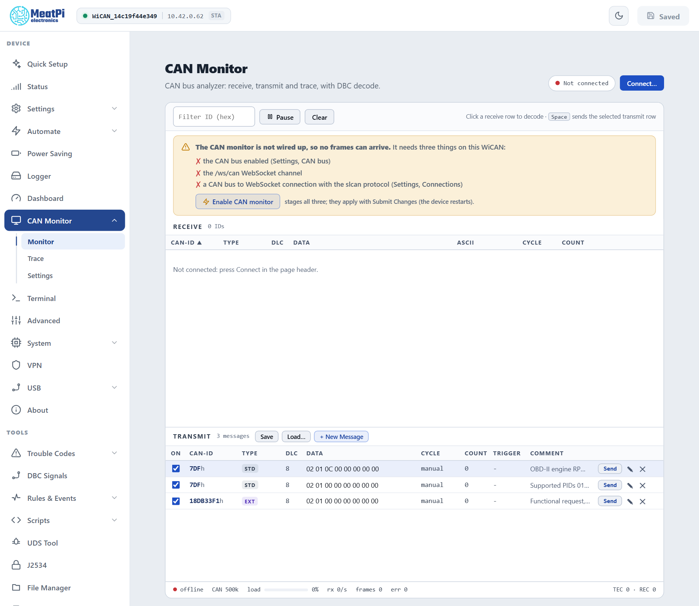

# CAN Monitor

A CAN bus analyzer in the browser, laid out like PCAN-View: a receive list grouped by identifier with the changing bytes lit, a transmit list, a trace, DBC decoding, and a status bar with the bus load and error counters. It reads WiCAN's own CAN interface, so it works beside the OBD chip and on any CAN bus, not only the diagnostic one.

## Wire it up once

The monitor needs three things that a new device has switched off: the CAN interface, the `/ws/can` WebSocket channel, and a connection row from the CAN bus to that channel with the slcan protocol. The page checks all three and names what is missing; ==Enable CAN monitor== stages them together, and ==Submit Changes== in the header applies them (WiCAN restarts).

<figure class="shot" markdown>
{ width="640" }
<figcaption>CAN Monitor on a device whose CAN interface is still off. The page opens disconnected.</figcaption>
</figure>

Under ==CAN Monitor== › ==Settings== › ==CAN INTERFACE== the same card sets the ==Bit rate== (==Automatic== lets WiCAN find it by listening) and the mode. Keep ==Listen-only== for watching a vehicle: WiCAN then never acknowledges a frame and cannot disturb the bus. Normal mode is for sending.

!!! note "WiCAN listens before it talks"
    A CAN node at the wrong bit rate damages the traffic of the bus it sits on. WiCAN's interface always starts listen-only, proves the bit rate from two frames it could read, and only then goes to normal mode when the settings ask for it. With ==Automatic== it walks the usual rates until one reads. The status bar and the Status page say where it is: `Listening for the bit rate`, `Listening · no traffic yet`, `Bus runs at another bit rate · listen-only`, then `Normal · active` or `Listen-only · active`.

## Connect

The page opens disconnected. ==Connect...== in the page header opens the stream and the receive list fills; the stream reconnects by itself until ==Disconnect==. ==Pause== freezes the lists without closing the stream; ==Clear== empties them.

## Monitor

**Receive.** One row per CAN id: type (`STD`, `EXT`, `RTR`), DLC, the data bytes with the ones that changed since the last frame lit, ASCII, cycle time and count. Columns sort and resize; ==Filter ID== narrows the list to an id (hex). Click a row for the decode panel: the signals of the DBC files loaded on the device, decoded with the firmware's bit rules, or the raw frame when no file describes it.

**Transmit.** A list of messages you compose: ==+ New Message== opens the edit dialog (id, standard or extended, DLC, one box per byte, cycle, a trigger id that sends the message whenever that id is received, a comment). ==Send== sends once; a cycle makes it periodic once switched on. ==Save== and ==Load...== keep the list as a JSON file. The context menu and the keyboard do the rest: ++space++ sends the selected row, ++insert++ adds, ++enter++ edits, ++delete++ removes, ++ctrl+x++ / ++ctrl+c++ / ++ctrl+v++ cut, copy and paste, ++shift+escape++ clears the selection.

The three rows WiCAN ships (an OBD-II engine speed request, a supported-PIDs request, a 29-bit functional request) are manual: nothing is ever sent on a vehicle bus by itself. Sending needs normal mode and a proven bit rate; when a frame cannot go out, ==Send== says why.

## Trace

A newest-first buffer of every frame with its time, direction, id, type, DLC and data, with bus errors as rows of their own. ==Record== and stop, the buffer size, ==Save CSV== to keep it. For long recordings use the [Data logger](../vehicle-data/data-logger.md), which writes to the SD card in MDF4, BLF, candump or ASC.

## Settings

Four cards: ==DEVICE== (the link state and counters), ==CAN INTERFACE== (bit rate, mode, the wiring check and the one-click enable; CAN FD is shown as unavailable, the controller has none), ==DECODING== (the DBC files on the device, upload) and ==SETTINGS FILE== (save or load the page's own settings as JSON). The DBC files are the same ones ==DBC Signals== manages, and the same ones AutoPID uses to turn broadcast frames into parameters.

## The status bar

`connected` or `offline`, the bit rate, bus load, frames per second, frame count, the error count, and the controller's transmit and receive error counters (TEC and REC). Errors come from WiCAN's CAN interface (`GET /api/can`): a count that climbs while the bus is quiet means the bit rate is wrong.

## Troubleshooting

| Symptom | Likely cause | What to do |
| --- | --- | --- |
| `The CAN monitor is not wired up` | the interface, the channel or the connection row is off | ==Enable CAN monitor==, then ==Submit Changes== |
| Connected, nothing arrives | the bus is quiet (ignition off), or WiCAN is on the wrong pins of the connector | ignition on; a gatewayed OBD port only answers when asked |
| `Listening for the bit rate` stays | no readable traffic at any rate | check the wiring; try a fixed rate |
| ==Send== does nothing | listen-only mode, or the bit rate is not proven yet | normal mode in ==CAN INTERFACE==, a fixed rate |
| `err` climbs | a bit rate mismatch | ==Automatic==, or the vehicle's rate |
| Frames from WiCAN's own OBD chip appear | expected: the chip and the CAN interface are two nodes on the same bus | nothing; pause AutoPID under ==Automate== › ==Settings== for a clean capture |
