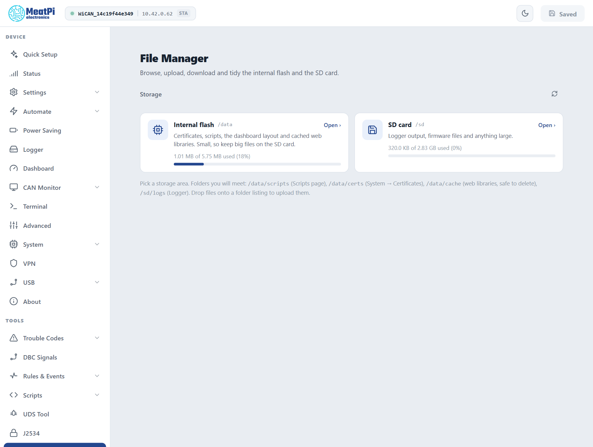

# Files

WiCAN PRO has two places for files: a small internal flash for the things the firmware keeps (certificates, scripts, the vehicle tables, the dashboard layout) and the SD card for everything large (logs, firmware files). The File Manager browses both, uploads, downloads and tidies.

<figure class="shot" markdown>
{ width="640" }
<figcaption>File Manager. Pick a storage area, then browse.</figcaption>
</figure>

## The two storage areas

| | Path | Size | Holds |
| --- | --- | --- | --- |
| Internal flash | `/data` | about 5.75 MB | certificates, scripts, the vehicle tables, the dashboard layout, cached web libraries |
| SD card | `/sd` | the card | log files, firmware files, anything large |

Folders you will meet:

| Folder | What is in it |
| --- | --- |
| `/data/autopid` | the vehicle tables: `config.json` (what is polled now), `vehicles.json` and `vehicles/` (every car WiCAN knows), `std_scan.json` (the last detection), `dtc_db/` (uploaded code databases) |
| `/data/certs` | certificate sets (==System== › ==Certificates==); the keys are never readable through the page |
| `/data/scripts` | Berry scripts (==Scripts==) |
| `/data/cache` | the web libraries the browser installed on demand (code editor, charts); safe to delete, they are fetched again when needed |
| `/sd/logs` | the [Data logger](../vehicle-data/data-logger.md)'s files |

The settings themselves are not files here: they live on a partition of their own and travel as one document, see [Backup and restore](../firmware/backup-and-restore.md).

## Browse, upload, download

- ==Open== on a storage card lists its root; the breadcrumb and the folder rows navigate, and the address bar carries the path so a folder can be bookmarked.
- The toolbar filters and sorts; ticking rows selects several for ==Delete==.
- **Upload**: drop files onto a folder listing, or use the upload button. Up to 2 MB per file; a file is written whole and swapped in at the end, so a power cut during an upload never leaves a torn file. Missing folders are created.
- **Download** any file with its row's button; small text files open in a preview first.
- A file that WiCAN is writing right now (the logger's active file) is marked `in use` and cannot be downloaded or deleted until it is released; a logger file set aside after a read error is marked `.corrupt`.

## The SD card

Any card formatted FAT, as cards come. WiCAN mounts it when it is seated and releases it when it is pulled, also while running; the Status page's ==SD card== row and the Logger's status chip say whether it is mounted. WiCAN never formats a card: an unreadable one stays unmounted and the log says why.

## By API

The same operations are routes, for scripts on a PC: list a folder, read the capacity, download, upload, delete, make a folder. The [HTTP API reference](../reference/http-api/logs-files-firmware.md) has them, with the device's own answers.

## Troubleshooting

| Symptom | Likely cause | What to do |
| --- | --- | --- |
| `/sd` says `backend unavailable` | no card, or the card is not readable | seat the card; format it FAT on a PC |
| Upload refused at 2 MB | the per-file limit | split the file, or keep it on the SD card by other means (a card reader) |
| `file in use` | the logger is writing that file | ==Pause== on the Logger page, then download |
| Internal flash nearly full | cached libraries, old scripts | delete `/data/cache`; the browser fetches a library again when a page needs it |
| A vehicle table disappeared after a factory flash from a PC | a flash with an erase wipes `/data` | restore the files from a copy; the settings come back from a backup |
