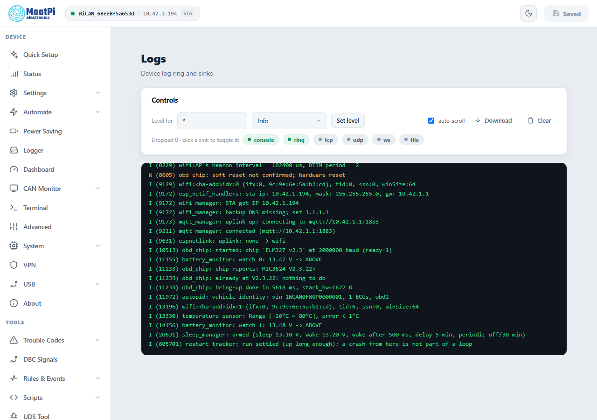
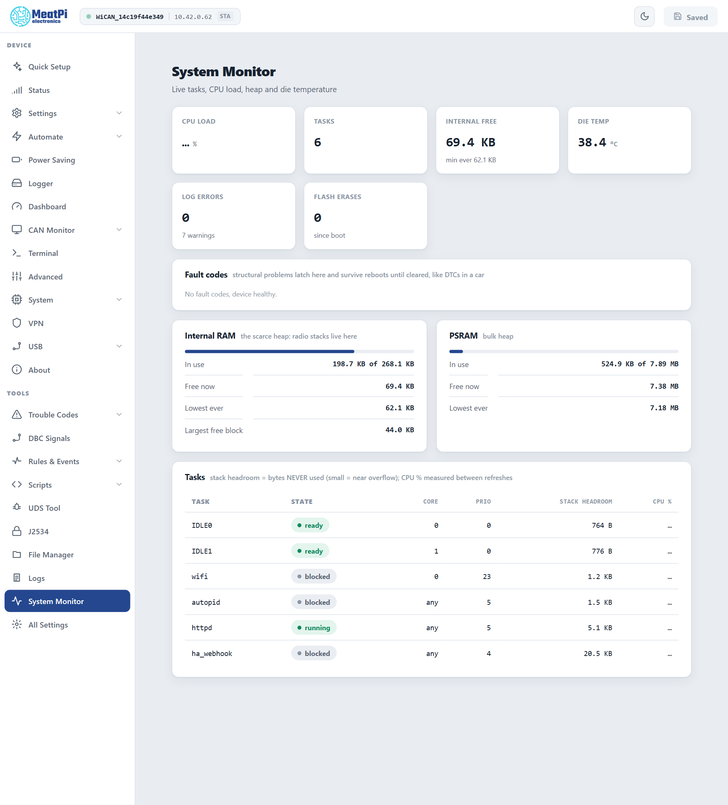

# Logs and system monitor

When something does not behave, two pages tell you what the device sees: ==Logs==, the firmware's own log with the lines from before the last restart still in it, and ==System Monitor==, the live state of memory, tasks and temperature with the fault codes. Both are read-only views; nothing here changes a setting.

## Logs

<figure class="shot" markdown>
{ width="640" }
<figcaption>Logs, on the bench device. Picture taken on the device: the preview cannot render this page.</figcaption>
</figure>

The log lives in a ring in RAM (16 KB) that survives a restart, so after a crash the lines that led to it are still there behind a `---- boot ----` separator. A power cut empties it. Lines are coloured by level: `I` information, `W` warning, `E` error.

- ==Level for== a component tag (or `*` for all) and a level (`none`, `error`, `warn`, `info`, `debug`, `verbose`), then ==Set level==: takes effect at once and lasts until the restart. The boot default is a setting (==All Settings== › ==Log manager==).
- **The sinks** are where lines go: `console` (the USB serial port), `ring` (this page), and four more that are off by default and need their settings under ==All Settings== › ==Log sinks==: `tcp` (a tail server to connect to with netcat), `udp` (lines pushed to a collector), `ws` (a WebSocket channel) and `file` (rotated files on the SD card, flushed once a minute). Clicking a chip pauses or resumes a running sink; it cannot start one whose setting is off.
- ==auto-scroll==, ==Download== (the ring as a text file: attach it to a bug report) and ==Clear==.
- `Dropped N` counts lines the device had to drop because a sink was too slow; a rising count means a sink over a bad link.

## System Monitor

<figure class="shot" markdown>
{ width="640" }
<figcaption>System Monitor on a healthy device.</figcaption>
</figure>

| Tile or card | What to read in it |
| --- | --- |
| ==CPU LOAD== | the share of the two cores not idle, measured between refreshes |
| ==TASKS== | how many tasks run; the table below lists them |
| ==INTERNAL FREE== | the scarce heap the radios live in, with its lowest value since boot. Under 8 KB free, or a lowest value under 4 KB, the device latches the fault `internal_ram_low` and Bluetooth and the web server start to misbehave |
| ==DIE TEMP== | the chip's temperature |
| ==LOG ERRORS== | error and warning lines since boot |
| ==FLASH ERASES== | flash erases since boot. A count that keeps rising while the device idles means something writes to flash continuously (the fault `flash_churn` says so after ten minutes) |
| ==Fault codes== | the latched faults, see [Faults](../troubleshooting/faults.md) |
| ==Internal RAM==, ==PSRAM== | in use, free now, the lowest ever, and for the internal heap the largest free block: a large free total with a small largest block is fragmentation |
| ==Tasks== | per task: state, core, priority, **stack headroom** (bytes the task never used: a small number means it is close to overflowing) and CPU share |

The same figures are in `GET /api/status` (`memory`, `health`, `temp_c`) and `GET /api/status/tasks` for a script that watches a device.

## Reporting a problem

Attach three things: the log ring (==Logs== › ==Download==) taken right after the problem, the firmware version (==About==), and the crash report when there is one ([Crash report](../troubleshooting/crash-report.md)). A screenshot of System Monitor helps with memory questions.

## Troubleshooting

| Symptom | Likely cause | What to do |
| --- | --- | --- |
| The log is empty after a problem | the device lost power (the ring is RAM), or the ring sink is paused | the `file` sink on an SD card for a device that loses power; the stored crash report survives power |
| `Dropped` keeps rising | a slow sink | pause `tcp` or `udp`; use the ring |
| Too many lines to read | a tag at `debug` or `verbose` | ==Set level== back to `info`, or restart |
| Internal free keeps falling | a leak, or too many features at once (Bluetooth, VPN, the monitor stream, a logger) | note the figures and report; switch off what is not needed |
